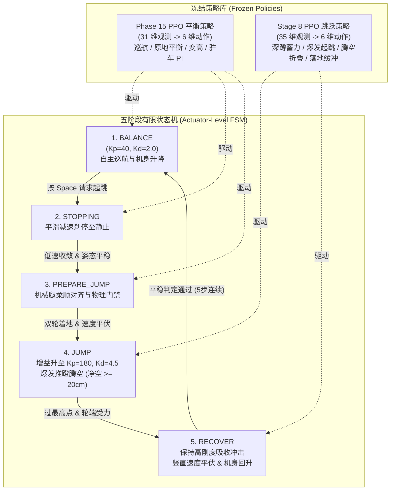

# 足式与轮足机器人强化学习仿真平台 (Isaac Gym + Legged Gym + RSL-RL)

本项目工作空间整合了基于 **NVIDIA Isaac Gym**、**ETH Zurich Legged Gym** 以及 **RSL-RL** 的机器人强化学习端到端训练与控制框架，支持四足机器人、双足机器人及轮足机器人的大规模 GPU 并行仿真、高动态平衡巡航以及爆发式跳跃控制。

> 📖 **MyRobot 初学者使用手册与开发指南**：  
> 如果您是第一次使用本项目，想要快速启动仿真、使用键盘遥控机器人、体验 Phase 15 闭环驻车基准模型 (`model_130`)、体验**连续双跳双策略融合控制**或启动新训练，请直接查阅面向初学者的完整手册：👉 **[README_MYROBOT.md](README_MYROBOT.md)** （包含命令速查表、快速启动、全流程图与常见问题解答）。

---

## 目录结构概览

```text
IsaacTu_jump/
├── isaacgym/           # NVIDIA Isaac Gym 底层 GPU 并行物理仿真引擎 (软链接)
├── legged_gym/         # 足式/轮足机器人环境定义、任务配置与训练/演示入口
│   └── legged_gym/
│       ├── envs/myrobot/   # 自定义双足轮足机器人环境与配置
│       │   ├── myrobot_env.py          # Phase 15 平衡/巡航/变高环境
│       │   ├── myrobot_config.py       # Phase 15 基础任务与网络超参
│       │   ├── myrobot_jump_env.py     # Stage 8 爆发跳跃专项训练环境
│       │   ├── myrobot_jump_config.py  # Stage 8 跳跃网络与物理奖励配置
│       │   ├── myrobot_dual_env.py     # 【正式集成】双策略连续跳跃与巡航环境
│       │   └── myrobot_dual_config.py  # 【正式集成】双策略 FSM 转换阈值与增益配置
│       └── scripts/
│           ├── train.py        # 强化学习训练入口
│           ├── play.py         # 策略回放与性能评测
│           ├── teleop.py       # Phase 15 单策略键盘遥控系统
│           └── teleop_dual.py  # 【正式集成】双策略连续跳跃 3D 交互遥控系统
├── rsl_rl/             # 高性能纯 GPU 强化学习算法库 (PPO 等)
├── evaluation_assets/  # 冻结模型权重与评测数据资产
│   ├── phase15/models/phase15_m130.pt  # 冻结 Phase 15 平衡策略
│   ├── frozen_stage8/model_40.pt       # 冻结 Stage 8 跳跃策略
│   └── phase6/viewer_telemetry.csv     # 50 Hz 高精度遥测日志
├── tests/              # 验证脚本与画图分析工具
│   └── myrobot_plot_data.py            # 通用 CSV 遥测曲线绘制工具
├── run_phase6_viewer.sh # 【推荐】一键启动纯手动交互 3D 视窗
└── README.md           # 平台架构与使用说明文档
```

---

## 核心架构与双策略连续跳跃控制原理

系统采用 **双策略分层状态机 (Dual-Policy Finite State Machine, FSM)** 架构，在物理执行器底层实现统一融合控制：



1. **Phase 15 平衡策略**：负责 `BALANCE`、`STOPPING` 与 `PREPARE_JUMP` 阶段，维持机身自平衡、前后巡航、原地点头转向、机身变高（$0.34\text{ m} \sim 0.52\text{ m}$）以及零速驻车防漂移。
2. **Stage 8 跳跃策略**：负责 `JUMP` 与 `RECOVER` 阶段，驱动膝关节输出最大力矩爆发推蹬，在腾空阶段快速收腿折叠，在触地阶段维持高阻尼缓冲吸收地面冲击。
3. **无重置连续双跳**：跳跃着地并完成交接后，机器人完全保留现有物理世界位姿与速度，无需仿真复位、无需重新加载模型，可立即通过键盘再次前行并再次起跳。

---

## 常用操作与运行指南

### 1. 🎮 启动双策略连续跳跃 3D 交互视窗 (推荐)

启动纯手动 3D 可视化视窗，支持 100% 键盘交互控制运动、高度与连续起跳：

```bash
# 方式一：一键脚本启动 (推荐)
bash run_phase6_viewer.sh

# 方式二：Python 正式入口启动
python legged_gym/legged_gym/scripts/teleop_dual.py
```

#### 🕹️ 键盘操作映射：
- **`W` / `↑`**：前进加速（单次 `+0.05 m/s`，平滑上限 `+0.50 m/s`）
- **`S` / `↓`**：减速 / 倒车行驶（单次 `-0.05 m/s`，平滑下限 `-0.30 m/s`）
- **`A` / `←`**：向左转向（单次 `+0.05 rad/s`，上限 `+0.35 rad/s`）
- **`D` / `→`**：向右转向（单次 `-0.05 rad/s`，下限 `-0.35 rad/s`）
- **`Q`**：**升高机身**（单次 `+0.01 m`，安全上限 **$0.52\text{ m}$**）
- **`E`**：**降低机身**（单次 `-0.01 m`，安全下限 **$0.34\text{ m}$**）
- **`Space`（空格键）**：**请求跳跃**（随时按下：行进中自动平滑刹停 → 深蹲蓄力 → 爆发起跳 → 缓冲交接回 BALANCE）
- **`X`**：**主动驻车**（速度指令归零，激活平衡防滑 PI 积分静止锁止）
- **`R`**：**复位仿真**（姿态与高度重置回初始标称 $0.398\text{ m}$）
- **`ESC`**：**退出视窗**（退出并自动将 50 Hz 逐帧遥测写入 CSV）

*(注：3D 渲染视窗与终端控制台均可直接监听键盘输入)*

---

### 2. 📊 绘制本次手动驾驶的遥测曲线

退出交互视窗后，可运行通用绘图工具一键生成详细曲线（包含 FSM 状态流转、指令 vs 实际速度、双轮最低净空、关节力矩、地面反力）：

```bash
python tests/myrobot_plot_data.py --file evaluation_assets/phase6/viewer_telemetry.csv
```

图表将自动保存于 `evaluation_assets/phase6/viewer_telemetry_plot.png`。

---

### 3. 策略回放与训练

```bash
# Phase 15 单策略演示回放 (50台机器人)
python legged_gym/legged_gym/scripts/play.py --task=myrobot --load_run Oct14_00-28-55_phase15_height_034_060_exploration --checkpoint 130

# 启动训练
python legged_gym/legged_gym/scripts/train.py --task=myrobot --headless --num_envs=512
```

---

## 严谨评测指标与物理能力边界

在标准测试集与严苛的 3D 圆柱体碰撞几何学评测下，当前双策略控制系统的基准成绩如下：

| 评测维度 | Clean 评测模式 | Noisy 噪声评测模式 | 说明 |
| :--- | :---: | :---: | :--- |
| **落地交接成功率** | **20 / 20 (100%)** | **19 / 20 (95%)** | 落地后由 Phase 15 正常平稳接管，无摔倒与倾覆 |
| **连续双跳全流程通过** | **8 / 10 (80%)** | **8 / 10 (80%)** | 单 session 零 reset 连续执行两次完整跳跃 |
| **严苛 20 cm 净空达标** | **16 / 20 (80%)** | **16 / 20 (80%)** | 左右双轮最低点离地间隙 $\ge 20.00\text{ cm}$ |
| **边界临界样本表现** | **19.93 ~ 19.97 cm** | **19.91 ~ 19.96 cm** | 2 台处于达标临界边缘 |

> [!NOTE]
> **关于 20 cm 临界样本的动力学成因说明**：  
> 经 200 Hz 高频刚体动力学与全刚体质心动量定理（$J_{\mathrm{net}} \approx M \Delta v_{\mathrm{CoM}}$，偏差 $<6\%$）核验，在特定随机种子下，环境随机化叠加使整机质量达到了系统上限（$22.90\text{ kg}$，比基准重 $1.15 \sim 1.45\text{ kg}$），且下蹲行程较浅导致离地冲量落后约 $13\% \sim 17\%$，使最低净空处于 $19.93 \sim 19.97\text{ cm}$。控制链路与状态机过渡均完全健康正常。
