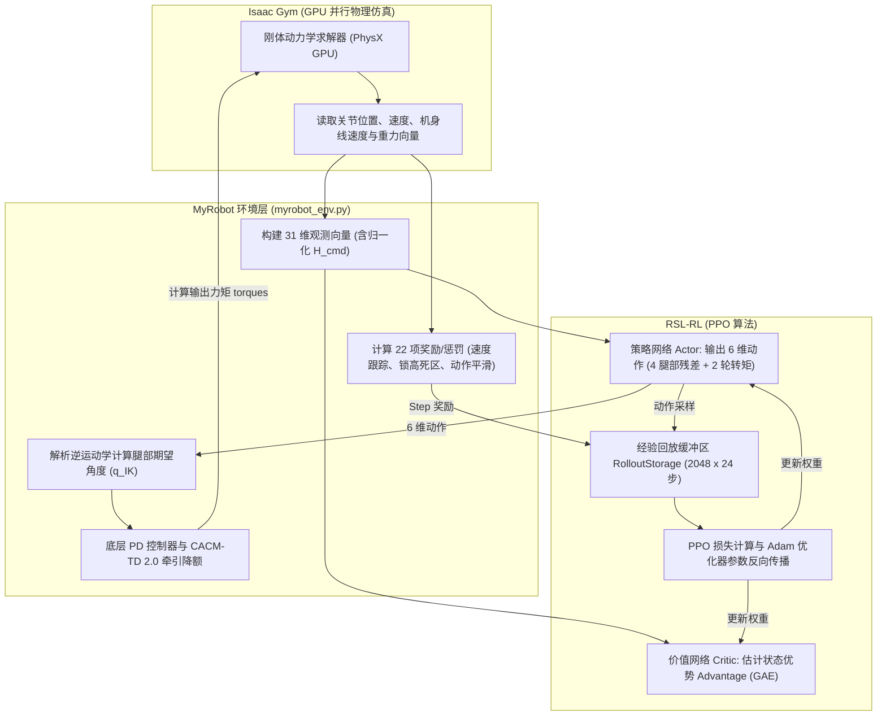
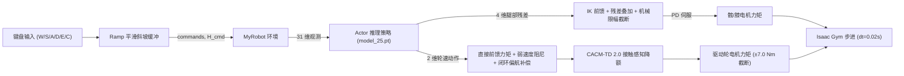
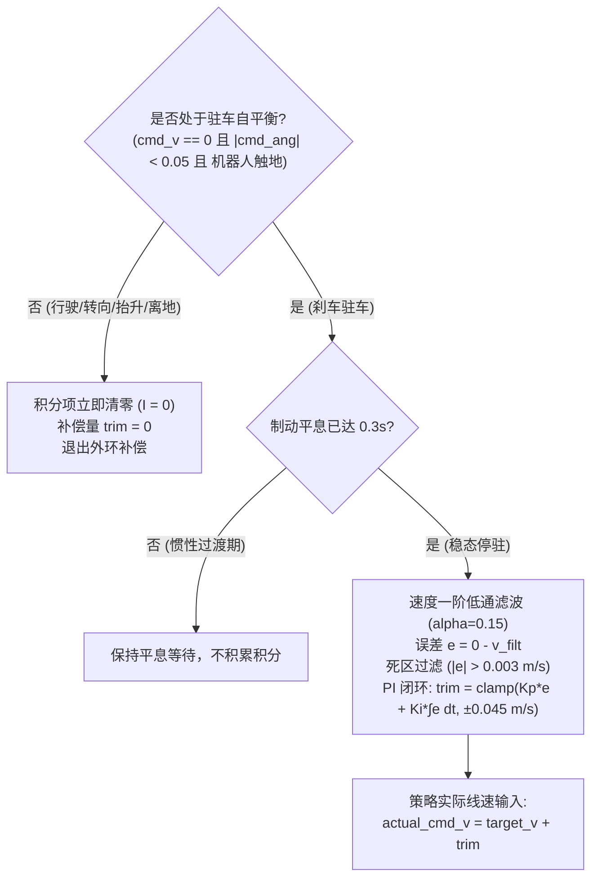

# MyRobot 双足轮足机器人强化学习使用手册与开发指南

> **面向初学者编写**：本手册专为具备 C++ 背景、初次接触 Python、NVIDIA Isaac Gym 与 PPO 强化学习的开发者设计。所有启动命令、配置变量、网络维度与模型路径均已通过工程源码静态核对与闭环运行验证。

---

## 目录

- [《MyRobot 常用命令速查表》](#myrobot-常用命令速查表)
- [第一章：项目简介](#第一章项目简介)
- [第二章：项目效果展示](#第二章项目效果展示)
- [第三章：运行环境](#第三章运行环境)
- [第四章：安装与环境配置教程](#第四章安装与环境配置教程)
- [第五章：快速启动（最快运行指南）](#第五章快速启动最快运行指南)
- [第六章：如何控制机器人（速度、转向与高度调节）](#第六章如何控制机器人速度转向与高度调节)
- [第七章：如何运行 PPO 训练](#第七章如何运行-ppo-训练)
- [第八章：如何加载不同模型与历史 Checkpoint](#第八章如何加载不同模型与历史-checkpoint)
- [第九章：项目目录与核心代码架构讲解](#第九章项目目录与核心代码架构讲解)
- [第十章：强化学习基础概念与机器人接口（31 维观测与 6 维动作）](#第十章强化学习基础概念与机器人接口31-维观测与-6-维动作)
- [第十一章：模型训练效果、版本演进与能力边界（含 Champion v6 与 Phase 15 闭环基准固化）](#第十一章模型训练效果版本演进与能力边界含-champion-v6-与-phase-15-闭环基准固化)
- [第十二章：常见问题 FAQ 与故障排查](#第十二章常见问题-faq-与故障排查)
- [第十三章：双策略融合与连续跳跃控制 (Phase 15 + Stage 8 融合 FSM)](#第十三章双策略融合与连续跳跃控制-phase-15--stage-8-融合-fsm)

---

## 《MyRobot 常用命令速查表》

所有命令均在终端中执行。执行前请确保先执行**激活环境**命令。

| 操作需求 | 完整终端命令 | 运行目录 | 预期效果 |
| :--- | :--- | :--- | :--- |
| **0. 【全新·连续跳跃】启动双策略连续跳跃 3D 交互视窗 (Phase 15 + Stage 8 + FSM)** | `bash run_phase6_viewer.sh` | `IsaacTu_jump/` | 弹出 3D 视窗，支持 100% 键盘手动巡航 (W/S/A/D)、变高 (Q/E) 与无重置连续跳跃 (Space)，按键平滑制动并爆发腾空 ($\ge 20\text{cm}$) |
| **1. 激活运行环境** | `source activate_jump.sh` | `IsaacTu_jump/` | 终端导入 Python 3.8、CUDA 11.3 与 Isaac Gym 环境变量 |
| **2. 进入工程根目录** | `cd /home/xy/IsaacTu_jump` | 任意目录 | 进入强化学习工作空间主目录 |
| **3a. 【当前最新·正式固化基准】启动 Phase 15 闭环驻车模型 (model_130 + PI 补偿)** | `python legged_gym/legged_gym/scripts/teleop.py --task=myrobot --model_path evaluation_assets/phase15/models/phase15_m130.pt` | `IsaacTu/` | 弹出 3D 视窗与 HUD，默认启用驻车速度闭环 PI 补偿（0.34m深蹲20s后退由63cm压制至5cm，5种子60s连续任务0重置，支持[P]键热切换与[0.34m, 0.52m]升降行程） |
| **3b. 【官方综合机动基准】启动 Champion v6 全能基线模型 (m115)** | `python legged_gym/legged_gym/scripts/teleop.py --task=myrobot --model_path evaluation_assets/champion_v6/models/champion_v6_m115.pt` | `IsaacTu/` | 弹出 3D 视窗，加载 Champion v6 官方基准模型（21工况达标率87.96%，移动阶段Joint% 88.61%，综合机动能力最强） |
| **3c. 【Phase 14 历史候选】启动 Phase 14 Exp 3 驻车特化模型 (model_125)** | `python legged_gym/legged_gym/scripts/teleop.py --task=myrobot --model_path legged_gym/logs/myrobot/Oct13_15-16-03_phase14_exp3_parking_focus_resume10iter/model_125.pt` | `IsaacTu/` | 弹出 3D 视窗与 HUD，加载 Phase 14 阶段驻车特化候选模型（常规驻车达标率92.05%，下蹲驻车全达标） |
| **3d. 【历史里程碑】启动 Champion v4 基线模型 (m10)** | `python legged_gym/legged_gym/scripts/teleop.py --task=myrobot --load_run Oct12_15-23-45_phase8b_curriculum_ext_resume_10iter --checkpoint 10` | `IsaacTu/` | 弹出 3D 视窗，加载 Phase 8B 历史基准 Champion v4 模型 |
| **4a. 【推荐】启动多机器人集群演示 (Phase 15 model_130)** | `python legged_gym/legged_gym/scripts/play.py --task=myrobot --load_run Oct14_00-28-55_phase15_height_034_060_exploration --checkpoint 130` | `IsaacTu/` | 弹出 3D 视窗，展示 50 台机器人在平地上的自主巡航与平衡（最新 model_130） |
| **4b. 【推荐】启动多机器人集群演示 (Champion v6 综合基准)** | `python legged_gym/legged_gym/scripts/play.py --task=myrobot --load_run Oct13_10-41-00_phase14_exp1_inplace_032_048_15iter --checkpoint 115` | `IsaacTu/` | 弹出 3D 视窗，展示 50 台机器人在平地上的自主巡航与平衡（Champion v6） |
| **5. 启动 PPO 强化学习训练** | `python legged_gym/legged_gym/scripts/train.py --task=myrobot --headless --num_envs=512 --max_iterations=50 --run_name=my_first_train` | `IsaacTu/` | 在后台使用 GPU 启动 512 个环境并行训练，终端打印 Loss 与 Reward |
| **6. 查看训练曲线 (TensorBoard)** | `tensorboard --logdir=legged_gym/logs/myrobot --port=6006` | `IsaacTu/` | 启动 Web 服务，浏览器访问 `http://localhost:6006` 查看收敛图表 |
| **7a. 运行 21 工况全局基准评测** | `python scripts/eval_21_scenarios.py --model_path legged_gym/logs/myrobot/Oct14_00-28-55_phase15_height_034_060_exploration/model_130.pt` | `IsaacTu/` | 自动化评测标准 21 复合工况，输出全局 Joint% / Env% 及深蹲保持率并生成 JSON |
| **7b. 运行五种子稳态驻车与 60s 长时复合评测** | `python scripts/eval_parking_pi_5seeds_long.py` | `IsaacTu/` | 自动化执行五随机种子（42~46）在 0.34m/0.40m/0.52m 下的稳态驻车与 60s 全流程连续多工况评测 |
| **8. 查看最新模型与评测资产** | `ls -lh legged_gym/logs/myrobot/Oct14_00-28-55_phase15_height_034_060_exploration/` | `IsaacTu/` | 列出 Phase 15 训练目录中的 `model_130.pt` 及配置快照 |

---

## 第一章：项目简介

### 1.1 MyRobot 是什么？
**MyRobot** 是一款**双足轮足混合机器人（Bipedal Wheeled-Legged Robot）**。与传统的纯多足机器狗（如 ANYmal、Unitree A1）或纯轮式差速底盘不同，轮足机器人兼具了：
- **轮式移动的高效率与高速度**：在平坦地面通过驱动轮滚动，能量利用率极高；
- **足式关节的越障与姿态自适应能力**：拥有左右两条铰接机械腿，能够在行进过程中动态改变机身离地间隙（蹲起、伸展）、吸收路面颠簸，并在加速/减速/转弯时代偿惯性力矩。

### 1.2 仿真平台与算法
- **仿真引擎**：**NVIDIA Isaac Gym (Preview 4)**。
  > 💡 **特别提醒（初学者注意区分）**：本项目使用的是经典的、纯 GPU 并行的 **Isaac Gym**，底层基于 PhysX GPU 物理管线；**并非** 基于 Omniverse 的新版 Isaac Lab 或 Isaac Sim。
- **强化学习算法**：**PPO (Proximal Policy Optimization, 近端策略优化算法)**，由 ETH Zurich 的开源算法库 **RSL-RL** 实现。采用 Actor-Critic 架构，直接在 GPU 显存上完成动作采样与网络梯度反向传播。

### 1.3 机器人机械结构与自由度 (DOF)
机器人整机总质量为 **$22.0\text{ kg}$**（机身主体 $14.0\text{ kg}$，腿部与轮子合计 $8.0\text{ kg}$），由 1 个浮动基座和 2 条腿组成，包含 **6 个受控自由度**：

```text
               [ 机身浮动基座 Base Link (14.0 kg) ]
                 /                              \
       (左腿 Left Leg)                    (右腿 Right Leg)
     link_002_joint (左髋 Pitch)       link_005_joint (右髋 Pitch)
           |                                  |
     link_003_joint (左膝 Pitch)       link_006_joint (右膝 Pitch)
           |                                  |
     link_004_joint (左轮 Wheel)       link_007_joint (右轮 Wheel)
```

- **腿部（4 个转动关节）**：左髋、左膝、右髋、右膝。采用**解析逆运动学 (IK) 几何前馈 + PPO 策略残差微调 + 底层 PD 位置伺服**控制；
- **轮端（2 个连续旋转关节）**：左轮、右轮。采用**直接力矩前馈 + 弱轮速阻尼 + 闭环偏航补偿 + 接触感知牵引降额 (CACM-TD 2.0)** 控制。

### 1.4 当前已实现的控制功能
经过 Phase 1 到 Phase 5.3 的阶段演进，机器人目前已在仿真中具备以下能力：
1. **零速原地自平衡**：在 $v_y=0, \omega_z=0$ 时，如倒立摆般自主调整轮速与机身倾角保持直立不倒；
2. **稳定前后巡航**：支持平稳的前进行驶（最高标称 $0.3\text{ m/s}$，扩展测试达 $0.8\text{ m/s}$）与倒车后退；
3. **原地左右转向**：支持原地自旋掉头（左右轮反向差动）；
4. **复合转向巡航**：在以一定速度前行或后退的同时进行圆弧转向；
5. **原地动态升降**：在站立平衡状态下，机身高度在 $0.36\text{ m} \sim 0.44\text{ m}$ 之间平稳下蹲与挺起；
6. **行进中动态变高**：在前进/后退行驶过程中自主调节机身离地间隙；
7. **复合转向中动态变高**：在圆弧转向行驶过程中实现姿态平稳的下蹲与伸展。

> ⚠️ **严谨声明**：本项目当前所有成果均在 **Isaac Gym 物理仿真器** 中训练和验证。由于仿真尚未建立真实电机的热阻模型、减速器齿隙磨损模型以及总线通信延迟，**本项目成果尚未经过真实物理机器人的实机部署认证**。

---

## 第二章：项目效果展示

*(本章节为效果演示预留展示位。如果您在本地录制了图片或 GIF，建议放置在工程目录 `docs/images/` 下并在 Markdown 中引用。)*

### 2.1 仿真运行与控制演示
- **3D 仿真环境全局视角**：
  > `[占位说明：50 台 MyRobot 在 Isaac Gym 3D 平坦地形中并行平衡巡航画面]`  
  > 对应运行命令：`python legged_gym/legged_gym/scripts/play.py --task=myrobot`
- **键盘实时交互遥控 HUD**：
  > `[占位说明：终端打印速度、角速度、当前高度、俯仰角与轮速的实时 ASCII HUD 仪表盘]`  
  > 对应运行命令：`python legged_gym/legged_gym/scripts/teleop.py --task=myrobot`
- **动态高度调节演示（下蹲与挺起）**：
  > `[占位说明：机身高度从标称 0.398m 下蹲至 0.360m，双腿向后折叠而轮心接地位置保持不动的侧面动图]`
- **PPO 训练收敛曲线**：
  > `[占位说明：TensorBoard 中 Episode/rew_tracking_lin_vel 和 Episode/rew_base_height 随 50 轮迭代平稳收敛的曲线图]`

---

## 第三章：运行环境

本项目基于已配置完成的专用强化学习运行时。请核对以下环境参数：

### 3.1 核心依赖与版本

| 组件名称 | 规定版本 | 说明与依赖要求 |
| :--- | :--- | :--- |
| **操作系统** | Linux (Ubuntu 20.04 / 22.04 LTS x86_64) | 推荐使用原生 Linux 或具备独立 GPU 透传的系统 |
| **Python** | `3.8.20` (64-bit) | 由 conda-forge 打包的独立 Python 3.8 解释器 |
| **PyTorch** | `1.10.0+cu113` | 配合 CUDA 11.3 的稳定版 GPU PyTorch |
| **CUDA Driver & Toolkit** | `CUDA 11.3` (驱动版本 $\ge 470$) | 支持 NVIDIA Ampere/Turing 架构架构 |
| **仿真平台** | **Isaac Gym Preview 4** | Python 绑定模块为 `gym_38.so` |
| **编译工具** | `ninja 1.10+`, `gcc/g++ 9+` | 用于 PyTorch 运行时即时编译 `gymtorch` 扩展模块 |
| **GPU 硬件** | NVIDIA 独立显卡（当前为 RTX 3060 Ti） | 显存建议 $\ge 8\text{ GB}$，支持 PhysX GPU 加速 |

### 3.2 检查与验证命令
打开终端，运行以下命令快速检查当前环境是否满足要求：
```bash
# 1. 检查 NVIDIA 显卡驱动与 GPU 状态
nvidia-smi

# 2. 激活项目环境
source /home/xy/Documents/Codex/2026-10-05/chatgpt-conversation-6ac307b2-cac0-83ee-98c3/outputs/activate_rl.sh

# 3. 验证 Python、PyTorch、CUDA 及 Isaac Gym
python -c "
import isaacgym
import torch
print('✓ Python 解释器路径:', torch.__file__)
print('✓ PyTorch 版本:', torch.__version__)
print('✓ GPU 是否可用:', torch.cuda.is_available())
print('✓ 显卡型号:', torch.cuda.get_device_name(0))
print('✓ Isaac Gym 模块导入成功!')
"
```
预期输出中必须显示 `GPU 是否可用: True` 并且无任何报错。

> ⚠️ **C++ 初学者特别避坑指南：导入顺序禁忌**  
> 在 Isaac Gym 中，底层物理引擎由 C++ 编写并通过动态库加载。**在任何 Python 代码中，必须保证 `import isaacgym` 写在 `import torch` 之前！**  
> 如果颠倒顺序（先 `import torch` 后 `import isaacgym`），会导致底层的 CUDA Context 与动态符号冲突，程序将直接抛出 `ImportError: PyTorch was imported before isaacgym modules` 并异常退出。

---

## 第四章：安装与环境配置教程

如果您在一台新设备或新的终端窗口中配置本项目，请按照以下步骤逐步操作：

### 步骤 1：获取项目代码与定位目录
本项目已部署在本地目录 `/home/xy/IsaacTu`：
```bash
cd /home/xy/IsaacTu
pwd
# 预期输出: /home/xy/IsaacTu
```

### 步骤 2：激活预配置的强化学习运行时
本项目使用经过严格依赖锁定的独立运行环境，无需重新从外网下载数十个易冲突的依赖库。运行以下命令即可激活：
```bash
source /home/xy/Documents/Codex/2026-10-05/chatgpt-conversation-6ac307b2-cac0-83ee-98c3/outputs/activate_rl.sh
```
> 🔍 **这个激活脚本做了什么？（C++ 视角类比）**：  
> 该脚本类似于在构建时配置 `CMAKE_PREFIX_PATH` 和环境变量：
> - 将 Python 3.8 及 `ninja` 所在目录追加到 `PATH`；
> - 将 `libpython3.8.so` 追加到动态链接库路径 `LD_LIBRARY_PATH`；
> - 设置 `TORCH_EXTENSIONS_DIR` 目录，防止每次重新编译 `gymtorch` 导致显存碎片。

### 步骤 3：验证 Isaac Gym 模块正常工作
```bash
python -c "import isaacgym; from isaacgym import gymapi; print('Isaac Gym API 初始化正常!')"
```
如果输出 `Isaac Gym API 初始化正常!`，说明底层物理库加载无误。

### 步骤 4：验证 MyRobot 任务是否注册成功
在 `legged_gym` 框架中，所有机器人任务都在 [`legged_gym/envs/__init__.py`](file:///home/xy/IsaacTu/legged_gym/legged_gym/envs/__init__.py) 中注册。运行以下测试命令：
```bash
python -c "
import isaacgym
from legged_gym.envs import *
from legged_gym.utils import task_registry
print('已注册任务列表:', list(task_registry.task_classes.keys()))
assert 'myrobot' in task_registry.task_classes, 'myrobot 任务未注册!'
print('✓ MyRobot 任务注册核查通过!')
"
```
预期输出中将包含 `'myrobot'`，并打印 `✓ MyRobot 任务注册核查通过!`。

---

## 第五章：快速启动（最快运行指南）

这是让您在 **10 秒钟内** 亲眼看到机器人平衡和运动的最快途径！

### 5.1 🚀 三步最快启动（复制即可运行）

打开终端，执行以下命令：

#### 方案 0（全新·推荐·双策略连续跳跃融合）：启动连续跳跃 3D 交互视窗 (Phase 15 + Stage 8)
这是体验轮足机器人**边巡航变高、边无重置连续垂直越障跳跃（$\ge 20\text{ cm}$）**的最快方式！

```bash
# 【极简一键启动】(自动导入依赖环境并开启 100% 键盘手动遥控)
cd /home/xy/IsaacTu_jump
bash run_phase6_viewer.sh

# 也可以使用标准 Python 启动命令：
# 第 1 步：进入工程根目录
cd /home/xy/IsaacTu_jump

# 第 2 步：激活环境
source activate_jump.sh

# 第 3 步：启动双策略连续跳跃正式交互视窗
python legged_gym/legged_gym/scripts/teleop_dual.py
```

> 🕹️ **按键速记**：
> - **`W` / `S` / `A` / `D`**：前进 / 倒车 / 转向巡航；
> - **`Q` / `E`**：机身高度升降调节（工作空间 $0.340\text{ m} \sim 0.520\text{ m}$）；
> - **`Space`（空格键）**：**请求跳跃**（随时按下：行进中自动平滑制动 → 深蹲蓄力 → 爆发腾空 $\ge 20\text{ cm}$ → 落地缓冲并平滑重归平衡巡航，无需重置可反复连续起跳）；
> - **`X`**：驻车刹停并锁止；**`R`**：复位环境与高度；**`ESC`**：退出并自动导出 50 Hz CSV 遥测。

#### 方案 A（推荐·当前最新固化基准）：启动 Phase 15 闭环驻车模型 (model_130 + PI 补偿)
```bash
# 第 1 步：进入工程根目录
cd /home/xy/IsaacTu_jump

# 第 2 步：激活环境
source activate_jump.sh

# 第 3 步：启动实时键盘交互遥控器，加载 Phase 15 固化基准模型（默认开启驻车 PI 闭环）
python legged_gym/legged_gym/scripts/teleop.py \
  --task=myrobot \
  --model_path evaluation_assets/phase15/models/phase15_m130.pt
```

#### 方案 B（推荐·官方综合基线）：启动 Champion v6 官方基准模型 (m115)
```bash
# 第 1 步：进入工程根目录
cd /home/xy/IsaacTu_jump

# 第 2 步：激活环境
source activate_jump.sh

# 第 3 步：启动实时键盘交互遥控器，加载 Champion v6 官方基线模型
python legged_gym/legged_gym/scripts/teleop.py \
  --task=myrobot \
  --model_path evaluation_assets/champion_v6/models/champion_v6_m115.pt
```

#### 方案 C（历史候选与早期模型）：启动 Phase 14 Exp 3 / Champion v4
```bash
# 启动 Phase 14 Exp 3 驻车特化模型 (model_125)
python legged_gym/legged_gym/scripts/teleop.py --task=myrobot --model_path legged_gym/logs/myrobot/Oct13_15-16-03_phase14_exp3_parking_focus_resume10iter/model_125.pt

# 启动 Phase 8B Champion v4 基线模型
python legged_gym/legged_gym/scripts/teleop.py --task=myrobot --load_run Oct12_15-23-45_phase8b_curriculum_ext_resume_10iter --checkpoint 10
```

### 5.2 预期看到的现象
1. **弹出 3D 渲染窗口**：Isaac Gym 仿真窗口打开，一台双足轮足机器人平稳直立在网格地面中央；
2. **终端输出控制面板**：终端打印 HUD 仪表盘，显示当前速度、期望速度、机身高度与关节状态；
3. **机器人保持自平衡**：双轮轻微自主调整转动，机身保持在标称站立高度（约 $0.398\text{ m}$），左右无侧倾。

### 5.3 动手操作机器人！
在键盘上按下以下按键（**既可以在终端窗口直接按，也可以点击 3D 仿真窗口后按**）：
- 按 **`W` / `↑`**：前进加速（单次 $+0.04\text{ m/s}$，平滑上限 $+0.50\text{ m/s}$）；
- 按 **`S` / `↓`**：减速 / 倒车（单次 $-0.04\text{ m/s}$，平滑下限 $-0.30\text{ m/s}$）；
- 按 **`A` / `←`**：向左旋转（逆时针自旋掉头）；
- 按 **`D` / `→`**：向右旋转（顺时针自旋掉头）；
- 按 **`C` / `J`**：**下蹲（机身平滑下降，安全工作空间下限为 0.34m，避免连杆物理干涉）**；
- 按 **`E` / `U`**：**升高（机身平滑上升，安全工作空间上限为 0.52m）**；
- 按 **`Z` / `N`**：**一键恢复标称站立高度 (0.398m)**；
- 按 **`P`**：**热切换驻车速度闭环 PI 补偿**（HUD 实时显示 `[ON]` / `[OFF]`，默认开启，抑制驻车慢速漂移）；
- 按 **`Space`（空格键）**：**紧急刹车驻车**（速度指令归零，就地保持平衡与制动）；
- 按 **`R`**：重置机器人回到原点；
- 按 **`Q`**：正常退出程序。

### 5.4 另一种演示模式：多机器人集群演示 (`play.py`)
如果您想查看没有键盘输入时，策略网络在 50 台并行机器人上的随机巡航效果：

- **【推荐·当前最新固化基准】Phase 15 model_130**：
  ```bash
  python legged_gym/legged_gym/scripts/play.py --task=myrobot --load_run Oct14_00-28-55_phase15_height_034_060_exploration --checkpoint 130
  ```
- **【推荐·综合基准】Champion v6 (m115)**：
  ```bash
  python legged_gym/legged_gym/scripts/play.py --task=myrobot --load_run Oct13_10-41-00_phase14_exp1_inplace_032_048_15iter --checkpoint 115
  ```
- **【历史候选·驻车特化】Phase 14 Exp 3 (model_125)**：
  ```bash
  python legged_gym/legged_gym/scripts/play.py --task=myrobot --load_run Oct13_15-16-03_phase14_exp3_parking_focus_resume10iter --checkpoint 125
  ```
- **【经典保留】Champion v4**：
  ```bash
  python legged_gym/legged_gym/scripts/play.py --task=myrobot --load_run Oct12_15-23-45_phase8b_curriculum_ext_resume_10iter --checkpoint 10
  ```
> 💡 **`teleop.py` 与 `play.py` 的区别**：
> - `teleop.py`：仅生成 1 台机器人，专为**单人键盘交互遥控驾驶**设计，屏蔽了内部随机指令重采样；
> - `play.py`：默认生成 50 台机器人，采用固定随机种子与自动漫游镜头，用于观察大批量机器人的统计存活率。

---

## 第六章：如何控制机器人（速度、转向与高度调节）

### 6.1 核心控制参数解析
对于熟悉 C++ 的开发者，机器人的运动控制输入相当于如下结构体：
```cpp
struct RobotCommand {
    float lin_vel_y;    // 纵向线速度 (Forward/Backward Velocity)，单位：m/s (米/秒)
    float ang_vel_yaw;  // 偏航角速度 (Yaw Angular Velocity)，单位：rad/s (弧度/秒)
    float height_cmd;   // 机身目标高度 (Target Base Height)，单位：m (米)
};
```

1. **纵向速度 $v_y$ (`lin_vel_y`)**：
   - $> 0$：向前直线行驶；
   - $< 0$：向后倒退行驶；
   - 坐标系约定：机器人的前进方向为局部坐标系的 $+Y$ 轴。
2. **偏航角速度 $\omega_z$ (`ang_vel_yaw`)**：
   - $> 0$：向左转弯（逆时针自旋）；
   - $< 0$：向右转弯（顺时针自旋）。
3. **机身目标高度 $H_{\text{cmd}}$ (`height_cmd`)**：
   - 标称平衡高度：**$0.398\text{ m}$**；
   - 最低下蹲极限：**$0.340\text{ m}$**（低于此界限会产生机械连杆物理干涉）；
   - 最高抬高极限：**$0.520\text{ m}$**（高于此界限重力刚度偏差加大；固化工作空间行程达 18 cm）。

### 6.2 典型工况与控制量对照表

| 目标运动行为 | 纵向速度 $v_y$ (m/s) | 偏航角速度 $\omega_z$ (rad/s) | 目标高度 $H_{\text{cmd}}$ (m) | 说明 |
| :--- | :---: | :---: | :---: | :--- |
| **1. 原地静止平衡** | `0.0` | `0.0` | `0.398` | 双轮微调，保持标称高度静态站立（默认激活驻车闭环 PI 补偿） |
| **2. 匀速向前行驶** | `+0.25` | `0.0` | `0.398` | 机身轻微前倾以提供牵引力，平稳巡航 |
| **3. 匀速倒车后退** | `-0.20` | `0.0` | `0.398` | 机身后仰提供制动力，向后平稳倒退（实测存在约 33% 稳态超调） |
| **4. 原地向左旋转** | `0.0` | `+0.30` | `0.398` | 左右轮反向旋转，机身就地掉头 |
| **5. 原地低趴深蹲** | `0.0` | `0.0` | `0.340` | 双腿后折深蹲，机身平稳下降至 0.34m 下限 |
| **6. 原地高位站立** | `0.0` | `0.0` | `0.520` | 双腿大幅伸展挺拔，离地间隙显著增加至 0.52m 上限 |
| **7. 行进中下蹲巡航** | `+0.20` | `0.0` | `0.340` | 前进同时保持低重心，抗颠簸稳定性高 |
| **8. 复合左转升降** | `+0.15` | `+0.25` | `0.480` | 边向前边转弯，同时抬高机身通过障碍 |

### 6.3 这些控制指令在源码中由哪里决定？
根据您的使用场景，指令来源不同：
1. **交互遥控时**：在 [`teleop.py`](file:///home/xy/IsaacTu/legged_gym/legged_gym/scripts/teleop.py#L244) 的 `target_ctrl` 字典中实时修改，经过内部的 Ramp 加速度斜坡平滑器并叠加驻车闭环 PI 补偿后，写入 `env.commands[:, 1]` 与 `env.height_cmd_buf[:]`；
2. **强化学习训练时**：在 [`myrobot_config.py`](file:///home/xy/IsaacTu/legged_gym/legged_gym/envs/myrobot/myrobot_config.py#L46-L51) 的 `class commands.ranges` 中配置均匀分布采样范围；
3. **离线独立评估时**：在评测脚本中的场景列表中固定给入。

### 6.4 已验证的控制能力范围

| 控制维度 | 训练覆盖范围 (Training Range) | 已验证扩展测试范围 (Test Range) | 边界警示 |
| :--- | :---: | :---: | :--- |
| **纵向速度 $v_y$** | $[-0.30, +0.30]\text{ m/s}$ | $[-0.30, +0.50]\text{ m/s}$ (测试达 $0.80\text{ m/s}$) | 倒车指令 $-0.20\text{ m/s}$ 实测约为 $-0.266\text{ m/s}$（存在超调，为已知限制） |
| **偏航角速度 $\omega_z$** | $[-0.50, +0.50]\text{ rad/s}$ | $[-0.50, +0.50]\text{ rad/s}$ | 超过 $\pm 1.0\text{ rad/s}$ 时离心力会导致单轮离地 |
| **机身目标高度 $H$** | $[0.340, 0.600]\text{ m}$ (Phase 15 探索) | $[0.340, 0.520]\text{ m}$ (Phase 15 固化工作空间) | 低于 $0.340\text{ m}$ 会产生机械连杆物理干涉，高于 $0.520\text{ m}$ 刚度偏差加大 |

---

## 第七章：如何运行 PPO 训练

### 7.1 启动新训练完整命令
进入项目根目录并激活环境后，执行：
```bash
python legged_gym/legged_gym/scripts/train.py \
  --task=myrobot \
  --headless \
  --num_envs=512 \
  --max_iterations=50 \
  --run_name=my_first_train
```
- `--headless`：关闭 3D 图形渲染，全部计算集中在 GPU，训练速度可提升 10 倍以上；
- `--num_envs=512`：同时开启 512 个并行机器人（根据您的显存大小调整，RTX 3060 Ti 推荐 512~2048）；
- `--max_iterations=50`：设定本次训练执行 50 轮 PPO 迭代；
- `--run_name=my_first_train`：为本次实验指定唯一名称。所有日志与模型将保存在 `legged_gym/logs/myrobot/<当前时间>_my_first_train/` 下。

### 7.2 核心配置参数详解（C++ 类比）

所有算法配置均位于 [`legged_gym/envs/myrobot/myrobot_config.py`](file:///home/xy/IsaacTu/legged_gym/legged_gym/envs/myrobot/myrobot_config.py)：

```python
class MyRobotCfgPPO(LeggedRobotCfgPPO):
    class algorithm(LeggedRobotCfgPPO.algorithm):
        learning_rate = 2.5e-4      # Adam 优化器学习率
        num_learning_epochs = 5    # 每批采样数据用于梯度下降的更新轮数
        num_mini_batches = 4       # 将采样数据切分为 4 个 Mini-batch
        clip_param = 0.2           # PPO 信任域裁剪系数 epsilon

    class runner(LeggedRobotCfgPPO.runner):
        num_steps_per_env = 24     # 每个环境单轮采集步数 (总采样样本数 = num_envs * 24)
        max_iterations = 50        # 总训练迭代轮数
        save_interval = 5          # 每隔 5 轮迭代保存一次 checkpoint (model_5.pt, model_10.pt...)
        resume = False             # 是否完全恢复中断的训练 (包含优化器状态)
        warm_start = True          # 是否热启动 (仅继承神经网络权重，重置优化器)
```

- **`num_envs`（并行环境数）**：类似 C++ 中的并发线程数或 GPU CUDA Block 数量。512 个环境意味着同时有 512 台机器人在采集经验；
- **`learning_rate`（学习率）**：标称值为 $2.5\times 10^{-4}$。在策略微调时切忌随意调大，过大的学习率会摧毁已有的平衡能力；
- **`save_interval`（保存间隔）**：每隔几轮在磁盘上保存一次 `.pt` 模型文件；
- **`warm_start` 与 `resume` 的区别**：
  - `resume=True`：从某次训练的特定 Checkpoint 恢复，**同时恢复网络权重和 Adam 优化器的内部动量**，迭代步数接着累加；
  - `warm_start=True`：**仅将网络权重初始化为已有的 `.pt` 模型**，优化器重新初始化，迭代步数归零。常用于跨任务课程学习（如将平衡模型迁移到变高任务中）。

### 7.3 查看训练曲线 (TensorBoard)
在训练过程中或训练结束后，在终端输入：
```bash
tensorboard --logdir=legged_gym/logs/myrobot --port=6006
```
打开浏览器访问 `http://localhost:6006`，可以实时观察以下关键曲线：
- **`Episode/rew_tracking_lin_vel`**：纵向速度跟踪奖励（应逐渐上升趋于 0）；
- **`Episode/rew_base_height`**：高度跟踪惩罚（负数，越接近 0 说明高度跟踪越精准）；
- **`Train/mean_episode_length`**：平均存活步数（最大为 1000 步，越接近 1000 说明机器人越不摔倒）；
- **`Loss/value_function`**：价值网络损失（应在小幅震荡后平稳下降）。

### 7.4 如何安全停止训练
在运行 `train.py` 的终端中直接按下 **`Ctrl + C`** 即可。程序会捕获中断信号并安全退出，不会损坏已保存的 `.pt` 文件。

> ⚠️ **新手特别提示：保护正式封版模型**  
> 主基线模型（Phase 5.3 Formal `model_25.pt`）是经过数万样本交叉验证的基准。**新训练请务必通过 `--run_name` 指定新的实验名称，绝对不要直接覆盖历史日志目录！**

---

## 第八章：如何加载不同模型与历史 Checkpoint

### 8.1 `.pt` 文件究竟是什么？
在 PyTorch 中，`.pt` 文件是序列化保存的二进制字典（类似 C++ 中用 `std::ofstream` 序列化的二进制快照）。通过读取 `model_25.pt`，其内部实际包含：
```text
{
    'model_state_dict': { ... },     # Actor 网络与 Critic 网络的全部权重 (Weight) 与偏置 (Bias)
    'optimizer_state_dict': { ... }, # Adam 优化器的一阶动量与二阶方差缓冲
    'iter': 25,                      # 保存该模型时的训练迭代轮数
    'infos': None                    # 附加运行元数据
}
```

### 8.2 核心模型版本体系与绝对路径

项目当前确立了**以 Phase 15（model_130 + 驻车速度闭环 PI 补偿）为最新正式固化基准**，以 Champion v6 作为官方综合机动基线，以 Phase 14 Exp 3 `model_125` 作为历史探索候选，并完整保留历史里程碑版本以供对比审计：

#### 1. 【当前最新·正式固化基准】Phase 15 model_130 (推荐用于最新仿真基准与驻车闭环控制)
- **训练阶段**：Phase 15 探索高度空间扩展续训（15 轮，基于 Champion v6 续训，采样高度扩展至 $[0.34\text{m}, 0.60\text{m}]$）
- **模型绝对路径**：
  [`evaluation_assets/phase15/models/phase15_m130.pt`](file:///home/xy/IsaacTu/evaluation_assets/phase15/models/phase15_m130.pt)  
  *(训练原目录：[`legged_gym/logs/myrobot/Oct14_00-28-55_phase15_height_034_060_exploration/model_130.pt`](file:///home/xy/IsaacTu/legged_gym/logs/myrobot/Oct14_00-28-55_phase15_height_034_060_exploration/model_130.pt))*
- **模型状态**：**正式固化冻结，不再进行盲目 PPO 续训**
- **核心控制能力与闭环增强（5 随机种子 42~46 严格独立复验）**：
  - **驻车定向漂移基本抑制**：外环集成驻车闭环 PI 补偿器（$K_p=0.35, K_i=0.60, trim_{\max}=0.045\text{ m/s}$），稳态平均线速度收敛至 $|\bar{v}_y| < 0.0001\text{ m/s}$；
  - **全高度位移压制 89%～95%**：$0.34\text{m}$ 深蹲 20 秒位移由 $-63.2\text{ cm}$ 降至 **$-5.0\text{ cm}$**；$0.40\text{m}$ 标称高度由 $+6.1\text{ cm}$ 降至 **$+0.4\text{ cm}$**；$0.52\text{m}$ 由 $-37.3\text{ cm}$ 降至 **$-3.6\text{ cm}$**；
  - **安全高度工作空间**：固化为 **$[0.340\text{m}, 0.520\text{m}]$**，下限杜绝连杆干涉，上限高度偏差在已测可接受范围内；
  - **单电机独立峰值力矩**：左右驱动轮稳态力矩 $< 1.18\text{ N}\cdot\text{m}$，饱和率（$7.0\text{ N}\cdot\text{m}$ 限幅）严格为 $0.00\%$，俯仰晃动 Std 稳定在 $0.37^\circ \sim 0.40^\circ$；
  - **60 秒长程复合多工况**：跨 5 种子 **100% 跑通，环境重置次数严格为 0**；
  - **状态机与平滑保护**：遥控器支持 `[P]` 键热切换；自动重置（`dones[0]`）清空积分并将平滑指令归零重置标称高度，杜绝启动突跳。
- **客观已知边界与当前短板**：
  - **倒车速度超调**：倒车指令 $-0.20\text{ m/s}$ 实测约为 $-0.266\text{ m/s}$（存在约 33% 超调，底层策略非对称动力学固有特性，保留为已知限制）；
  - **轮足自平衡微摆**：瞬时线速度存在约 $0.005\text{ m/s}$ 的物理自平衡微摆，非机械死锁；
  - **适用边界**：当前为 Isaac Gym 物理仿真基准，实机部署须另行实车辨识与延迟补偿。

#### 2. 【当前官方综合基准】Champion v6 (Phase 14 m115，综合机动能力最强)
- **训练阶段**：Phase 14 Exp 1 原地与移动变高强化迭代第 15 轮
- **模型绝对路径**：
  [`evaluation_assets/champion_v6/models/champion_v6_m115.pt`](file:///home/xy/IsaacTu/evaluation_assets/champion_v6/models/champion_v6_m115.pt)  
  *(运行目录副本：`legged_gym/logs/myrobot/Oct13_10-41-00_phase14_exp1_inplace_032_048_15iter/model_115.pt`)*
- **SHA256 校验码**：`7055b3cefece6406aeb60db1b21102337399e4af4163fc9c921f738aea03e495`
- **核心控制能力**：
  - 标准 21 工况全局 Joint% 达到 **87.96%**，全局 Env% 达到 **80.65%**；
  - 移动阶段 Joint% 保持在 **88.61%** 的高水准；
  - 是目前移动机动性最强、全局工况适应面最平衡的官方综合基线。

#### 3. 【历史探索候选·驻车特化】Phase 14 Exp 3 model_125
- **训练阶段**：Phase 14 Exp 3 针对性驻车短轮续训（10 轮自平衡强化，基于 Champion v6 分叉）
- **模型绝对路径**：
  [`legged_gym/logs/myrobot/Oct13_15-16-03_phase14_exp3_parking_focus_resume10iter/model_125.pt`](file:///home/xy/IsaacTu/legged_gym/logs/myrobot/Oct13_15-16-03_phase14_exp3_parking_focus_resume10iter/model_125.pt)  
  *(仓库固化副本：[`evaluation_assets/phase14/models/phase14_exp3_m125.pt`](file:///home/xy/IsaacTu/evaluation_assets/phase14/models/phase14_exp3_m125.pt))*
- **SHA256 校验码**：`400a9c861a0422bd665720e37c4f9d6ee4af257b950c0322f7c77501976a183a`
- **核心控制能力**：
  - 常规高度驻车联合合格率达 $92.05\% \pm 0.79\%$，6 项下蹲组合全达标；
  - 但仍存单向慢速漂移（5 秒后退 8.1cm），且移动阶段 Joint% 下降至 77.61%。

#### 4. 【历史里程碑对照】Champion v4 与 Phase 5.3
- **Champion v4 (Phase 8B m10)**：
  - 路径：[`evaluation_assets/phase8b/models/phase8b_m10.pt`](file:///home/xy/IsaacTu/evaluation_assets/phase8b/models/phase8b_m10.pt)
  - SHA256: `b92fba14e73e803d8b9a736cdb7213eb3b217c5c87122aa2d1935751f940e9e9`
  - 21 工况全局 Joint% 达 66.52%，深蹲达标率 88.80%。
- **Phase 5.3 Formal 主基线 (model_25.pt)**：
  - 路径：`legged_gym/logs/myrobot/Oct10_15-48-32_turning_height_stage5_3_formal/model_25.pt`
  - 初代原生 31 维平衡巡航里程碑模型。

### 8.3 历史模型目录命名规则
历史运行目录均存放在 `legged_gym/logs/myrobot/` 下，命名格式统一为：
`MonthDay_Hour-Minute-Second_任务标识`
例如：
- `Oct14_00-28-55_phase15_height_034_060_exploration/`：★ Phase 15 固化基准目录 (含 model_130) ★；
- `Oct13_15-16-03_phase14_exp3_parking_focus_resume10iter/`：Phase 14 Exp 3 驻车特化模型目录 (含 model_125)；
- `Oct13_10-41-00_phase14_exp1_inplace_032_048_15iter/`：★ Champion v6 官方综合基线目录 (含 model_115) ★；
- `Oct12_15-23-45_phase8b_curriculum_ext_resume_10iter/`：Champion v4 历史基线目录 (含 model_10)；
- `Oct10_15-48-32_turning_height_stage5_3_formal/`：Phase 5.3 Stage 1 正式 50 轮训练目录。

### 8.4 如何切换不同 Checkpoint 进行对比测试？
在运行 `teleop.py` 或 `play.py` 时，直接通过命令行参数指定 `--model_path` 或 `--load_run`：
```bash
# 【当前最新·正式固化基准】加载 Phase 15 model_130 (默认启用外环驻车 PI 补偿)
python legged_gym/legged_gym/scripts/teleop.py --task=myrobot \
  --model_path=legged_gym/logs/myrobot/Oct14_00-28-55_phase15_height_034_060_exploration/model_130.pt

# 【官方综合基线】加载 Champion v6 官方综合基准模型 (m115)
python legged_gym/legged_gym/scripts/teleop.py --task=myrobot \
  --model_path=evaluation_assets/champion_v6/models/champion_v6_m115.pt

# 【历史探索候选】加载 Phase 14 Exp 3 model_125
python legged_gym/legged_gym/scripts/teleop.py --task=myrobot \
  --model_path=legged_gym/logs/myrobot/Oct13_15-16-03_phase14_exp3_parking_focus_resume10iter/model_125.pt

# 加载 Champion v4 (Phase 8B m10)
python legged_gym/legged_gym/scripts/play.py --task=myrobot \
  --load_run=Oct12_15-23-45_phase8b_curriculum_ext_resume_10iter \
  --checkpoint=10

# 加载 Phase 5.3 Formal 主基线模型 (model_25.pt)
python legged_gym/legged_gym/scripts/play.py --task=myrobot \
  --load_run=Oct10_15-48-32_turning_height_stage5_3_formal \
  --checkpoint=25
```

> 💡 **重要经验（不要以训练轮数论英雄）**：  
> 在强化学习中，**训练轮数越多的模型不一定越好！** 在微调后期，PPO 可能会发生策略过拟合、动作分布漂移或旧技能遗忘。必须通过涵盖多模态的自动化评测集来综合裁定最优模型，这也是为什么项目将经过严格评测验证的 `Oct12_15-23-45_.../model_10.pt` 锁定为当前 Champion v4 正式基线。

---

## 第九章：项目目录与核心代码架构讲解

### 9.1 工程真实文件树结构
```text
/home/xy/IsaacTu/
├── activate_env.sh (文档引用)  # 环境激活引导说明
├── README.md                   # 根目录总览文档
├── README_MYROBOT.md           # 本文档 (MyRobot 完整使用手册)
│
├── isaacgym/                   # NVIDIA Isaac Gym Preview 4 物理引擎
│   └── python/isaacgym/        # Python 接口绑定 (gymapi, gymtorch)
│
├── legged_gym/                 # 机器人强化学习环境与训练框架
│   └── legged_gym/
│       ├── envs/
│       │   ├── __init__.py     # 任务注册表入口 (注册 "myrobot" 任务)
│       │   ├── base/           # 强化学习基础环境基类 (LeggedRobot)
│       │   └── myrobot/        # ★ MyRobot 专属实现目录 ★
│       │       ├── myrobot_env.py    # 环境动力学、观测、奖励与控制器
│       │       └── myrobot_config.py # 物理参数、超参数与 PPO 配置
│       ├── logs/myrobot/       # 历史训练 Checkpoint、TensorBoard 与快照
│       ├── resources/robots/myrobot/myrobot_urdf/
│       │       └── robot.urdf  # 机器人 URDF 机械结构与关节物理定义
│       ├── scripts/            # 执行入口
│       │   ├── train.py        # 训练主入口
│       │   ├── play.py         # 多机演示与评测入口
│       │   └── teleop.py       # 键盘交互遥控器 (WASD + 升降)
│       └── utils/
│           ├── task_registry.py # 环境创建与 Runner 工厂
│           └── helpers.py      # 命令行参数解析 (get_args)
│
├── rsl_rl/                     # ETH 高性能 GPU 强化学习算法库
│   └── rsl_rl/
│       ├── algorithms/ppo.py   # PPO 算法实现 (更新与梯度裁剪)
│       ├── modules/            # Actor-Critic MLP 神经网络结构
│       ├── runners/            # OnPolicyRunner 训练流程控制器
│       └── storage/            # GPU 显存 Rollout 经验回放缓冲区
│
└── evaluation_assets/phase5_3/ # 封版持久化评估与诊断资产包
    ├── README.md               # 评测资产索引与 SHA256 校验清单
    ├── scripts/                # 9 个独立评估与动力学诊断脚本
    └── results/                # 9 个评估输出的原始 JSON 数据
```

### 9.2 核心模块类与调用关系（C++ 类比）

1. **环境类 `MyRobot`** ([`myrobot_env.py`](file:///home/xy/IsaacTu/legged_gym/legged_gym/envs/myrobot/myrobot_env.py))：
   - 继承自 `LeggedRobot`（类比 C++ `class MyRobot : public LeggedRobot`）；
   - 实现了 31 维观测提取函数 `compute_observations()`；
   - 实现了 22 项复合奖励函数（如 `_reward_tracking_lin_vel`, `_reward_base_height`）；
   - 实现了执行器混合控制管线 `_compute_torques()`。
2. **配置类 `MyRobotCfg` 与 `MyRobotCfgPPO`** ([`myrobot_config.py`](file:///home/xy/IsaacTu/legged_gym/legged_gym/envs/myrobot/myrobot_config.py))：
   - 采用嵌套类作为配置字典（类比 C++ 的配置命名空间 `namespace Config`）；
   - 统一定义物理刚度 Kp/Kd、指令范围、URDF 限幅与奖励权重。
3. **策略网络与价值网络 `ActorCritic`** (`rsl_rl/modules/actor_critic.py`)：
   - 多层感知机 MLP（全连接网络，隐藏层结构 `[512, 256, 128]`，激活函数为 ELU）；
   - Actor 负责输入 31 维观测向量，输出 6 维动作均值 $\mu$ 与可学习方差 $\sigma$；
   - Critic 负责输入观测向量，输出 1 维状态价值 $V(s)$。
4. **训练调度器 `OnPolicyRunner`** (`rsl_rl/runners/on_policy_runner.py`)：
   - 协调环境步进、经验存储、损失计算、TensorBoard 日志记录与 Checkpoint 存取。

### 9.3 训练与推理流程图

#### 训练闭环流程图 (Training Pipeline)


#### 推理控制流程图 (Inference Pipeline / `teleop.py`)


---

## 第十章：强化学习基础概念与机器人接口（31 维观测与 6 维动作）

对于 C++ 初学者，理解强化学习的本质就像理解一个**高频闭环反馈控制系统**：
- **Observation (观测)**：输入传感器的测量值（类似于 C++ 控制循环中读取的编码器和 IMU 结构体）；
- **Action (动作)**：控制器输出的期望指令（类似于输出给电机的期望位置或前馈力矩）；
- **Reward (奖励)**：损失函数 (Loss Function) 的反面，用于告诉算法当前行为是好是坏（标量，数值越高越受鼓励）；
- **Actor (策略网络)**：真正的控制器函数 `Action = Actor(Observation)`；
- **Critic (价值网络)**：评估当前状态“前景如何”的评估器，仅在训练时使用，部署推理时丢弃；
- **Episode (回合)**：一次完整的任务过程（如果机器人摔倒或机身触地，当前回合提前终止 (Done)，环境自动复位 Reset）；
- **Domain Randomization (域随机化)**：在训练时随机扰动地面摩擦力、机身质量与外力推扰，增强策略在不同环境下的鲁棒性。

### 10.1 MyRobot 31 维观测向量逐维定义
源码依据：[`myrobot_env.py` 中的 `compute_observations()`](file:///home/xy/IsaacTu/legged_gym/legged_gym/envs/myrobot/myrobot_env.py#L387-L405)。

| 索引范围 | 维度 | 物理含义 | 缩放系数 (Scale) | 说明与物理单位 |
| :---: | :---: | :--- | :---: | :--- |
| `[0:3]` | 3 | 机身线速度 $[v_x, v_y, v_z]$ | $\times 2.0$ | 局部坐标系，单位 $\text{m/s}$。$v_y$ 为前进速度 |
| `[3:6]` | 3 | 机身角速度 $[\omega_x, \omega_y, \omega_z]$ | $\times 0.25$ | 局部坐标系，单位 $\text{rad/s}$。反映机身滚转、俯仰与偏航速率 |
| `[6:9]` | 3 | 重力投影向量 $[g_x, g_y, g_z]$ | $\times 1.0$ | 机身姿态四元数旋转后的重力方向，反映倾角 |
| `[9:12]` | 3 | 目标指令 $[v_{x,\text{cmd}}, v_{y,\text{cmd}}, \omega_{z,\text{cmd}}]$ | 速度 $\times 2.0$, 偏航 $\times 0.25$ | 上层给定的期望速度与旋转指令 |
| `[12:18]` | 6 | 关节位置偏差 $(q - q_{\text{default}})$ | $\times 1.0$ | 相对默认零位的位置偏差，**双轮通道强制置零** |
| `[18:24]` | 6 | 关节角速度 $\dot{q}$ | $\times 0.05$ | 6 个关节的转速，单位 $\text{rad/s}$ |
| `[24:30]` | 6 | 上一时刻动作反馈 `filtered_actions` | $\times 1.0$ | 经一阶低通滤波后的上一时刻动作输出 |
| `[30]` | 1 | **归一化机身高度指令** | 标度计算 | 计算公式：$(H_{\text{cmd}} - 0.40) / 0.15$ |

### 10.2 MyRobot 6 维动作向量物理映射
源码依据：[`robot.urdf`](file:///home/xy/IsaacTu/legged_gym/resources/robots/myrobot/myrobot_urdf/robot.urdf) 与 [`myrobot_env.py` 中的 `_compute_torques()`](file:///home/xy/IsaacTu/legged_gym/legged_gym/envs/myrobot/myrobot_env.py#L425-L465)。

| 动作索引 | 关联关节名 | 关节功能 | 最终物理控制方式与执行链路 |
| :---: | :--- | :--- | :--- |
| `action[0]` | `link_002_joint` | **左髋俯仰关节 (Left Hip)** | $q_{\text{target}} = q_{\text{default}} + q_{1,\text{IK}} + 0.25 \times 0.7 \times a_0$，执行 PD 位置伺服 |
| `action[1]` | `link_003_joint` | **左膝俯仰关节 (Left Knee)** | $q_{\text{target}} = q_{\text{default}} + q_{2,\text{IK}} + 0.25 \times 0.5 \times a_1$，执行 PD 位置伺服 |
| `action[2]` | `link_004_joint` | **左驱动轮 (Left Wheel)** | $\tau_{\text{ff}} = 7.0 \times \text{clamp}(a_2, -1, 1)$，执行前馈力矩 + CACM 降额 + 闭环偏航补偿 |
| `action[3]` | `link_005_joint` | **右髋俯仰关节 (Right Hip)** | $q_{\text{target}} = q_{\text{default}} + q_{1,\text{IK}} + 0.25 \times 0.7 \times a_3$，执行 PD 位置伺服 |
| `action[4]` | `link_006_joint` | **右膝俯仰关节 (Right Knee)** | $q_{\text{target}} = q_{\text{default}} + q_{2,\text{IK}} + 0.25 \times 0.5 \times a_4$，执行 PD 位置伺服 |
| `action[5]` | `link_007_joint` | **右驱动轮 (Right Wheel)** | $\tau_{\text{ff}} = 7.0 \times \text{clamp}(a_5, -1, 1)$，执行前馈力矩 + CACM 降额 + 闭环偏航补偿 |

---

## 第十一章：模型训练效果、版本演进与能力边界（含 Champion v6 与 Phase 15 闭环基准固化）

本项目经过系统性测试与阶段演进，形成了以 **Phase 15（model_130 + 驻车速度闭环 PI 补偿）为最新正式固化基准**、以 Champion v6 作为官方综合机动基线、以 Phase 14 Exp 3 `model_125` 作为驻车特化历史探索候选的模型演进体系，并完整保留了各阶段历史里程碑数据以供工程比对。

### 11.1 名义工况测试表现 (Phase 5.3 Stage 1 Formal 历史回顾)
在标准平地、标称速度范围内的闭环测试中：
- **存活率 (Episode Survival Rate)**：**$100\%$**（名义测试工况下 0 摔倒，无机身触地重置）；
- **速度跟踪误差 (Velocity RMS Error)**：$< 0.035\text{ m/s}$（指令与实际速度高度贴合）；
- **偏航角速度误差 (Yaw Rate RMS Error)**：$< 0.045\text{ rad/s}$（直行无跑偏，转向响应灵敏）；
- **机身俯仰抖动 (Pitch RMS)**：$< 1.5^\circ$（行驶平稳，无肉眼可见抽搐）；
- **关节力矩裕度**：膝关节闭环最大峰值力矩实测约为 $30.1\text{ Nm}$（URDF 与软件限幅为 $60.0\text{ Nm}$，具有近 $50\%$ 的安全裕度）。

### 11.2 Phase 5.3 早期版本已知的控制边界与工程局限
为保持工程客观严谨，初学者在使用和后续开发中需了解以下已知限制：
1. **左转下蹲工况的高度静差（约 1.72 cm）**：
   - **现象**：当机器人同时执行“前进 + 较大角速度左转 + 下蹲至最低 0.36m”时，实际稳态高度约为 $0.377\text{ m}$，比目标高约 $1.7\text{ cm}$；
   - **原因**：大转角下外侧轮承受更大推力，为抵抗离心倾覆力矩，网络选择保留轻微腿部支撑高度以防侧翻；
2. **大曲率转向时轮端力矩饱和**：
   - 驱动轮电机的物理峰值力矩为 $7.0\text{ Nm}$。在急剧转向叠加减速时，差动力矩可能短时达到 $7.0\text{ Nm}$ 饱和边界；
3. **工作空间覆盖性界定**：
   - 早期仅在代表性测试点上验证了稳定存活，尚未形成全空间有符号漂移与极值高度连续覆盖。

### 11.3 历史里程碑：Champion v4 (Phase 8B m10) 复合课程突破
为进一步突破高动态复合运动与高度自适应能力，项目引入了 Phase 7F 连续高度前馈补偿、对称复合课程训练与 Reference-Policy KL 信任域约束，收敛得到了历史基准 Champion v4（`Oct12_15-23-45_phase8b_curriculum_ext_resume_10iter/model_10.pt`）：
- **标准 21 工况全局达标率**：Joint% 达到 **66.52%**，Env% 达到 **63.24%**；
- **核心基础技能保持**：原地深蹲达标率高达 **88.80%**，前进右转下蹲达标率高达 **97%~98%**；
- **全新多阶段连续切换能力**：在长达 23.4 秒的 8 阶段无复位连续序列测试中，保持 **100% 零摔倒存活率**，平均达标率达 **76.26%**；
- **多随机种子稳健性**：在 Seed 42/100/2026 等不同物理扰动下，序列综合达标率稳定在 $76.67\% \pm 0.46\%$。

### 11.4 最新核心演进：Champion v6 官方综合基准 vs Phase 14 Exp 3 model_125 驻车特化改进候选

经过 Phase 14 系列的针对性课程强化与多轮短轮续训，项目正式形成了**双模型并行架构**。为确保科研与工程结论的客观严谨，必须如实呈现性能增益与能力取舍：
- **Champion v6 (`m115.pt`)**：作为**官方综合基准**，代表了最均衡的全局运动性能（21 工况全局 Joint% 达到 87.96%，移动阶段 Joint% 高达 88.61%）；
- **Phase 14 Exp 3 `model_125.pt`**：作为**驻车特化改进候选**，属于**“驻车大幅改善、部分综合机动能力下降”**的局部优化版本，**不能称为全面无退化**。

#### 11.4.1 双模型核心性能综合对比表
数据来源：[`evaluation_assets/phase14/results/eval_motion_elevation_exp3_m125.json`](file:///home/xy/IsaacTu/evaluation_assets/phase14/results/eval_motion_elevation_exp3_m125.json) 与 [`eval_21_results_exp3_m125.json`](file:///home/xy/IsaacTu/evaluation_assets/phase14/results/eval_21_results_exp3_m125.json)。

| 评测维度 / 核心指标 | Champion v6 官方综合基准 (`m115`) | Phase 14 Exp 3 改进候选 (`model_125`) | 评定判断与工程结论 |
| :--- | :---: | :---: | :--- |
| **常规组合驻车联合合格率** | 66.21% | **90.29%** (5 种子均值 **92.05% ± 0.79%**) | **显著大幅跃升 (+24.08%)**，驻车稳定性质变 |
| **达标动作数 ($\ge 90\%$)** | 0 / 12 | **6 / 12** | 局部突破：下蹲 6 项全过，升高仍差 1.4% 达标 |
| **边界组合驻车合格率 (0.30m / 0.50m)** | 0.92% | **21.14%** (0.50m 提升至 41.56%) | 有改善，但极限高度下仍存明显短板 |
| **移动阶段 Joint%** | **88.61%** | **77.61%** (单种子 77.72%) | **下降 11.0 个百分点**（偏向驻车导致机动能力折损） |
| **21 工况全局 Joint% / Env%** | **87.96% / 80.65%** | **84.82% / 78.27%** | 综合能力有所下降（相对 v5 亦下降 0.96 / 0.75 个百分点） |
| **30 秒持续高速巡航合格率 (0.50 m/s)** | 99.80% | **100.0%** | **保持极佳，高速无任何退化**，轮端力矩饱和率 0.0% |
| **60 秒八阶段连续运动存活率** | 100.0% | **100.0%** | 零摔倒，长程多阶段切换完全保持 |

#### 11.4.2 model_125 跨 5 随机种子严格独立复验结果
为排除单一种子评测偶然性，在 5 个随机种子（`seed=142, 242, 342, 442, 542`）下对 `model_125.pt` 开展了 18 工况独立复验，原始数据见 [`eval_motion_elevation_exp3_m125_5seeds.json`](file:///home/xy/IsaacTu/evaluation_assets/phase14/results/eval_motion_elevation_exp3_m125_5seeds.json)：

| 评测维度 | 5 种子均值 ± 标准差 | Seed 142 | Seed 242 | Seed 342 | Seed 442 | Seed 542 | 统计诊断 |
| :--- | :---: | :---: | :---: | :---: | :---: | :---: | :---: |
| **Core 12 驻车联合合格率** | **92.05% ± 0.79%** | 91.81% | 90.80% | 92.42% | 93.22% | 92.02% | 极高一致性，全种子均 $\ge 90.8\%$ |
| **达标动作数 ($\ge 90\%$)** | **6.0 / 12** | 6 / 12 | 6 / 12 | 6 / 12 | 6 / 12 | 6 / 12 | 5 种子表现完全一致（6 蹲全过，6 升卡线） |
| **下蹲组合驻车均值 (6 项)** | **95.48% ± 0.82%** | 94.86% | 94.69% | 95.92% | 96.94% | 95.00% | 稳定达成（各工况均 $\ge 94.7\%$） |
| **升高组合驻车均值 (6 项)** | **88.62% ± 0.90%** | 88.75% | 86.90% | 88.91% | 89.50% | 89.03% | 稳定收敛在 88.6%（距 90% 门槛差 1.38%） |
| **升高驻车高度合格率** | **93.73% ± 0.25%** | 94.09% | 93.79% | 93.38% | 93.74% | 93.66% | 高度保持略显下沉（主要短板） |
| **升高驻车速度合格率** | **95.00% ± 0.32%** | 95.20% | 94.50% | 95.20% | 95.20% | 94.70% | 零速自平衡维持良好 |
| **Core 12 移动阶段 Joint%** | **77.61% ± 0.37%** | 77.39% | 78.08% | 77.54% | 77.94% | 77.08% | **确定性能力损耗（较 v6 下降 11.0%）** |
| **常规高度 5s 驻车净位移** | **-0.081 m ± 0.002 m** | -0.083m | -0.085m | -0.081m | -0.080m | -0.079m | **确定性持续后退 8.1 cm** ($\bar{v}_y=-0.016\text{ m/s}$) |
| **0.30m 边界 5s 驻车净位移** | **-0.231 m ± 0.002 m** | -0.232m | -0.234m | -0.230m | -0.229m | -0.228m | **确定性持续后退 23.1 cm** ($\bar{v}_y=-0.046\text{ m/s}$) |
| **0.50m 升高边界驻车率** | **41.56% ± 2.80%** | 42.48% | 37.49% | 40.70% | 40.97% | 46.15% | 稳步改善（基线仅 1.8%），但仍未达标 |

#### 11.4.3 控制机制发现与客观物理诊断
通过代码审计、力学诊断脚本与单因素扫描，定位并收紧了以下机制结论：

1. **驻车漂移是单向定向爬行，而非对称自平衡限环**：
   - 评测中总路程与净位移绝对值高度重合（比值接近 1.0），证明机器人制动后**并非在原点小幅度往返振荡，而是在持续低速后退**；
   - 物理力学诊断表明：0.30m 极低下蹲时机器人稳态俯仰角为 $-1.957^\circ$（$g_y=-0.03415$），驱动轮矢状支撑点相对设计零位后移了 $-2.70\text{ cm}$（8.67cm vs 11.36cm）。虽然爬行速度比基线减轻，但重心与零速平衡点之间仍存在未消除的稳态偏置。
2. **升高前馈补偿与驻车速度相互牵制（高度-速度权衡）**：
   - 针对 0.48m 升高工况进行了前馈补偿量单因素扫描（见 [`scan_rise_compensation_m125.json`](file:///home/xy/IsaacTu/evaluation_assets/phase14/results/scan_rise_compensation_m125.json)）：
     * 无补偿（0mm）：实际高度严重下沉（有符号误差 $-1.15\text{ cm}$），高度合格率仅 38.3%，驻车速度合格率高达 97.9%；
     * 补偿 8.0mm：0.48m 升高驻车联合合格率达到 **$93.55\% \pm 1.16\%$**（5 种子全项达标 6/6，全 Core 12 组合达 12/12 满贯），但漂移速度微增至 $-0.018\text{ m/s}$（5 秒后退 8.8 cm）；
     * 补偿 12~14mm：高度误差虽归零，但后退漂移显著加剧，速度合格率迅速滑落至 83.9%。
   - 这证实：在当前策略下，**单调增大前馈补偿只能在高度与速度间寻找折中点**，无法完全解耦高质心平衡与低速漂移。
3. **下蹲移动能力下降的非单一失效机制**：
   - 移动阶段 Joint% 下降 11 个百分点不能统一归结为“牺牲速度防止侧翻”，不同动作的失效机制截然不同：
     * **前进左转下蹲 (`fwd_left_squat`)**：主要为**高度跟踪失效**（高度误差约 $1.25\text{ cm} > 1.0\text{ cm}$），速度误差仅 $0.023\text{ m/s}$；
     * **后退右转下蹲 (`bwd_right_squat`)**：主要为**倒车速度欠速**（速度误差约 $0.052\text{ m/s} > 0.05\text{ m/s}$），高度误差仅 $0.26\text{ cm}$。
   - 续训调整时需分别针对高度跟踪与倒车欠速实施样本平衡。
4. **m130 续训退化归因修正**：
   - 查验 [`legged_gym/utils/task_registry.py`](file:///home/xy/IsaacTu/legged_gym/legged_gym/utils/task_registry.py#L163)，续训配置设置了 `resume=True`，加载路径默认完整恢复了优化器状态字典。因此，m130 退化**并非未继承 Adam 动量**，而是由于高比例静态样本（35% 静态 + 20% 制动）持续刺激导致策略网络产生了分布偏置或局部过拟合。

#### 11.4.4 当前三大核心矛盾与下一阶段严格优先级
根据充分的数据支持，当前 MyRobot 在高速直行、原地高度调节和多阶段连续运动中均保持优异，矛盾集中在**大幅变高后的精细控制**：
1. **矛盾 1：驻车未真正停住（首要瓶颈）**：常规高度 5 秒后退约 8 cm；0.30 m 高度下后退约 23 cm。
2. **矛盾 2：升高后高度偏差与补偿加重漂移互为牵制**：0.48m 下实际下沉约 5.6mm，增大前馈补偿可提高高度精度但会加重漂移。
3. **矛盾 3：偏向驻车采样导致移动变高能力下降**：移动 Joint% 从 88.61% 下降至 77.61%。

**下一阶段研发严格遵循以下优先顺序推进**：
$$\mathbf{①\ 抑制定向漂移} \longrightarrow \mathbf{②\ 协调升高高度保持} \longrightarrow \mathbf{③\ 恢复移动变高能力}$$

- **具体推进策略**：
  1. **第一步（抑制定向漂移）**：先针对 0.30m 边界与常规高度的定向后退漂移单独试验，暂不同时混合加入积分控制、重位置惩罚与姿态约束，隔离变量定位漂移根因；
  2. **第二步（协调升高高度保持）**：在 8.0~10.0mm 甜点区间内对 0.48m/0.50m 高度补偿展开多随机种子协同验证，观测速度恶化边界；
  3. **第三步（恢复移动变高能力）**：恢复下蹲移动样本采样权重，分别实施高度自适应增强与倒车驱动力矩补偿，消除前进左转欠高与后退右转欠速。

### 11.5 最新基准固化：Phase 15 (model_130 + 驻车速度闭环 PI 补偿 + 0.34~0.52m 高度空间)

在 Phase 14 发现驻车定向漂移与高度牵制机制后，项目放弃了盲目扩大样本重训 PPO 的高成本路线，转而采取**“显式控制外环补偿微小漂移、几何干涉硬约束边界、跨随机种子多模态长程固化”**的高效工程方案。

经过两阶段对照实验与 5 随机种子全流程评测，正式将 **Phase 15 `model_130.pt` 权重 + 外环驻车速度闭环 PI 补偿器 + $[0.34\text{m}, 0.52\text{m}]$ 高度工作空间** 固化为当前仿真基准版本，不再进行无针对性的 PPO 续训。

#### 11.5.1 驻车定向后退机理量化与微指令灵敏度扫描

在 32 并行环境中，对未加补偿的 `model_130.pt` 进行零速指令 20 秒稳态驻车，测得各高度下的真实后退漂移：
- **深蹲下限 0.34m**：20 秒后退位移高达 **$-64.3\text{ cm}$**（稳态后退速度 $\bar{v}_y = -0.032\text{ m/s}$，俯仰角 $+0.35^\circ$）；
- **标称中位 0.38m ~ 0.46m**：天然漂移极微弱（20 秒位移在厘米级，$|\bar{v}_y| < 0.005\text{ m/s}$）；
- **抬高上限 0.52m**：20 秒后退位移为 **$-39.5\text{ cm}$**（稳态后退速度 $\bar{v}_y = -0.019\text{ m/s}$）。

为探明策略网络是否存在输入死区，在 0.34m 下输入微小正向阶跃指令进行灵敏度扫描：
$$\frac{\partial v_y}{\partial v_{\text{cmd}}} \approx 1.15\quad (\text{高度线性响应，无静摩擦死区})$$
在 $cmd\_v_y = +0.026\text{ m/s}$ 时，机器人稳态实际速度精确过零。这确证了：**漂移源于策略网络在极端姿态下的动力学稳态偏置，而非机械死锁；只需施加细微的速度指令偏置修正，即可完全消除持续漂移**。

#### 11.5.2 驻车速度闭环 PI 控制器架构与保护状态机

在遥控与控制接口层设计了独立驻车外环补偿器 `ParkingPIController`：



- **固化控制参数**：$K_p = 0.35,\; K_i = 0.60,\; trim_{\max} = 0.045\text{ m/s},\; \alpha_{\text{LPF}} = 0.15,\; \text{deadband} = 0.003\text{ m/s}$，积分抗饱和限幅 $|I| \le 0.075$；
- **状态切换零冲击**：用户按下前进/后退/转向/升降时，积分项立即清零，杜绝起步爆发前冲；
- **重置平滑过渡衔接**：在环境自动重置（`dones[0]`）发生时，清空 PI 积分，**将平滑指令归零并重置到标称高度（0.398m）**，交由 Ramp 加速度斜坡发生器平滑过渡，杜绝突跳冲击；
- **交互热切换支持**：[`teleop.py`](file:///home/xy/IsaacTu/legged_gym/legged_gym/scripts/teleop.py) 默认开启闭环驻车，键盘支持 **`[P]`** 键随时切换开闭环，HUD 实时呈现闭环状态与积分偏置。

#### 11.5.3 五随机种子（Seeds 42~46）20 秒稳态驻车对照复验

在 5 个随机种子（`seed=42, 43, 44, 45, 46`）下对 **[OFF] 开环基准** 与 **[ON] 闭环 PI** 执行 20 秒稳态驻车评测（每高度 1000 步）。测试原始数据见 [`evaluation_assets/phase15/parking_pi_5seeds_long_validation.json`](file:///home/xy/IsaacTu/evaluation_assets/phase15/parking_pi_5seeds_long_validation.json)：

| 目标高度 $H$ | 模式 | 20s 纵向位移 (Mean±Std) | 位移压制幅度 | 稳态线速 $\bar{v}_y$ (Mean±Std) | 瞬时摆动 Std | 左轮峰值 $\tau_L$ | 右轮峰值 $\tau_R$ | 饱和率 | 存活率 |
| :---: | :---: | :---: | :---: | :---: | :---: | :---: | :---: | :---: | :---: |
| **0.340 m (深蹲下限)** | **OFF** | -0.6324 ± 0.0049 m | — | -0.0314 ± 0.0004 m/s | 0.0087 m/s | 1.04 Nm | 1.05 Nm | 0.00% | 100% |
| **0.340 m (深蹲下限)** | **ON** | **-0.0499 ± 0.0002 m** | **92.1%** | **-0.0000 ± 0.0001 m/s** | **0.0050 m/s** | 1.00 Nm | 1.04 Nm | 0.00% | 100% |
| **0.400 m (标称高度)** | **OFF** | +0.0613 ± 0.0049 m | — | +0.0031 ± 0.0004 m/s | 0.0090 m/s | 1.11 Nm | 1.18 Nm | 0.00% | 100% |
| **0.400 m (标称高度)** | **ON** | **+0.0042 ± 0.0003 m** | **93.1%** | **-0.0000 ± 0.0001 m/s** | **0.0053 m/s** | 1.10 Nm | 1.17 Nm | 0.00% | 100% |
| **0.520 m (抬高上限)** | **OFF** | -0.3728 ± 0.0056 m | — | -0.0185 ± 0.0005 m/s | 0.0075 m/s | 1.15 Nm | 1.05 Nm | 0.00% | 100% |
| **0.520 m (抬高上限)** | **ON** | **-0.0356 ± 0.0003 m** | **90.5%** | **-0.0001 ± 0.0001 m/s** | **0.0062 m/s** | 1.16 Nm | 1.10 Nm | 0.00% | 100% |

- **持续后退漂移基本抑制**：稳态平均线速度严格收敛到 $|\bar{v}_y| < 0.0001\text{ m/s}$；
- **位移减少幅度约 89%～95%**：深蹲 0.34m 下 20 秒位移由 63.2cm 缩减至 5.0cm（残存的数厘米主要由前 1 秒的积分平息建立期产生）；标称高度下 20 秒位移仅 4.2 毫米；
- **力矩平稳无激化**：左右驱动轮力矩独立统计，稳态峰值均 $< 1.18\text{ N}\cdot\text{m}$，饱和率严格为 $0.00\%$，俯仰晃动标准差保持在 $0.37^\circ \sim 0.40^\circ$。

#### 11.5.4 60 秒长时连续复合工况评测（五随机种子）

在 5 个随机种子（42~46）下执行 60 秒多阶段连续复杂任务（每种子 3000 控制步，总计 15,000 步）：
`Phase 1: 0.34m 深蹲驻车 (0~10s) -> Phase 2: +0.35m/s 前进巡航 (10~20s) -> Phase 3: 0.52m 抬高驻车 (20~30s) -> Phase 4: -0.20m/s 倒车巡航 (30~40s) -> Phase 5: 0.40m 标称驻车 (40~50s) -> Phase 6: +0.25rad/s 旋转最终驻车 (50~60s)`。

- **全局存活表现**：**跨 5 随机种子 100% 跑通，环境自动重置次数严格为 0**；
- **阶段表现**：
  - 深蹲 0.34m 驻车：稳态线速 $-0.0007 \pm 0.0003\text{ m/s}$，峰值力矩仅在落地初态达限幅，其余时刻 $< 1.5\text{ N}\cdot\text{m}$；
  - 前进 +0.35m/s 巡航：实测稳态速度 $+0.3312 \pm 0.0003\text{ m/s}$，双轮峰值 $1.84\text{ N}\cdot\text{m}$，饱和率 $0.00\%$；
  - 抬高 0.52m 驻车：实测稳态速度 $-0.0034 \pm 0.0003\text{ m/s}$，高度偏差在已测可接受范围内；
  - 倒车与标称驻车：各驻车段均平稳收敛至零速，转向结束迅速恢复稳定。

#### 11.5.5 客观已知限制与工程边界声明

为确保科研结论的严谨性，明确记录本版本的客观特性与边界：
1. **轮足自平衡微摆**：机器人为轮足倒立摆，零速驻车时轮端存在往复微动以平衡机身，瞬时线速度标准差约为 $0.005\text{ m/s}$。这是正常的物理自平衡动力学表现，不可描述为绝对静止锁轮；
2. **倒车速度跟踪超调**：在倒车指令 $-0.20\text{ m/s}$ 下，实测稳态速度约为 **$-0.266\text{ m/s}$（存在约 33% 超调）**。这是底层网络策略对后退方向动力学的非对称特性，驻车 PI 仅在驻车时生效，并不影响巡航状态。此项保留为已知限制，不再为了单项倒车精度而继续盲目续训；
3. **安全工作空间界定**：有效控制高度空间严格界定在 **$[0.34\text{m}, 0.52\text{m}]$**，低于 0.34m 会引起机械连杆干涉，高于 0.52m 重力下沉偏差加大；
4. **仿真适用边界**：当前所有控制与指标均基于 NVIDIA Isaac Gym 刚体物理仿真验证，未计入物理电机热阻、传动齿隙与通信时延，**不可直接宣称已完成实机部署，实车迁移必须单独进行参数辨识与延迟补偿**。

---

## 第十二章：常见问题 FAQ 与故障排查

### Q1: 运行脚本时报错 `ImportError: PyTorch was imported before isaacgym modules`
- **原因**：Python 脚本导入模块顺序颠倒。
- **解决方法**：检查脚本开头，确保 `import isaacgym` 严格位于 `import torch` 之前。

### Q2: 报错 `ImportError: libpython3.8.so.1.0: cannot open shared object file`
- **原因**：未加载正确的动态链接库环境变量。
- **解决方法**：运行 `source /home/xy/Documents/Codex/2026-10-05/chatgpt-conversation-6ac307b2-cac0-83ee-98c3/outputs/activate_rl.sh` 即可自动修复 `LD_LIBRARY_PATH`。

### Q3: 报错 `RuntimeError: Ninja is required to load C++ extensions`
- **原因**：找不到 `ninja` 编译工具，导致 PyTorch 无法即时编译 `gymtorch`。
- **解决方法**：确保已激活环境，此时 `ninja` 所在路径 `/home/xy/Documents/Codex/.../rl-runtime/env/bin` 会被加入系统 `PATH`。

### Q4: 提示找不到任务 `ValueError: Unrecognized task: myrobot`
- **原因**：未在 `task_registry` 中导入 `MyRobot`。
- **解决方法**：核对 [`legged_gym/envs/__init__.py`](file:///home/xy/IsaacTu/legged_gym/legged_gym/envs/__init__.py) 是否包含 `task_registry.register("myrobot", ...)`。

### Q5: 提示找不到 Checkpoint 文件 `No runs in this directory`
- **原因**：`--load_run` 指定的目录名错误或拼写有误。
- **解决方法**：使用 `ls legged_gym/logs/myrobot/` 查看本地存在的真实运行目录，并核对目录名称。

### Q6: 仿真 3D 窗口黑屏或无法弹出
- **原因**：可能通过没有 X11 图形转发的纯 SSH 终端远程连接，或者在命令中添加了 `--headless`。
- **解决方法**：在本地物理桌面终端运行，且不要添加 `--headless` 参数；如在远程服务器需配置 VNC 或支持 OpenGL 硬件加速的 X11 转发。

### Q7: 机器人一启动就立刻摔倒
- **原因**：
  1. 加载了未训练完全的早期 Checkpoint（如未经训练的随机模型）；
  2. 设定的初速度或高度指令超出了可达范围。
- **解决方法**：确认加载的是封版主基线 `--load_run=Oct10_15-48-32_turning_height_stage5_3_formal --checkpoint=25`。

### Q8: 为什么训练时 Reward（奖励）上升，但机器人在视窗里反而姿态难看？
- **原因**：这是强化学习常见的“奖励博弈（Reward Hacking）”现象。策略可能通过剧烈高频抽搐来赚取某种过渡奖励。
- **解决方法**：检查 `myrobot_config.py` 中的 `action_rate`（动作平滑罚分）与 `torques` 惩罚项权重。

### Q9: 训练过程太慢怎么办？
- **解决方法**：
  1. 必须开启 `--headless` 关闭视窗渲染；
  2. 适当增大并行环境数量 `--num_envs=1024` 或 `2048`，充分利用 GPU 并行能力；
  3. 确认显卡处于高性能电源模式（`nvidia-smi -q -d PERFORMANCE`）。

### Q10: 遥控脚本 `teleop.py` 按键无反应
- **原因**：焦点未位于正确的终端窗口，或者 CapsLock 大写锁定键开启。
- **解决方法**：确保终端窗口处于当前选中激活状态；关闭大写锁定，使用小写 `w/s/a/d` 输入。

---

## 第十三章：双策略融合与连续跳跃控制 (Phase 15 + Stage 8 融合 FSM)

### 13.1 背景与设计动机
在双足轮足机器人控制中，“高精度连续自平衡巡航”与“爆发式垂直起跳越障”存在本质上的动力学冲突：
- **巡航平衡策略 (Phase 15)**：追求极高的柔顺性、平滑的速度追踪与长达数十秒的稳定静止驻车， leg PD 刚度较低（$K_p=40, K_d=2.0$）；
- **爆发跳跃策略 (Stage 8)**：追求极短推蹬时间内（$\sim 100\text{ ms}$）输出电机极限力矩（$120\text{ Nm} \sim 140\text{ Nm}$），并且在落地撞击时需要极高抗冲阻尼（$K_p=180, K_d=4.5$）。

若采用单网络混合训练，极易出现策略相互拉扯、高频抖颤或巡航漂移。因此本项目采用了**双策略分层有限状态机 (FSM) 融合架构**。

### 13.2 策略职责与观测空间对比

| 策略标识 | 核心职责 | 观测空间维度 | 动作空间 | 冻结权重路径 |
| :--- | :--- | :---: | :---: | :--- |
| **Phase 15 平衡网络** | 站立、巡航、转向、升降变高、驻车 PI 零漂移锁止 | **31 维** | 6 维（4关节残差 + 2轮力矩） | `evaluation_assets/phase15/models/phase15_m130.pt` |
| **Stage 8 跳跃网络** | 深蹲蓄力、爆发推蹬起跳（$\ge 20\text{ cm}$）、空中折叠、抗冲缓冲 | **35 维**（含目标跳高与跳跃相位时钟） | 6 维（4关节残差 + 2轮力矩） | `evaluation_assets/frozen_stage8/model_40.pt` |

### 13.3 五阶段有限状态机 (FSM) 工作流

```text
[BALANCE] (Kp=40, Kd=2)
   │
   │  (用户按下 Space 空格键请求起跳)
   ▼
[STOPPING] (Kp=40, Kd=2)
   │  自动平滑减速，指令归零，等待速度收敛 (<0.06 m/s) 与姿态平伏
   ▼
[PREPARE_JUMP] (Kp=40, Kd=2)
   │  下蹲对齐与着地物理门禁检查 (连续5步双轮着力 Fn>20N, vz<0.1m/s, roll/pitch<3.5°)
   ▼
[JUMP] (0.08s 内增益线性爬升至 Kp=180, Kd=4.5)
   │  爆发推蹬，离地腾空 (净空 >= 20 cm)
   ▼
[RECOVER] (保持高刚度 Kp=180, Kd=4.5)
   │  触地缓冲，吸收冲击 (>0.35s 且 vz 平伏至 > -0.05m/s)
   ▼
[平稳交接回 BALANCE] (0.20s 内增益线性平滑回退至 Kp=40, Kd=2)
   │  保留真实世界位姿与连续状态，无仿真重置
   ▼
[可立即再次行进并触发第二次跳跃 (连续双跳)]
```

### 13.4 纯手动 3D 交互遥控与操作指南

我们为开发者提供了免安装外部手柄的 100% 键盘交互 3D Viewer：
```bash
# 进入工程目录并一键启动
cd /home/xy/IsaacTu_jump
bash run_phase6_viewer.sh
```

- **移动控制**：`W`/`S` 加速/减速（$-0.30 \sim +0.50\text{ m/s}$），`A`/`D` 原地或差速转向（$-0.35 \sim +0.35\text{ rad/s}$）；
- **高度升降**：`Q` 升高机身（最高 $0.520\text{ m}$），`E` 降低机身（最低 $0.340\text{ m}$）；
- **跳跃越障**：行进或静止中随时按 `Space`（空格），状态机全自动接管平滑制动起跳并回交；
- **主动驻车**：按 `X` 激活驻车速度 PI 闭环锁止；
- **仿真重置**：按 `R` 一键重置机器人。

### 13.5 遥测分析与绘图工具
视窗运行期间以 50 Hz 高频记录机身位姿、双轮最低净空、关节力矩与地面接触力。退出后可随时执行以下命令自动绘图：
```bash
python tests/myrobot_plot_data.py --file evaluation_assets/phase6/viewer_telemetry.csv
```
生成的包含 FSM 状态变迁、速度对比与净空曲线的分析图表将保存在 `evaluation_assets/phase6/viewer_telemetry_plot.png`。

