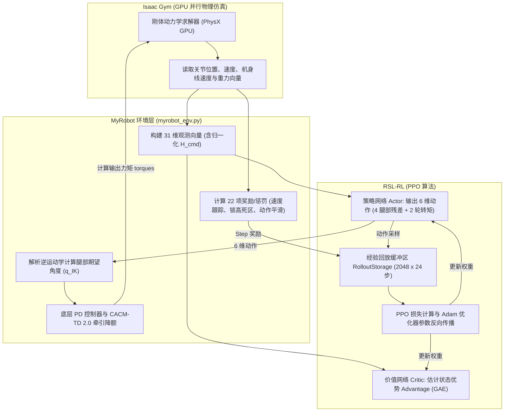
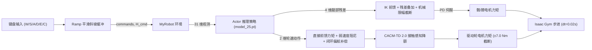

# MyRobot 双足轮足机器人强化学习使用手册与开发指南

> **面向初学者编写**：本手册专为具备 C++ 背景、初次接触 Python、NVIDIA Isaac Gym 与 PPO 强化学习的开发者设计。所有启动命令、配置变量、网络维度与模型路径均已通过工程源码静态核对与闭环运行验证。

---

## 目录

- [《MyRobot 常用命令速查表》](#myrobot-常用命令速查表)
- [第一章：项目简介](#第一章项目简介)
- [第二章：项目效果展示](#第二章项目效果展示)
- [第三章：运行环境](#第三章运行环境)
- [第四章：安装与环境配置教程](#第四章安装与环境配置教程)
- [第五章：快速启动（最快运行指南）](#第五章快速启动最快运行指南)
- [第六章：如何控制机器人（速度、转向与高度调节）](#第六章如何控制机器人速度转向与高度调节)
- [第七章：如何运行 PPO 训练](#第七章如何运行-ppo-训练)
- [第八章：如何加载不同模型与历史 Checkpoint](#第八章如何加载不同模型与历史-checkpoint)
- [第九章：项目目录与核心代码架构讲解](#第九章项目目录与核心代码架构讲解)
- [第十章：强化学习基础概念与机器人接口（31 维观测与 6 维动作）](#第十章强化学习基础概念与机器人接口31-维观测与-6-维动作)
- [第十一章：当前模型训练效果与能力边界（Phase 5.3 封版总结）](#第十一章当前模型训练效果与能力边界phase-53-封版总结)
- [第十二章：常见问题 FAQ 与故障排查](#第十二章常见问题-faq-与故障排查)

---

## 《MyRobot 常用命令速查表》

所有命令均在终端中执行。执行前请确保先执行**激活环境**命令。

| 操作需求 | 完整终端命令 | 运行目录 | 预期效果 |
| :--- | :--- | :--- | :--- |
| **1. 激活运行环境** | `source /home/xy/Documents/Codex/2026-10-05/chatgpt-conversation-6ac307b2-cac0-83ee-98c3/outputs/activate_rl.sh` | 任意目录 | 终端导入 Python 3.8、CUDA 11.3 与 Isaac Gym 环境变量 |
| **2. 进入工程根目录** | `cd /home/xy/IsaacTu` | 任意目录 | 进入强化学习工作空间主目录 |
| **3. 最快启动键盘交互遥控** | `python legged_gym/legged_gym/scripts/teleop.py --task=myrobot --load_run=Oct10_15-48-32_turning_height_stage5_3_formal --checkpoint=25` | `IsaacTu/` | 弹出 3D 视窗，加载封版最佳模型，可用键盘 WASD/EC 遥控运动与升降 |
| **4. 启动多机器人策略演示** | `python legged_gym/legged_gym/scripts/play.py --task=myrobot --load_run=Oct10_15-48-32_turning_height_stage5_3_formal --checkpoint=25` | `IsaacTu/` | 弹出 3D 视窗，展示 50 台机器人在平地上的自主巡航与平衡 |
| **5. 启动 PPO 强化学习训练** | `python legged_gym/legged_gym/scripts/train.py --task=myrobot --headless --num_envs=512 --max_iterations=50 --run_name=my_first_train` | `IsaacTu/` | 在后台使用 GPU 启动 512 个环境并行训练，终端打印 Loss 与 Reward |
| **6. 查看训练曲线 (TensorBoard)** | `tensorboard --logdir=legged_gym/logs/myrobot --port=6006` | `IsaacTu/` | 启动 Web 服务，浏览器访问 `http://localhost:6006` 查看收敛图表 |
| **7. 运行自动化闭环评测** | `python evaluation_assets/phase5_3/scripts/eval_phase5_3_stage1_comprehensive.py` | `IsaacTu/` | 无视窗自动化测试 16 种工况，输出速度/高度跟踪误差并生成 JSON |
| **8. 查看主基线模型文件** | `ls -lh legged_gym/logs/myrobot/Oct10_15-48-32_turning_height_stage5_3_formal/` | `IsaacTu/` | 列出正式封版训练目录中的 `model_25.pt` 及配置快照 |

---

## 第一章：项目简介

### 1.1 MyRobot 是什么？
**MyRobot** 是一款**双足轮足混合机器人（Bipedal Wheeled-Legged Robot）**。与传统的纯多足机器狗（如 ANYmal、Unitree A1）或纯轮式差速底盘不同，轮足机器人兼具了：
- **轮式移动的高效率与高速度**：在平坦地面通过驱动轮滚动，能量利用率极高；
- **足式关节的越障与姿态自适应能力**：拥有左右两条铰接机械腿，能够在行进过程中动态改变机身离地间隙（蹲起、伸展）、吸收路面颠簸，并在加速/减速/转弯时代偿惯性力矩。

### 1.2 仿真平台与算法
- **仿真引擎**：**NVIDIA Isaac Gym (Preview 4)**。
  > 💡 **特别提醒（初学者注意区分）**：本项目使用的是经典的、纯 GPU 并行的 **Isaac Gym**，底层基于 PhysX GPU 物理管线；**并非** 基于 Omniverse 的新版 Isaac Lab 或 Isaac Sim。
- **强化学习算法**：**PPO (Proximal Policy Optimization, 近端策略优化算法)**，由 ETH Zurich 的开源算法库 **RSL-RL** 实现。采用 Actor-Critic 架构，直接在 GPU 显存上完成动作采样与网络梯度反向传播。

### 1.3 机器人机械结构与自由度 (DOF)
机器人整机总质量为 **$22.0\text{ kg}$**（机身主体 $14.0\text{ kg}$，腿部与轮子合计 $8.0\text{ kg}$），由 1 个浮动基座和 2 条腿组成，包含 **6 个受控自由度**：

```text
               [ 机身浮动基座 Base Link (14.0 kg) ]
                 /                              \
       (左腿 Left Leg)                    (右腿 Right Leg)
     link_002_joint (左髋 Pitch)       link_005_joint (右髋 Pitch)
           |                                  |
     link_003_joint (左膝 Pitch)       link_006_joint (右膝 Pitch)
           |                                  |
     link_004_joint (左轮 Wheel)       link_007_joint (右轮 Wheel)
```

- **腿部（4 个转动关节）**：左髋、左膝、右髋、右膝。采用**解析逆运动学 (IK) 几何前馈 + PPO 策略残差微调 + 底层 PD 位置伺服**控制；
- **轮端（2 个连续旋转关节）**：左轮、右轮。采用**直接力矩前馈 + 弱轮速阻尼 + 闭环偏航补偿 + 接触感知牵引降额 (CACM-TD 2.0)** 控制。

### 1.4 当前已实现的控制功能
经过 Phase 1 到 Phase 5.3 的阶段演进，机器人目前已在仿真中具备以下能力：
1. **零速原地自平衡**：在 $v_y=0, \omega_z=0$ 时，如倒立摆般自主调整轮速与机身倾角保持直立不倒；
2. **稳定前后巡航**：支持平稳的前进行驶（最高标称 $0.3\text{ m/s}$，扩展测试达 $0.8\text{ m/s}$）与倒车后退；
3. **原地左右转向**：支持原地自旋掉头（左右轮反向差动）；
4. **复合转向巡航**：在以一定速度前行或后退的同时进行圆弧转向；
5. **原地动态升降**：在站立平衡状态下，机身高度在 $0.36\text{ m} \sim 0.44\text{ m}$ 之间平稳下蹲与挺起；
6. **行进中动态变高**：在前进/后退行驶过程中自主调节机身离地间隙；
7. **复合转向中动态变高**：在圆弧转向行驶过程中实现姿态平稳的下蹲与伸展。

> ⚠️ **严谨声明**：本项目当前所有成果均在 **Isaac Gym 物理仿真器** 中训练和验证。由于仿真尚未建立真实电机的热阻模型、减速器齿隙磨损模型以及总线通信延迟，**本项目成果尚未经过真实物理机器人的实机部署认证**。

---

## 第二章：项目效果展示

*(本章节为效果演示预留展示位。如果您在本地录制了图片或 GIF，建议放置在工程目录 `docs/images/` 下并在 Markdown 中引用。)*

### 2.1 仿真运行与控制演示
- **3D 仿真环境全局视角**：
  > `[占位说明：50 台 MyRobot 在 Isaac Gym 3D 平坦地形中并行平衡巡航画面]`  
  > 对应运行命令：`python legged_gym/legged_gym/scripts/play.py --task=myrobot`
- **键盘实时交互遥控 HUD**：
  > `[占位说明：终端打印速度、角速度、当前高度、俯仰角与轮速的实时 ASCII HUD 仪表盘]`  
  > 对应运行命令：`python legged_gym/legged_gym/scripts/teleop.py --task=myrobot`
- **动态高度调节演示（下蹲与挺起）**：
  > `[占位说明：机身高度从标称 0.398m 下蹲至 0.360m，双腿向后折叠而轮心接地位置保持不动的侧面动图]`
- **PPO 训练收敛曲线**：
  > `[占位说明：TensorBoard 中 Episode/rew_tracking_lin_vel 和 Episode/rew_base_height 随 50 轮迭代平稳收敛的曲线图]`

---

## 第三章：运行环境

本项目基于已配置完成的专用强化学习运行时。请核对以下环境参数：

### 3.1 核心依赖与版本

| 组件名称 | 规定版本 | 说明与依赖要求 |
| :--- | :--- | :--- |
| **操作系统** | Linux (Ubuntu 20.04 / 22.04 LTS x86_64) | 推荐使用原生 Linux 或具备独立 GPU 透传的系统 |
| **Python** | `3.8.20` (64-bit) | 由 conda-forge 打包的独立 Python 3.8 解释器 |
| **PyTorch** | `1.10.0+cu113` | 配合 CUDA 11.3 的稳定版 GPU PyTorch |
| **CUDA Driver & Toolkit** | `CUDA 11.3` (驱动版本 $\ge 470$) | 支持 NVIDIA Ampere/Turing 架构架构 |
| **仿真平台** | **Isaac Gym Preview 4** | Python 绑定模块为 `gym_38.so` |
| **编译工具** | `ninja 1.10+`, `gcc/g++ 9+` | 用于 PyTorch 运行时即时编译 `gymtorch` 扩展模块 |
| **GPU 硬件** | NVIDIA 独立显卡（当前为 RTX 3060 Ti） | 显存建议 $\ge 8\text{ GB}$，支持 PhysX GPU 加速 |

### 3.2 检查与验证命令
打开终端，运行以下命令快速检查当前环境是否满足要求：
```bash
# 1. 检查 NVIDIA 显卡驱动与 GPU 状态
nvidia-smi

# 2. 激活项目环境
source /home/xy/Documents/Codex/2026-10-05/chatgpt-conversation-6ac307b2-cac0-83ee-98c3/outputs/activate_rl.sh

# 3. 验证 Python、PyTorch、CUDA 及 Isaac Gym
python -c "
import isaacgym
import torch
print('✓ Python 解释器路径:', torch.__file__)
print('✓ PyTorch 版本:', torch.__version__)
print('✓ GPU 是否可用:', torch.cuda.is_available())
print('✓ 显卡型号:', torch.cuda.get_device_name(0))
print('✓ Isaac Gym 模块导入成功!')
"
```
预期输出中必须显示 `GPU 是否可用: True` 并且无任何报错。

> ⚠️ **C++ 初学者特别避坑指南：导入顺序禁忌**  
> 在 Isaac Gym 中，底层物理引擎由 C++ 编写并通过动态库加载。**在任何 Python 代码中，必须保证 `import isaacgym` 写在 `import torch` 之前！**  
> 如果颠倒顺序（先 `import torch` 后 `import isaacgym`），会导致底层的 CUDA Context 与动态符号冲突，程序将直接抛出 `ImportError: PyTorch was imported before isaacgym modules` 并异常退出。

---

## 第四章：安装与环境配置教程

如果您在一台新设备或新的终端窗口中配置本项目，请按照以下步骤逐步操作：

### 步骤 1：获取项目代码与定位目录
本项目已部署在本地目录 `/home/xy/IsaacTu`：
```bash
cd /home/xy/IsaacTu
pwd
# 预期输出: /home/xy/IsaacTu
```

### 步骤 2：激活预配置的强化学习运行时
本项目使用经过严格依赖锁定的独立运行环境，无需重新从外网下载数十个易冲突的依赖库。运行以下命令即可激活：
```bash
source /home/xy/Documents/Codex/2026-10-05/chatgpt-conversation-6ac307b2-cac0-83ee-98c3/outputs/activate_rl.sh
```
> 🔍 **这个激活脚本做了什么？（C++ 视角类比）**：  
> 该脚本类似于在构建时配置 `CMAKE_PREFIX_PATH` 和环境变量：
> - 将 Python 3.8 及 `ninja` 所在目录追加到 `PATH`；
> - 将 `libpython3.8.so` 追加到动态链接库路径 `LD_LIBRARY_PATH`；
> - 设置 `TORCH_EXTENSIONS_DIR` 目录，防止每次重新编译 `gymtorch` 导致显存碎片。

### 步骤 3：验证 Isaac Gym 模块正常工作
```bash
python -c "import isaacgym; from isaacgym import gymapi; print('Isaac Gym API 初始化正常!')"
```
如果输出 `Isaac Gym API 初始化正常!`，说明底层物理库加载无误。

### 步骤 4：验证 MyRobot 任务是否注册成功
在 `legged_gym` 框架中，所有机器人任务都在 [`legged_gym/envs/__init__.py`](file:///home/xy/IsaacTu/legged_gym/legged_gym/envs/__init__.py) 中注册。运行以下测试命令：
```bash
python -c "
import isaacgym
from legged_gym.envs import *
from legged_gym.utils import task_registry
print('已注册任务列表:', list(task_registry.task_classes.keys()))
assert 'myrobot' in task_registry.task_classes, 'myrobot 任务未注册!'
print('✓ MyRobot 任务注册核查通过!')
"
```
预期输出中将包含 `'myrobot'`，并打印 `✓ MyRobot 任务注册核查通过!`。

---

## 第五章：快速启动（最快运行指南）

这是让您在 **10 秒钟内** 亲眼看到机器人平衡和运动的最快途径！

### 5.1 🚀 三步最快启动（复制即可运行）

打开终端，依次执行以下 3 条命令：
```bash
# 第 1 步：进入工程根目录
cd /home/xy/IsaacTu

# 第 2 步：激活环境
source /home/xy/Documents/Codex/2026-10-05/chatgpt-conversation-6ac307b2-cac0-83ee-98c3/outputs/activate_rl.sh

# 第 3 步：启动实时键盘交互遥控器，加载 Phase 5.3 正式封版模型
python legged_gym/legged_gym/scripts/teleop.py --task=myrobot --load_run=Oct10_15-48-32_turning_height_stage5_3_formal --checkpoint=25
```

### 5.2 预期看到的现象
1. **弹出 3D 渲染窗口**：Isaac Gym 仿真窗口打开，一台双足轮足机器人平稳直立在网格地面中央；
2. **终端输出控制面板**：终端打印 HUD 仪表盘，显示当前速度、期望速度、机身高度与关节状态；
3. **机器人保持自平衡**：双轮轻微自主调整转动，机身保持在标称站立高度（约 $0.398\text{ m}$），左右无侧倾。

### 5.3 动手操作机器人！
在键盘上按下以下按键（**既可以在终端窗口直接按，也可以点击 3D 仿真窗口后按**）：
- 按 **`W`**：前进加速（机器人向前行驶）；
- 按 **`S`**：减速 / 倒车（机器人减速并向后行驶）；
- 按 **`A`**：向左旋转（机器人逆时针旋转掉头）；
- 按 **`D`**：向右旋转（机器人顺时针旋转掉头）；
- 按 **`C`**：**下蹲（机身高度下降）**；
- 按 **`E`**：**升高（机身高度上升）**；
- 按 **`Space`（空格键）**：**紧急刹车**（速度指令归零，就地保持平衡）；
- 按 **`R`**：重置机器人回到原点；
- 按 **`Q`**：正常退出程序。

### 5.4 另一种演示模式：多机器人集群演示 (`play.py`)
如果您想查看没有键盘输入时，策略网络在 50 台并行机器人上的随机巡航效果：
```bash
python legged_gym/legged_gym/scripts/play.py --task=myrobot --load_run=Oct10_15-48-32_turning_height_stage5_3_formal --checkpoint=25
```
> 💡 **`teleop.py` 与 `play.py` 的区别**：
> - `teleop.py`：仅生成 1 台机器人，专为**单人键盘交互遥控驾驶**设计，屏蔽了内部随机指令重采样；
> - `play.py`：默认生成 50 台机器人，采用固定随机种子与自动漫游镜头，用于观察大批量机器人的统计存活率。

---

## 第六章：如何控制机器人（速度、转向与高度调节）

### 6.1 核心控制参数解析
对于熟悉 C++ 的开发者，机器人的运动控制输入相当于如下结构体：
```cpp
struct RobotCommand {
    float lin_vel_y;    // 纵向线速度 (Forward/Backward Velocity)，单位：m/s (米/秒)
    float ang_vel_yaw;  // 偏航角速度 (Yaw Angular Velocity)，单位：rad/s (弧度/秒)
    float height_cmd;   // 机身目标高度 (Target Base Height)，单位：m (米)
};
```

1. **纵向速度 $v_y$ (`lin_vel_y`)**：
   - $> 0$：向前直线行驶；
   - $< 0$：向后倒退行驶；
   - 坐标系约定：机器人的前进方向为局部坐标系的 $+Y$ 轴。
2. **偏航角速度 $\omega_z$ (`ang_vel_yaw`)**：
   - $> 0$：向左转弯（逆时针自旋）；
   - $< 0$：向右转弯（顺时针自旋）。
3. **机身目标高度 $H_{\text{cmd}}$ (`height_cmd`)**：
   - 标称平衡高度：**$0.398\text{ m}$**；
   - 最低下蹲极限：**$0.360\text{ m}$**；
   - 最高伸展极限：**$0.440\text{ m}$**。

### 6.2 典型工况与控制量对照表

| 目标运动行为 | 纵向速度 $v_y$ (m/s) | 偏航角速度 $\omega_z$ (rad/s) | 目标高度 $H_{\text{cmd}}$ (m) | 说明 |
| :--- | :---: | :---: | :---: | :--- |
| **1. 原地静止平衡** | `0.0` | `0.0` | `0.398` | 双轮微调，保持标称高度静态站立 |
| **2. 匀速向前行驶** | `+0.25` | `0.0` | `0.398` | 机身轻微前倾以提供牵引力，平稳巡航 |
| **3. 匀速倒车后退** | `-0.20` | `0.0` | `0.398` | 机身后仰提供制动力，向后平稳倒退 |
| **4. 原地向左旋转** | `0.0` | `+0.30` | `0.398` | 左右轮反向旋转，机身就地掉头 |
| **5. 原地低趴下蹲** | `0.0` | `0.0` | `0.360` | 双腿后折下蹲，机身平稳下降约 3.8 cm |
| **6. 原地高位站立** | `0.0` | `0.0` | `0.440` | 双腿伸展挺拔，离地间隙显著增加 |
| **7. 行进中下蹲巡航** | `+0.20` | `0.0` | `0.360` | 前进同时保持低重心，抗颠簸稳定性高 |
| **8. 复合左转升降** | `+0.15` | `+0.25` | `0.420` | 边向前边转弯，同时抬高机身通过障碍 |

### 6.3 这些控制指令在源码中由哪里决定？
根据您的使用场景，指令来源不同：
1. **交互遥控时**：在 [`teleop.py`](file:///home/xy/IsaacTu/legged_gym/legged_gym/scripts/teleop.py#L132) 的 `target_ctrl` 字典中实时修改，经过内部的 Ramp 加速度斜坡平滑器后，写入 `env.commands[:, 1]` 与 `env.height_cmd_buf[:]`；
2. **强化学习训练时**：在 [`myrobot_config.py`](file:///home/xy/IsaacTu/legged_gym/legged_gym/envs/myrobot/myrobot_config.py#L46-L51) 的 `class commands.ranges` 中配置均匀分布采样范围；
3. **离线独立评估时**：在 [`evaluation_assets/phase5_3/scripts/eval_phase5_3_stage1_comprehensive.py`](file:///home/xy/IsaacTu/evaluation_assets/phase5_3/scripts/eval_phase5_3_stage1_comprehensive.py) 中的场景列表中固定给入。

### 6.4 已验证的控制能力范围

| 控制维度 | 训练覆盖范围 (Training Range) | 已验证扩展测试范围 (Test Range) | 边界警示 |
| :--- | :---: | :---: | :--- |
| **纵向速度 $v_y$** | $[-0.30, +0.30]\text{ m/s}$ | $[-0.60, +0.80]\text{ m/s}$ | 超过 $\pm 0.8\text{ m/s}$ 时可能触发轮端饱和 |
| **偏航角速度 $\omega_z$** | $[-0.50, +0.50]\text{ rad/s}$ | $[-1.00, +1.00]\text{ rad/s}$ | 超过 $\pm 1.0\text{ rad/s}$ 时离心力会导致单轮离地 |
| **机身目标高度 $H$** | $[0.360, 0.440]\text{ m}$ | $[0.355, 0.445]\text{ m}$ | 低于 $0.355\text{ m}$ 会触碰机械臂物理死点 |

---

## 第七章：如何运行 PPO 训练

### 7.1 启动新训练完整命令
进入项目根目录并激活环境后，执行：
```bash
python legged_gym/legged_gym/scripts/train.py \
  --task=myrobot \
  --headless \
  --num_envs=512 \
  --max_iterations=50 \
  --run_name=my_first_train
```
- `--headless`：关闭 3D 图形渲染，全部计算集中在 GPU，训练速度可提升 10 倍以上；
- `--num_envs=512`：同时开启 512 个并行机器人（根据您的显存大小调整，RTX 3060 Ti 推荐 512~2048）；
- `--max_iterations=50`：设定本次训练执行 50 轮 PPO 迭代；
- `--run_name=my_first_train`：为本次实验指定唯一名称。所有日志与模型将保存在 `legged_gym/logs/myrobot/<当前时间>_my_first_train/` 下。

### 7.2 核心配置参数详解（C++ 类比）

所有算法配置均位于 [`legged_gym/envs/myrobot/myrobot_config.py`](file:///home/xy/IsaacTu/legged_gym/legged_gym/envs/myrobot/myrobot_config.py)：

```python
class MyRobotCfgPPO(LeggedRobotCfgPPO):
    class algorithm(LeggedRobotCfgPPO.algorithm):
        learning_rate = 2.5e-4      # Adam 优化器学习率
        num_learning_epochs = 5    # 每批采样数据用于梯度下降的更新轮数
        num_mini_batches = 4       # 将采样数据切分为 4 个 Mini-batch
        clip_param = 0.2           # PPO 信任域裁剪系数 epsilon

    class runner(LeggedRobotCfgPPO.runner):
        num_steps_per_env = 24     # 每个环境单轮采集步数 (总采样样本数 = num_envs * 24)
        max_iterations = 50        # 总训练迭代轮数
        save_interval = 5          # 每隔 5 轮迭代保存一次 checkpoint (model_5.pt, model_10.pt...)
        resume = False             # 是否完全恢复中断的训练 (包含优化器状态)
        warm_start = True          # 是否热启动 (仅继承神经网络权重，重置优化器)
```

- **`num_envs`（并行环境数）**：类似 C++ 中的并发线程数或 GPU CUDA Block 数量。512 个环境意味着同时有 512 台机器人在采集经验；
- **`learning_rate`（学习率）**：标称值为 $2.5\times 10^{-4}$。在策略微调时切忌随意调大，过大的学习率会摧毁已有的平衡能力；
- **`save_interval`（保存间隔）**：每隔几轮在磁盘上保存一次 `.pt` 模型文件；
- **`warm_start` 与 `resume` 的区别**：
  - `resume=True`：从某次训练的特定 Checkpoint 恢复，**同时恢复网络权重和 Adam 优化器的内部动量**，迭代步数接着累加；
  - `warm_start=True`：**仅将网络权重初始化为已有的 `.pt` 模型**，优化器重新初始化，迭代步数归零。常用于跨任务课程学习（如将平衡模型迁移到变高任务中）。

### 7.3 查看训练曲线 (TensorBoard)
在训练过程中或训练结束后，在终端输入：
```bash
tensorboard --logdir=legged_gym/logs/myrobot --port=6006
```
打开浏览器访问 `http://localhost:6006`，可以实时观察以下关键曲线：
- **`Episode/rew_tracking_lin_vel`**：纵向速度跟踪奖励（应逐渐上升趋于 0）；
- **`Episode/rew_base_height`**：高度跟踪惩罚（负数，越接近 0 说明高度跟踪越精准）；
- **`Train/mean_episode_length`**：平均存活步数（最大为 1000 步，越接近 1000 说明机器人越不摔倒）；
- **`Loss/value_function`**：价值网络损失（应在小幅震荡后平稳下降）。

### 7.4 如何安全停止训练
在运行 `train.py` 的终端中直接按下 **`Ctrl + C`** 即可。程序会捕获中断信号并安全退出，不会损坏已保存的 `.pt` 文件。

> ⚠️ **新手特别提示：保护正式封版模型**  
> 主基线模型（Phase 5.3 Formal `model_25.pt`）是经过数万样本交叉验证的基准。**新训练请务必通过 `--run_name` 指定新的实验名称，绝对不要直接覆盖历史日志目录！**

---

## 第八章：如何加载不同模型与历史 Checkpoint

### 8.1 `.pt` 文件究竟是什么？
在 PyTorch 中，`.pt` 文件是序列化保存的二进制字典（类似 C++ 中用 `std::ofstream` 序列化的二进制快照）。通过读取 `model_25.pt`，其内部实际包含：
```text
{
    'model_state_dict': { ... },     # Actor 网络与 Critic 网络的全部权重 (Weight) 与偏置 (Bias)
    'optimizer_state_dict': { ... }, # Adam 优化器的一阶动量与二阶方差缓冲
    'iter': 25,                      # 保存该模型时的训练迭代轮数
    'infos': None                    # 附加运行元数据
}
```

### 8.2 当前正式封版的主基线模型
- **模型绝对路径**：
  [`legged_gym/logs/myrobot/Oct10_15-48-32_turning_height_stage5_3_formal/model_25.pt`](file:///home/xy/IsaacTu/legged_gym/logs/myrobot/Oct10_15-48-32_turning_height_stage5_3_formal/model_25.pt)
- **SHA256 校验码**：`d67474d0e47f908a8c863e605b8d5de7ea1bd9f89f41d2c303fbef33d963536c`
- **文件大小**：约 $4.16\text{ MB}$ (4,360,524 字节)

### 8.3 历史模型目录命名规则
历史运行目录均存放在 `legged_gym/logs/myrobot/` 下，命名格式统一为：
`MonthDay_Hour-Minute-Second_任务标识`
例如：
- `Oct10_15-48-32_turning_height_stage5_3_formal/`：Phase 5.3 Stage 1 正式 50 轮训练目录；
- `Oct10_16-13-43_turning_height_stage5_3_stage2_seg1/`：Phase 5.3 Stage 2 首段 25 轮扩展探索目录；
- `Oct10_18-20-47_phase5_3_height_deadzone_A_015/`：高度死区 0.015m 对照实验组。

### 8.4 如何切换不同 Checkpoint 进行对比测试？
在运行 `teleop.py` 或 `play.py` 时，直接通过命令行参数指定 `--load_run` 和 `--checkpoint`：
```bash
# 加载 Stage 1 第 10 轮模型 (model_10.pt)
python legged_gym/legged_gym/scripts/play.py --task=myrobot \
  --load_run=Oct10_15-48-32_turning_height_stage5_3_formal \
  --checkpoint=10

# 加载 Stage 1 第 25 轮主基线模型 (model_25.pt - 推荐)
python legged_gym/legged_gym/scripts/play.py --task=myrobot \
  --load_run=Oct10_15-48-32_turning_height_stage5_3_formal \
  --checkpoint=25

# 加载 Stage 1 第 50 轮模型 (model_50.pt)
python legged_gym/legged_gym/scripts/play.py --task=myrobot \
  --load_run=Oct10_15-48-32_turning_height_stage5_3_formal \
  --checkpoint=50
```

> 💡 **重要经验（不要以训练轮数论英雄）**：  
> 在强化学习中，**训练轮数越多的模型不一定越好！** 在微调后期，PPO 可能会发生策略过拟合、动作分布漂移或旧技能遗忘。独立评估证实，Stage 1 的 `model_25` 在高度跟踪精度与抗侧翻稳定性上均显著优于 `model_50`。因此，我们将其冻结为主基线。

---

## 第九章：项目目录与核心代码架构讲解

### 9.1 工程真实文件树结构
```text
/home/xy/IsaacTu/
├── activate_env.sh (文档引用)  # 环境激活引导说明
├── README.md                   # 根目录总览文档
├── README_MYROBOT.md           # 本文档 (MyRobot 完整使用手册)
│
├── isaacgym/                   # NVIDIA Isaac Gym Preview 4 物理引擎
│   └── python/isaacgym/        # Python 接口绑定 (gymapi, gymtorch)
│
├── legged_gym/                 # 机器人强化学习环境与训练框架
│   └── legged_gym/
│       ├── envs/
│       │   ├── __init__.py     # 任务注册表入口 (注册 "myrobot" 任务)
│       │   ├── base/           # 强化学习基础环境基类 (LeggedRobot)
│       │   └── myrobot/        # ★ MyRobot 专属实现目录 ★
│       │       ├── myrobot_env.py    # 环境动力学、观测、奖励与控制器
│       │       └── myrobot_config.py # 物理参数、超参数与 PPO 配置
│       ├── logs/myrobot/       # 历史训练 Checkpoint、TensorBoard 与快照
│       ├── resources/robots/myrobot/myrobot_urdf/
│       │       └── robot.urdf  # 机器人 URDF 机械结构与关节物理定义
│       ├── scripts/            # 执行入口
│       │   ├── train.py        # 训练主入口
│       │   ├── play.py         # 多机演示与评测入口
│       │   └── teleop.py       # 键盘交互遥控器 (WASD + 升降)
│       └── utils/
│           ├── task_registry.py # 环境创建与 Runner 工厂
│           └── helpers.py      # 命令行参数解析 (get_args)
│
├── rsl_rl/                     # ETH 高性能 GPU 强化学习算法库
│   └── rsl_rl/
│       ├── algorithms/ppo.py   # PPO 算法实现 (更新与梯度裁剪)
│       ├── modules/            # Actor-Critic MLP 神经网络结构
│       ├── runners/            # OnPolicyRunner 训练流程控制器
│       └── storage/            # GPU 显存 Rollout 经验回放缓冲区
│
└── evaluation_assets/phase5_3/ # 封版持久化评估与诊断资产包
    ├── README.md               # 评测资产索引与 SHA256 校验清单
    ├── scripts/                # 9 个独立评估与动力学诊断脚本
    └── results/                # 9 个评估输出的原始 JSON 数据
```

### 9.2 核心模块类与调用关系（C++ 类比）

1. **环境类 `MyRobot`** ([`myrobot_env.py`](file:///home/xy/IsaacTu/legged_gym/legged_gym/envs/myrobot/myrobot_env.py))：
   - 继承自 `LeggedRobot`（类比 C++ `class MyRobot : public LeggedRobot`）；
   - 实现了 31 维观测提取函数 `compute_observations()`；
   - 实现了 22 项复合奖励函数（如 `_reward_tracking_lin_vel`, `_reward_base_height`）；
   - 实现了执行器混合控制管线 `_compute_torques()`。
2. **配置类 `MyRobotCfg` 与 `MyRobotCfgPPO`** ([`myrobot_config.py`](file:///home/xy/IsaacTu/legged_gym/legged_gym/envs/myrobot/myrobot_config.py))：
   - 采用嵌套类作为配置字典（类比 C++ 的配置命名空间 `namespace Config`）；
   - 统一定义物理刚度 Kp/Kd、指令范围、URDF 限幅与奖励权重。
3. **策略网络与价值网络 `ActorCritic`** (`rsl_rl/modules/actor_critic.py`)：
   - 多层感知机 MLP（全连接网络，隐藏层结构 `[512, 256, 128]`，激活函数为 ELU）；
   - Actor 负责输入 31 维观测向量，输出 6 维动作均值 $\mu$ 与可学习方差 $\sigma$；
   - Critic 负责输入观测向量，输出 1 维状态价值 $V(s)$。
4. **训练调度器 `OnPolicyRunner`** (`rsl_rl/runners/on_policy_runner.py`)：
   - 协调环境步进、经验存储、损失计算、TensorBoard 日志记录与 Checkpoint 存取。

### 9.3 训练与推理流程图

#### 训练闭环流程图 (Training Pipeline)


#### 推理控制流程图 (Inference Pipeline / `teleop.py`)


---

## 第十章：强化学习基础概念与机器人接口（31 维观测与 6 维动作）

对于 C++ 初学者，理解强化学习的本质就像理解一个**高频闭环反馈控制系统**：
- **Observation (观测)**：输入传感器的测量值（类似于 C++ 控制循环中读取的编码器和 IMU 结构体）；
- **Action (动作)**：控制器输出的期望指令（类似于输出给电机的期望位置或前馈力矩）；
- **Reward (奖励)**：损失函数 (Loss Function) 的反面，用于告诉算法当前行为是好是坏（标量，数值越高越受鼓励）；
- **Actor (策略网络)**：真正的控制器函数 `Action = Actor(Observation)`；
- **Critic (价值网络)**：评估当前状态“前景如何”的评估器，仅在训练时使用，部署推理时丢弃；
- **Episode (回合)**：一次完整的任务过程（如果机器人摔倒或机身触地，当前回合提前终止 (Done)，环境自动复位 Reset）；
- **Domain Randomization (域随机化)**：在训练时随机扰动地面摩擦力、机身质量与外力推扰，增强策略在不同环境下的鲁棒性。

### 10.1 MyRobot 31 维观测向量逐维定义
源码依据：[`myrobot_env.py` 中的 `compute_observations()`](file:///home/xy/IsaacTu/legged_gym/legged_gym/envs/myrobot/myrobot_env.py#L387-L405)。

| 索引范围 | 维度 | 物理含义 | 缩放系数 (Scale) | 说明与物理单位 |
| :---: | :---: | :--- | :---: | :--- |
| `[0:3]` | 3 | 机身线速度 $[v_x, v_y, v_z]$ | $\times 2.0$ | 局部坐标系，单位 $\text{m/s}$。$v_y$ 为前进速度 |
| `[3:6]` | 3 | 机身角速度 $[\omega_x, \omega_y, \omega_z]$ | $\times 0.25$ | 局部坐标系，单位 $\text{rad/s}$。反映机身滚转、俯仰与偏航速率 |
| `[6:9]` | 3 | 重力投影向量 $[g_x, g_y, g_z]$ | $\times 1.0$ | 机身姿态四元数旋转后的重力方向，反映倾角 |
| `[9:12]` | 3 | 目标指令 $[v_{x,\text{cmd}}, v_{y,\text{cmd}}, \omega_{z,\text{cmd}}]$ | 速度 $\times 2.0$, 偏航 $\times 0.25$ | 上层给定的期望速度与旋转指令 |
| `[12:18]` | 6 | 关节位置偏差 $(q - q_{\text{default}})$ | $\times 1.0$ | 相对默认零位的位置偏差，**双轮通道强制置零** |
| `[18:24]` | 6 | 关节角速度 $\dot{q}$ | $\times 0.05$ | 6 个关节的转速，单位 $\text{rad/s}$ |
| `[24:30]` | 6 | 上一时刻动作反馈 `filtered_actions` | $\times 1.0$ | 经一阶低通滤波后的上一时刻动作输出 |
| `[30]` | 1 | **归一化机身高度指令** | 标度计算 | 计算公式：$(H_{\text{cmd}} - 0.40) / 0.15$ |

### 10.2 MyRobot 6 维动作向量物理映射
源码依据：[`robot.urdf`](file:///home/xy/IsaacTu/legged_gym/resources/robots/myrobot/myrobot_urdf/robot.urdf) 与 [`myrobot_env.py` 中的 `_compute_torques()`](file:///home/xy/IsaacTu/legged_gym/legged_gym/envs/myrobot/myrobot_env.py#L425-L465)。

| 动作索引 | 关联关节名 | 关节功能 | 最终物理控制方式与执行链路 |
| :---: | :--- | :--- | :--- |
| `action[0]` | `link_002_joint` | **左髋俯仰关节 (Left Hip)** | $q_{\text{target}} = q_{\text{default}} + q_{1,\text{IK}} + 0.25 \times 0.7 \times a_0$，执行 PD 位置伺服 |
| `action[1]` | `link_003_joint` | **左膝俯仰关节 (Left Knee)** | $q_{\text{target}} = q_{\text{default}} + q_{2,\text{IK}} + 0.25 \times 0.5 \times a_1$，执行 PD 位置伺服 |
| `action[2]` | `link_004_joint` | **左驱动轮 (Left Wheel)** | $\tau_{\text{ff}} = 7.0 \times \text{clamp}(a_2, -1, 1)$，执行前馈力矩 + CACM 降额 + 闭环偏航补偿 |
| `action[3]` | `link_005_joint` | **右髋俯仰关节 (Right Hip)** | $q_{\text{target}} = q_{\text{default}} + q_{1,\text{IK}} + 0.25 \times 0.7 \times a_3$，执行 PD 位置伺服 |
| `action[4]` | `link_006_joint` | **右膝俯仰关节 (Right Knee)** | $q_{\text{target}} = q_{\text{default}} + q_{2,\text{IK}} + 0.25 \times 0.5 \times a_4$，执行 PD 位置伺服 |
| `action[5]` | `link_007_joint` | **右驱动轮 (Right Wheel)** | $\tau_{\text{ff}} = 7.0 \times \text{clamp}(a_5, -1, 1)$，执行前馈力矩 + CACM 降额 + 闭环偏航补偿 |

---

## 第十一章：当前模型训练效果与能力边界（Phase 5.3 封版总结）

本项目在 Phase 5.3 完成了系统性测试与阶段封版，推荐使用的核心模型为 **Stage 1 Formal `model_25.pt`**。

### 11.1 名义工况测试表现 (Stage 1 Formal 评估)
在标准平地、标称速度范围内的闭环测试中：
- **存活率 (Episode Survival Rate)**：**$100\%$**（名义测试工况下 0 摔倒，无机身触地重置）；
- **速度跟踪误差 (Velocity RMS Error)**：$< 0.035\text{ m/s}$（指令与实际速度高度贴合）；
- **偏航角速度误差 (Yaw Rate RMS Error)**：$< 0.045\text{ rad/s}$（直行无跑偏，转向响应灵敏）；
- **机身俯仰抖动 (Pitch RMS)**：$< 1.5^\circ$（行驶平稳，无肉眼可见抽搐）；
- **关节力矩裕度**：膝关节闭环最大峰值力矩实测约为 $30.1\text{ Nm}$（URDF 与软件限幅为 $60.0\text{ Nm}$，具有近 $50\%$ 的安全裕度）。

### 11.2 当前仍然存在的控制不足与能力边界
为保持工程客观严谨，初学者在使用和后续开发中需了解以下已知限制：
1. **左转下蹲工况的高度静差（约 1.72 cm）**：
   - **现象**：当机器人同时执行“前进 + 较大角速度左转 + 下蹲至最低 0.36m”时，实际稳态高度约为 $0.377\text{ m}$，比目标高约 $1.7\text{ cm}$；
   - **原因**：大转角下外侧轮承受更大推力，为抵抗离心倾覆力矩，网络选择保留轻微腿部支撑高度以防侧翻；
2. **大曲率转向时轮端力矩饱和**：
   - 驱动轮电机的物理峰值力矩为 $7.0\text{ Nm}$。在急剧转向叠加减速时，差动力矩可能短时达到 $7.0\text{ Nm}$ 饱和边界；
3. **工作空间覆盖性界定**：
   - 目前在 21 个已定义的代表性测试点上验证了稳定存活，但**不能等同于在极端速度与极端转角的任意连续组合下都具备理论保证**。

---

## 第十二章：常见问题 FAQ 与故障排查

### Q1: 运行脚本时报错 `ImportError: PyTorch was imported before isaacgym modules`
- **原因**：Python 脚本导入模块顺序颠倒。
- **解决方法**：检查脚本开头，确保 `import isaacgym` 严格位于 `import torch` 之前。

### Q2: 报错 `ImportError: libpython3.8.so.1.0: cannot open shared object file`
- **原因**：未加载正确的动态链接库环境变量。
- **解决方法**：运行 `source /home/xy/Documents/Codex/2026-10-05/chatgpt-conversation-6ac307b2-cac0-83ee-98c3/outputs/activate_rl.sh` 即可自动修复 `LD_LIBRARY_PATH`。

### Q3: 报错 `RuntimeError: Ninja is required to load C++ extensions`
- **原因**：找不到 `ninja` 编译工具，导致 PyTorch 无法即时编译 `gymtorch`。
- **解决方法**：确保已激活环境，此时 `ninja` 所在路径 `/home/xy/Documents/Codex/.../rl-runtime/env/bin` 会被加入系统 `PATH`。

### Q4: 提示找不到任务 `ValueError: Unrecognized task: myrobot`
- **原因**：未在 `task_registry` 中导入 `MyRobot`。
- **解决方法**：核对 [`legged_gym/envs/__init__.py`](file:///home/xy/IsaacTu/legged_gym/legged_gym/envs/__init__.py) 是否包含 `task_registry.register("myrobot", ...)`。

### Q5: 提示找不到 Checkpoint 文件 `No runs in this directory`
- **原因**：`--load_run` 指定的目录名错误或拼写有误。
- **解决方法**：使用 `ls legged_gym/logs/myrobot/` 查看本地存在的真实运行目录，并核对目录名称。

### Q6: 仿真 3D 窗口黑屏或无法弹出
- **原因**：可能通过没有 X11 图形转发的纯 SSH 终端远程连接，或者在命令中添加了 `--headless`。
- **解决方法**：在本地物理桌面终端运行，且不要添加 `--headless` 参数；如在远程服务器需配置 VNC 或支持 OpenGL 硬件加速的 X11 转发。

### Q7: 机器人一启动就立刻摔倒
- **原因**：
  1. 加载了未训练完全的早期 Checkpoint（如未经训练的随机模型）；
  2. 设定的初速度或高度指令超出了可达范围。
- **解决方法**：确认加载的是封版主基线 `--load_run=Oct10_15-48-32_turning_height_stage5_3_formal --checkpoint=25`。

### Q8: 为什么训练时 Reward（奖励）上升，但机器人在视窗里反而姿态难看？
- **原因**：这是强化学习常见的“奖励博弈（Reward Hacking）”现象。策略可能通过剧烈高频抽搐来赚取某种过渡奖励。
- **解决方法**：检查 `myrobot_config.py` 中的 `action_rate`（动作平滑罚分）与 `torques` 惩罚项权重。

### Q9: 训练过程太慢怎么办？
- **解决方法**：
  1. 必须开启 `--headless` 关闭视窗渲染；
  2. 适当增大并行环境数量 `--num_envs=1024` 或 `2048`，充分利用 GPU 并行能力；
  3. 确认显卡处于高性能电源模式（`nvidia-smi -q -d PERFORMANCE`）。

### Q10: 遥控脚本 `teleop.py` 按键无反应
- **原因**：焦点未位于正确的终端窗口，或者 CapsLock 大写锁定键开启。
- **解决方法**：确保终端窗口处于当前选中激活状态；关闭大写锁定，使用小写 `w/s/a/d` 输入。
