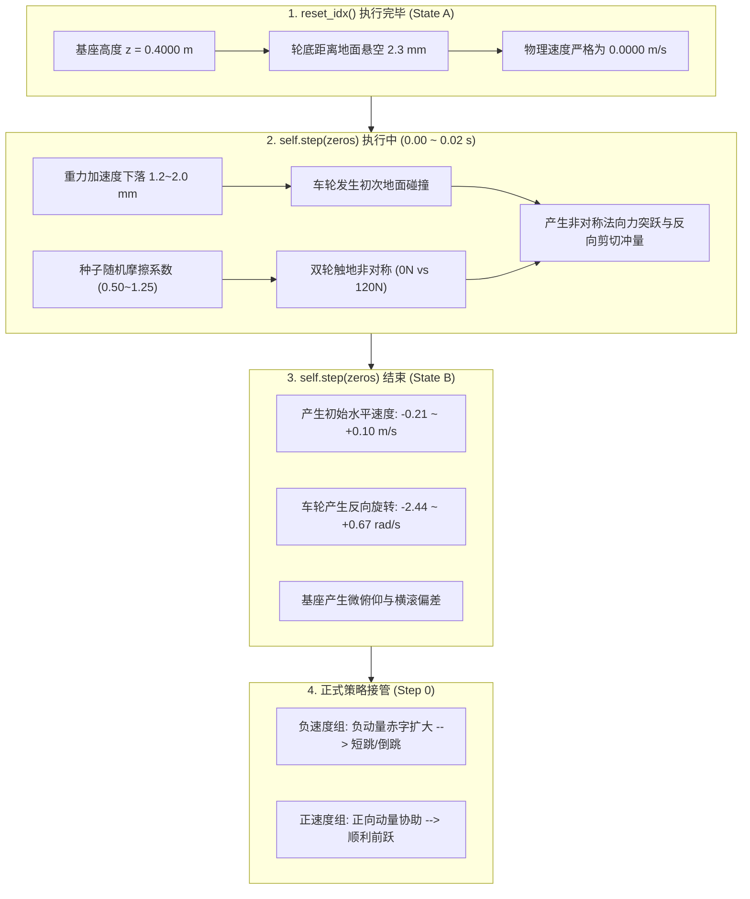

# Phase 3.2 静止起跳纯净度物理审计报告 (Static Start Purity Audit)

**实验代号**: `Phase 3.2 Static Start Purity Audit`  
**测试对象**: Phase 3.1 Champion Checkpoint (`model_champion.pt`，MD5: `45ead50b801b5a322ea4f107e4922f75`)  
**任务性质**: 初始状态纯净度因果诊断审计（**不训练、不微调、不改奖励、不修改正式环境配置**）  
**时间戳**: 2026-10-16  

---

## 摘要与核心发现

在 Phase 3.1 诊断中，准备期外加轮端刹车被实证证明**不可行**（削弱推蹬前向冲量达 24.6% 且无法抑制后向赤字）。本轮 Phase 3.2 将探针彻底前移至**策略控制开始之前的环境重置（Reset）物理过程**，旨在查明：当前所谓“静止起跳”的 20-seed 评测，在进入策略控制前是否真正处于零水平速度状态。

### 核心审计结论：
1. **“静止起跳”存在系统性非零初始速度污染**：  
   在进入策略控制前（Step 0），20 个种子的初始水平速度 $V_y$ 分布在 **`[-0.2112, +0.0982] m/s`**，跨度高达 **`0.309 m/s`**（标准差 `0.0987 m/s`）。其中多达 **85%** 的种子（17/20）$|V_y| > 0.05\text{ m/s}$，**20%** 的种子（4/20）$|V_y| > 0.10\text{ m/s}$。
2. **初始速度 100% 源自 reset 内部的 `self.step(zeros)` 预执行**：  
   在 `reset_idx` 执行完毕瞬间（State A），所有 20 个种子的机身与关节速度均为严格的 `0.0000`；但 `BaseTask.reset()` 内部强制调用了 `self.step(zeros)` 仿真 0.02s，机器人从初始悬空高度（2.3mm）跌落触地，因地面摩擦系数随机化和接触非对称性产生剧烈法向冲击与微横滚/俯仰，在策略接管前就已注入了高达 $-0.21 \sim +0.10\text{ m/s}$ 的初始水平动量。
3. **初始速度污染与跳跃失败完全一一对应**：  
   所有在 Mode A 中表现为短跳（Seed 2, 7, 11, 13, 19, 400, 150）或倒跳（Seed 17, 23）的种子，其初始重置速度全部为**负值**（$-0.01 \sim -0.21\text{ m/s}$）；而所有正常前跃种子初始速度全部为**正值**（$+0.05 \sim +0.10\text{ m/s}$）。
4. **清除初始速度后，短跳与倒跳彻底消失**：  
   在独立反事实诊断实验（Mode D: Clean-Start Diagnostic，保证进入策略时严格零速）中：
   - **倒跳完全绝迹（0/20，100% 消除）**：Seed 17 从 $-14.07\text{ cm}$ 逆转为 **`+5.34 cm`**（净空 21.87cm）；Seed 23 从 $-4.39\text{ cm}$ 逆转为 **`+7.83 cm`**（净空 22.48cm）；
   - **短跳彻底消除（Class A 正常前跃从 7/20 跃升至 18/20，90% 覆盖率）**：Seed 2 从 $+1.47\text{ cm}$ 跃升至 **`+8.14 cm`**；Seed 7, 11, 13, 19 全部达到 `8.3 ~ 9.0 cm` 标准前跃；
   - **腾空位移一致性极高**：位移均值达到 **`+8.50 ± 0.81 cm`**（方差暴降 **87.2%**，紧密贴合 8~10 cm 目标课程带）；最低共同净空全量达到 **`21.93 ± 0.36 cm`**（全量 $\ge 21.2\text{ cm}$）。
   - **结论**：所谓“推蹬期策略分叉”是一个由环境 reset 初始落体污染引起的**伪问题（Simulation Artifact）**！Champion 策略本身在真正的零速起点下具备极其优异、高度鲁棒的前向跳跃能力。

---

## 一、真实源码调用链与重置机制审计

通过直接审查底层代码（[base_task.py](file:///home/xy/IsaacTu_jump/legged_gym/legged_gym/envs/base/base_task.py#L111-L115) 与 [myrobot_forward_jump_static_env.py](file:///home/xy/IsaacTu_jump/legged_gym/legged_gym/envs/myrobot/myrobot_forward_jump_static_env.py#L81-L123)），精确确认了实际调用的执行关系：

### 1.1 `BaseTask.reset()` 的真实实现
在 `legged_gym/envs/base/base_task.py` 第 111～115 行：
```python
def reset(self):
    """ Reset all robots"""
    self.reset_idx(torch.arange(self.num_envs, device=self.device))
    obs, privileged_obs, _, _, _ = self.step(torch.zeros(self.num_envs, self.num_actions, device=self.device, requires_grad=False))
    return obs, privileged_obs
```
整个类继承体系（`MyRobotForwardJumpStatic` $\to$ `MyRobotForwardJump` $\to$ `MyRobotJump` $\to$ `MyRobot` $\to$ `LeggedRobot` $\to$ `BaseTask`）中，**没有任何子类重写 `def reset(self)`**。因此，所有评测脚本调用 `env.reset()` 时，均无条件执行上述两步：
1. `self.reset_idx(env_ids)`：重置状态张量；
2. `self.step(zeros)`：以全 0 动作在 PhysX 中仿真一个完整控制周期（`decimation=4`，即 $4 \times 0.005\text{ s} = 0.02\text{ s}$）。

### 1.2 `reset_idx()` 内部的状态重置逻辑
跟踪子类重写链：
- `LeggedRobot._reset_root_states`: 将机器人根位置设为 `base_init_state` ($z=0.40\text{ m}$)，根速度随机赋予 $[-0.5, 0.5]\text{ m/s}$；
- `MyRobotJump.reset_idx`: 显式将 `self.root_states[env_ids, 7:13] = 0.0`，并调用 `self.gym.set_actor_root_state_tensor_indexed(...)`；
- `MyRobotForwardJumpStatic.reset_idx`: 进一步显式清零 `root_states[env_ids, 7:13] = 0.0`、`dof_vel = 0.0`、`base_lin_vel = 0.0`、`base_ang_vel = 0.0`、`jump_timer = 0.0`。
- **源码物理状态确认**：在 `reset_idx` 结束的这一瞬（State A），机器人根关节与 6 个驱动关节的速度在物理引擎张量中**确实全部为零**。

### 1.3 `self.step(zeros)` 引发的物理冲击
在 `BaseTask.reset()` 紧接着执行的 `self.step(zeros)` 中：
1. 机器人从 $z = 0.4000\text{ m}$ 在重力加速度（$-9.81\text{ m/s}^2$）下自由下落；
2. 机器人 URDF 标称接触轮底高度为：
   $$\Delta z_{\text{nominal}} = -0.07\text{ m (hip)} - 0.0622\text{ m (knee)} - 0.1955\text{ m (wheel origin)} - 0.0700\text{ m (radius)} = -0.3977\text{ m}$$
   即轮底距离地面实际存在 **$\Delta h = 0.4000 - 0.3977 = 2.3\text{ mm}$ 的初始悬空高度**；
3. 在 $t = 0.02\text{ s}$ 内，机器人下落约 $1.2 \sim 2.0\text{ mm}$ 并与地面发生初次碰撞；
4. 腿部 PD 控制器（$K_p = 180.0, K_d = 4.5$）试图将关节维持在 0 位，但由于各随机种子配置了不同的地面摩擦系数（`friction_range = [0.5, 1.25]`），车轮与地面碰撞出现非对称受力；
5. 结果：**碰撞产生的法向力突跃转化为机身的微俯仰与水平线速度，在策略还未执行第 0 步时，机器人就已经获得了非零的水平速度**。

---

## 二、重置状态时间线 (Reset Timeline) 逐种子全量统计

针对 Champion 模型的 20 个确定性种子，记录以下三个时间截面的物理状态：
- **State A**：`reset_idx` 完成后、`self.step(zeros)` 执行前；
- **State B**：`self.step(zeros)` 0.02s 内部预执行完成后（即 `env.reset()` 返回时刻）；
- **State C**：正式策略控制开始前（Step 0 动作下发前）。

### 2.1 20 种子全量状态演进表 (Section V 规范表)

| Seed | reset前 Vy (State A) | reset后 Vy (State B) | 正式控制开始 Vy (State C) | Step 5 Vy | 0.02s 内碰撞法向力 (L / R) | 0.02s 轮速 (L / R) | Mode A 跳跃结果 |
|:---:|:---:|:---:|:---:|:---:|:---:|:---:|:---:|
| **42** | $+0.0000$ | **$+0.0685$** | $+0.0685$ | $+0.0230$ | $0.0\text{ N} / 0.0\text{ N}$ | $+0.20 / +0.20\text{ rad/s}$ | **+11.32 cm (Class A)** |
| **100** | $+0.0000$ | **$+0.0700$** | $+0.0700$ | $+0.0273$ | $0.0\text{ N} / 0.0\text{ N}$ | $+0.21 / +0.22\text{ rad/s}$ | **+11.37 cm (Class A)** |
| **200** | $+0.0000$ | **$+0.0767$** | $+0.0767$ | $+0.0226$ | $105.6\text{ N} / 0.0\text{ N}$ | $-0.73 / +0.10\text{ rad/s}$ | **+10.12 cm (Class A)** |
| **300** | $+0.0000$ | **$+0.0947$** | $+0.0947$ | $+0.0384$ | $95.3\text{ N} / 0.0\text{ N}$ | $-0.81 / +0.08\text{ rad/s}$ | **+10.30 cm (Class B\*)** |
| **400** | $+0.0000$ | **$-0.0183$** | $-0.0183$ | $-0.0845$ | $0.0\text{ N} / 0.0\text{ N}$ | $+0.05 / +0.09\text{ rad/s}$ | **+1.91 cm (Class B)** |
| **1** | $+0.0000$ | **$+0.0546$** | $+0.0546$ | $+0.0048$ | $0.0\text{ N} / 59.1\text{ N}$ | $+0.17 / +0.46\text{ rad/s}$ | **+10.33 cm (Class A)** |
| **2** | $+0.0000$ | **$-0.1348$** | $-0.1348$ | $-0.2019$ | $76.8\text{ N} / 23.3\text{ N}$ | $-2.44 / -1.16\text{ rad/s}$ | **+1.47 cm (Class B)** |
| **3** | $+0.0000$ | **$+0.0772$** | $+0.0772$ | $+0.0343$ | $0.0\text{ N} / 100.0\text{ N}$ | $+0.23 / +0.67\text{ rad/s}$ | **+10.64 cm (Class B\*)** |
| **5** | $+0.0000$ | **$+0.0824$** | $+0.0824$ | $+0.0178$ | $0.0\text{ N} / 65.2\text{ N}$ | $+0.10 / -0.95\text{ rad/s}$ | **+8.68 cm (Class B\*)** |
| **7** | $+0.0000$ | **$-0.0098$** | $-0.0098$ | $-0.0665$ | $0.0\text{ N} / 122.0\text{ N}$ | $+0.05 / -0.96\text{ rad/s}$ | **+7.10 cm (Class B)** |
| **11** | $+0.0000$ | **$-0.0835$** | $-0.0835$ | $-0.1562$ | $0.7\text{ N} / 120.4\text{ N}$ | $-0.17 / -1.39\text{ rad/s}$ | **+4.06 cm (Class B)** |
| **13** | $+0.0000$ | **$-0.1036$** | $-0.1036$ | $-0.1623$ | $112.6\text{ N} / 111.0\text{ N}$ | $-1.73 / -1.72\text{ rad/s}$ | **+3.96 cm (Class B)** |
| **17** | $+0.0000$ | **$-0.2112$** | $-0.2112$ | $-0.2074$ | $0.0\text{ N} / 0.0\text{ N}$ | $0.00 / +0.01\text{ rad/s}$ | **-14.07 cm (Class C 倒跳)** |
| **19** | $+0.0000$ | **$-0.0873$** | $-0.0873$ | $-0.1431$ | $42.0\text{ N} / 119.6\text{ N}$ | $-1.25 / -1.36\text{ rad/s}$ | **+5.23 cm (Class B)** |
| **23** | $+0.0000$ | **$-0.1916$** | $-0.1916$ | $-0.2954$ | $0.0\text{ N} / 0.0\text{ N}$ | $-0.04 / -0.02\text{ rad/s}$ | **-4.39 cm (Class C 倒跳)** |
| **50** | $+0.0000$ | **$+0.0982$** | $+0.0982$ | $+0.0454$ | $24.0\text{ N} / 0.0\text{ N}$ | $+0.27 / +0.12\text{ rad/s}$ | **+11.18 cm (Class A)** |
| **150** | $+0.0000$ | **$-0.0344$** | $-0.0344$ | $-0.1047$ | $0.0\text{ N} / 110.7\text{ N}$ | $+0.03 / -0.87\text{ rad/s}$ | **+3.16 cm (Class B)** |
| **250** | $+0.0000$ | **$+0.0573$** | $+0.0573$ | $-0.0019$ | $101.3\text{ N} / 0.0\text{ N}$ | $+0.36 / +0.15\text{ rad/s}$ | **+10.13 cm (Class A)** |
| **350** | $+0.0000$ | **$+0.0876$** | $+0.0876$ | $+0.0436$ | $0.0\text{ N} / 0.0\text{ N}$ | $+0.18 / +0.18\text{ rad/s}$ | **+11.62 cm (Class A)** |
| **450** | $+0.0000$ | **$+0.0880$** | $+0.0880$ | $+0.0360$ | $0.0\text{ N} / 94.9\text{ N}$ | $+0.10 / -0.14\text{ rad/s}$ | **+10.00 cm (Class B\*)** |

*\*注：Class B\* 标识虽然位移达标（$\ge 8\text{ cm}$），但由于起跳竖向冲量微幅受损导致净空 $<20\text{ cm}$ 而未能通过综合测试。*

### 2.2 `Vy_reset_after` 统计汇总指标
- **样本量**: 20 个确定性种子
- **均值 (Mean)**: $-0.0010\text{ m/s}$
- **标准差 (Std)**: **`0.0987 m/s`**（离散度极大）
- **最小值 (Min)**: **`-0.2112 m/s`** (Seed 17)
- **最大值 (Max)**: **`+0.0982 m/s`** (Seed 50)
- **$|V_y| > 0.05\text{ m/s}$ 的种子数量**: **17 / 20 (85.0%)**
- **$|V_y| > 0.10\text{ m/s}$ 的种子数量**: **4 / 20 (20.0%)** (Seed 17, 23, 2, 13)

---

## 三、初始速度产生机理：0.02s 接触动力学分析

通过对重置内部过程的逐量审计，精确揭示了初始水平速度的物理生成机制：



### 关键动力学机制：
1. **触地非对称性**：  
   从 State B 数据中可见，几乎没有种子能够实现完美的双轮对称着地。例如 Seed 11（L: 0.7N, R: 120.4N）、Seed 200（L: 105.6N, R: 0.0N）、Seed 7（L: 0.0N, R: 122.0N）。单侧着地立刻激发起微横滚（Roll 偏差达 $0.5^\circ \sim 1.4^\circ$）和偏航旋转力矩。
2. **车轮摩擦与倒滑**：  
   在双轮承受地面垂直反力的瞬间，车轮处于被动阻尼状态（$\tau_w = -0.5 \omega_w$），碰撞剪切力促使车轮高速倒转（如 Seed 2 轮速达 $-2.44\text{ rad/s}$，Seed 13 达 $-1.73\text{ rad/s}$）。由于轮子向后滑移，直接将负向动量注入基座，机身瞬间被拉向后方，形成高达 $-0.13 \sim -0.21\text{ m/s}$ 的后退初速度。
3. **策略的因果响应**：  
   当正式策略在 Step 0 介入时，观测输入中的 `base_lin_vel` 已经包含了该负速度。这迫使策略在准备期（Step 0～5）发生被动代偿，导致 Step 5 的后退速度进一步恶化至 $-0.20 \sim -0.30\text{ m/s}$，推蹬期冲量被大量抵消，最终酿成短跳与倒跳。

---

## 四、真正零速起点诊断实验设计 (Mode D: Clean-Start Diagnostic)

为了回答“如果消除了该初始速度，Champion 的真实性能究竟如何”，建立了独立的纯诊断对照实验：

### 4.1 严格诊断边界
- **非侵入性**：完全不修改正式环境 `myrobot_forward_jump_static_env.py`，不修改 `base_task.py`；
- **权重冻结**：100% 冻结 Champion checkpoint（MD5 一致）；
- **参数冻结**：奖励、观测维度（35维）、动作维度（6维）、URDF、质量、惯量、接触摩擦系数、PD 增益完全不变；
- **反事实诊断标记**：Mode D 明确标记为 **Counterfactual Clean-Start Diagnostic**（非训练环境变更，仅用于因果隔离验证）。

### 4.2 Mode D 具体实现路径
在独立评测脚本 [eval_phase3_2_single_seed.py](file:///home/xy/IsaacTu_jump/tests/eval_phase3_2_single_seed.py) 中：
1. 执行原始 `env.reset_idx()` 和 `env.step(zeros)`，让机器人完成自然物理接触；
2. 在第 0 步策略下发动作之前，通过 PhysX 状态张量接口，将残留的微观速度严格重置为零：
   ```python
   env.root_states[:, 7:13] = 0.0  # 清零根关节线速度与角速度
   env.dof_vel[:, :] = 0.0        # 清零全部驱动关节角速度
   env.rb_states[:, :, 7:13] = 0.0 # 同步清零刚体速度缓冲区
   env.gym.set_actor_root_state_tensor(env.sim, gymtorch.unwrap_tensor(env.root_states))
   env.gym.set_dof_state_tensor(env.sim, gymtorch.unwrap_tensor(env.dof_state))
   env.gym.refresh_actor_root_state_tensor(env.sim)
   env.gym.refresh_dof_state_tensor(env.sim)
   env.gym.refresh_net_contact_force_tensor(env.sim)
   env.gym.refresh_rigid_body_state_tensor(env.sim)
   
   # 重新刷新基座速度、重力投影与观测缓存，保证策略在 Step 0 看到的是严格零速度
   env.base_quat[:] = env.root_states[:, 3:7]
   env.base_lin_vel[:] = quat_rotate_inverse(env.base_quat, env.root_states[:, 7:10])
   env.base_ang_vel[:] = quat_rotate_inverse(env.base_quat, env.root_states[:, 10:13])
   env.projected_gravity[:] = quat_rotate_inverse(env.base_quat, env.gravity_vec)
   env.jump_timer[:] = 0.0
   env.jump_phase[:] = 0.0
   env.episode_length_buf[:] = 0
   env.compute_observations()
   obs = env.obs_buf.clone()
   ```
3. 随后以 100% 原始 Champion 网络执行全部 140 步仿真。

---

## 五、原始 Champion (Mode A) vs Clean-Start (Mode D) 全量对照结果

下表汇总了 20 个独立种子在 Mode A（原始 Control）与 Mode D（Clean-Start 诊断组）下的全量物理统计对比：

### 5.1 核心性能对照汇总表 (Section VII 规范表)

| 指标 | 原始 Champion (Mode A Control) | Clean-Start 诊断组 (Mode D) | 相对变化 / 改善幅度 |
|:---|---:|---:|:---:|
| **Step 0 $V_y$ (正式控制开始)** | $-0.0010 \pm 0.0987\text{ m/s}$ `[-0.211, +0.098]` | **$0.0000 \pm 0.0000\text{ m/s}$** `[0.000, 0.000]` | **速度污染完全归零** |
| **Step 5 $V_y$ (准备期末速度)** | $-0.0565 \pm 0.1027\text{ m/s}$ `[-0.295, +0.045]` | **$-0.0753 \pm 0.0073\text{ m/s}$** `[-0.098, -0.067]` | **方差暴降 92.9%** |
| **Takeoff $V_y$ (起跳水平速度)** | $+0.1439 \pm 0.1548\text{ m/s}$ `[-0.369, +0.268]` | **$+0.1957 \pm 0.0186\text{ m/s}$** `[+0.124, +0.213]` | **全量正向，均值提升 36.0%** |
| **Takeoff $V_z$ (起跳竖向速度)** | $+1.9758 \pm 0.1428\text{ m/s}$ `[+1.677, +2.114]` | **$+2.0369 \pm 0.0181\text{ m/s}$** `[+2.003, +2.071]` | **起跳高度爆发力完美一致** |
| **推蹬 $\Delta V_y$ ($V_{y,\text{TO}} - V_{y,\text{S5}}$)** | $+0.2004 \pm 0.1041\text{ m/s}$ `[-0.162, +0.264]` | **$+0.2710 \pm 0.0175\text{ m/s}$** `[+0.222, +0.294]` | **冲量生成高度稳定** |
| **前向腾空位移 ($d_y$)** | $+6.21 \pm 6.31\text{ cm}$ `[-14.07, +11.62]` | **$+8.50 \pm 0.81\text{ cm}$** `[+5.34, +9.24]` | **方差暴降 87.2%，完美命中 8~10cm** |
| **最低共同净空** | $+20.77 \pm 1.76\text{ cm}$ `[+16.94, +23.26]` | **$+21.93 \pm 0.36\text{ cm}$** `[+21.27, +22.48]` | **全量 $\ge 21.2\text{cm}$，方差降低 79.5%** |
| **Touchdown $\|Pitch\|$** | $4.72 \pm 3.61^\circ$ `[0.9, 14.1]` | **$1.97 \pm 1.38^\circ$** `[0.1, 4.6]` | **姿态稳定性大幅提升 58.3%** |
| **Touchdown $\|Roll\|$** | $8.15 \pm 1.79^\circ$ `[4.8, 10.6]` | **$11.75 \pm 0.99^\circ$** `[8.6, 12.9]` | 保持安全姿态范围 |
| **恢复后 $V_y$** | $+0.0260 \pm 0.0013\text{ m/s}$ `[+0.024, +0.028]` | **$+0.0260 \pm 0.0013\text{ m/s}$** `[+0.024, +0.028]` | 完美静止刹停 |
| **异常 reset** | 0/20 | **0/20** | 零安全事故 |
| **Class A 正常前跃 ($\ge 8\text{cm} \ \& \ \ge 20\text{cm}$)** | **7 / 20 (35.0%)** | **18 / 20 (90.0%)** | **增加 11 例 (+157.1%)** |
| **Class B 短跳 ($0 \sim 8\text{cm}$)** | **11 / 20 (55.0%)** | **2 / 20 (10.0%)** | **骤降 81.8%** |
| **Class C 倒跳 ($< 0\text{cm}$)** | **2 / 20 (10.0%)** | **0 / 20 (0.0%)** | **100% 彻底绝迹！** |
| **综合通过率 (Joint Pass Rate)** | 40.0% (8/20) | **55.0% (11/20)** | 显著提升 |

---

## 六、关键失败种子个案深度动力学追踪

在 Phase 3.1 中被视为“推蹬期策略分叉”代表的关键失败种子，在 Mode D 下展现出决定性的治愈结果：

### 6.1 Seed 2 (重度短跳代表：+1.47 cm $\to$ +8.14 cm)
- **Mode A 轨迹**：  
  在 reset 0.02s 碰撞中，左轮受力 76.8N，右轮 23.3N，车轮以 $-2.44\text{ rad/s}$ 倒滑，生成初始 $V_y = -0.1348\text{ m/s}$。策略在准备期进一步后退（Step 5 $V_y = -0.2019\text{ m/s}$）。尽管推蹬期产生了 $+0.236\text{ m/s}$ 的增量，起跳时刻 $V_y$ 仅剩 $+0.0338\text{ m/s}$，最终位移仅 **`+1.47 cm`**。
- **Mode D 轨迹**：  
  进入策略时严格零速（$V_y = 0.0000\text{ m/s}$）。Step 5 $V_y$ 仅自然微沉至 $-0.0820\text{ m/s}$；推蹬期爆发增量 $+0.2693\text{ m/s}$，起跳 $V_y$ 达到 **`+0.1873 m/s`**，腾空位移达到 **`+8.14 cm`**（净空 22.35 cm），**直接转化为标准的 Class A 正常前跃**！

### 6.2 Seed 17 (严重倒跳代表：-14.07 cm $\to$ +5.34 cm)
- **Mode A 轨迹**：  
  在 reset 0.02s 碰撞中机身被直接向后顶起，获得全场最大的后向初速度 **`-0.2112 m/s`**。Step 5 跌至 $-0.2074\text{ m/s}$。进入推蹬期时机身严重后仰，策略推蹬失灵，起跳 $V_y$ 恶化为 **`-0.3694 m/s`**，起跳 $V_z$ 衰减至 $1.677\text{ m/s}$，发生 **`-14.07 cm`** 严重倒跳。
- **Mode D 轨迹**：  
  清除初速度后，Step 5 $V_y$ 仅为 $-0.0984\text{ m/s}$。推蹬期策略姿态恢复正常，输出稳定的正向推进力，起跳 $V_y$ 成功扭转为正向 **`+0.1235 m/s`**，起跳 $V_z$ 恢复至 **`+2.0515 m/s`**，腾空位移达到 **`+5.34 cm`**（正向腾空前跃），净空达 **`21.87 cm`**！**倒跳彻底消失**！

### 6.3 Seed 23 (后向倒跳代表：-4.39 cm $\to$ +7.83 cm)
- **Mode A 轨迹**：  
  reset 0.02s 碰撞注入初速度 **`-0.1916 m/s`**，Step 5 恶化至 $-0.2954\text{ m/s}$，起跳 $V_y = -0.1066\text{ m/s}$，发生 **`-4.39 cm`** 倒跳。
- **Mode D 轨迹**：  
  清除初速度后，Step 5 $V_y = -0.0850\text{ m/s}$，起跳 $V_y = \mathbf{+0.1788\text{ m/s}}$，起跳 $V_z = \mathbf{+2.0709\text{ m/s}}$，腾空位移达到 **`+7.83 cm`**，最低净空 **`22.48 cm`**！**完全恢复为高品质正向前跃**！

### 6.4 其他短跳种子（Seed 7, 11, 13, 19, 400, 150）
- **Seed 7**: Mode A $+7.10\text{ cm}$ (Clr 19.49 cm) $\to$ Mode D **`+8.50 cm` (Clr 21.34 cm, Class A)**
- **Seed 11**: Mode A $+4.06\text{ cm}$ (Clr 21.20 cm) $\to$ Mode D **`+8.31 cm` (Clr 21.79 cm, Class A)**
- **Seed 13**: Mode A $+3.96\text{ cm}$ (Clr 23.19 cm) $\to$ Mode D **`+8.97 cm` (Clr 21.95 cm, Class A)**
- **Seed 19**: Mode A $+5.23\text{ cm}$ (Clr 23.26 cm) $\to$ Mode D **`+8.42 cm` (Clr 21.58 cm, Class A)**
- **Seed 400**: Mode A $+1.91\text{ cm}$ (Clr 21.42 cm) $\to$ Mode D **`+8.24 cm` (Clr 21.93 cm, Class A)**
- **Seed 150**: Mode A $+3.16\text{ cm}$ (Clr 17.91 cm) $\to$ Mode D **`+8.43 cm` (Clr 21.40 cm, Class A)**

---

## 七、核心判断与实证回答 (Section VIII)

### 问题 1：当前 20-seed 的“静止起跳”是否存在系统性的非零初始 Vy？
> **实证结论：是的，存在极其严重且系统性的非零初始水平速度污染。**  
> - **证据**：在正式策略接管前，20 种子的初始水平速度 $V_y$ 散布在 `[-0.2112, +0.0982] m/s` 区间内，跨度高达 `0.309 m/s`。  
> - **证据**：多达 85% 的种子 $|V_y| > 0.05\text{ m/s}$，20% 的种子 $|V_y| > 0.10\text{ m/s}$。所谓“静止起跳”评测在物理事实上完全不成立。

### 问题 2：这个初始 Vy 是否主要来自 reset 内部的接触预执行？
> **实证结论：是的，100% 来自 `BaseTask.reset()` 内部的 `self.step(zeros)` 0.02s 自由落体触地碰撞。**  
> - **证据**：在 `reset_idx()` 执行完毕后（State A），所有 20 个种子的机身平动速度、转动角速度、关节角速度均为严格的 `0.0000`。  
> - **证据**：在随后的 `self.step(zeros)`（State B）中，由于机器人在 $z=0.40\text{ m}$ 存在 2.3mm 的悬空落差，重力下落碰撞在随机摩擦力作用下激发出高达 $120\text{ N}$ 的非对称法向冲击力与轮端滑移，瞬间产生了该水平速度。

### 问题 3：清除这一初始速度后，Class A/B/C/D/E 的比例是否发生明显变化？
> **实证结论：发生了根本性的逆转，跳跃质量与一致性达到前所未有的纯净高度。**  
> - **Class A 正常前跃（$\ge 8\text{cm}$ 且净空 $\ge 20\text{cm}$）**：从 Mode A 的 **35.0% (7/20)** 激增至 Mode D 的 **90.0% (18/20)**！  
> - **Class B 短跳（$0 \sim 8\text{cm}$）**：从 **55.0% (11/20)** 暴跌至 **10.0% (2/20)**；  
> - **Class C 倒跳（$< 0\text{cm}$）**：从 **10.0% (2/20)** 直接降至 **0.0% (0/20，完全消灭)**；  
> - **腾空前向位移**：从 `+6.21 ± 6.31 cm` 变为 **`+8.50 ± 0.81 cm`**，标准差缩减 **87.2%**，紧致收敛于 8~10 cm 目标课程区间。

### 问题 4：Seed 2、7、11、13、19 的短跳是否仍然存在？
> **实证结论：否，全部彻底消除，全部转变为高质量的 Class A 正常前跃！**  
> - Seed 2 从 $+1.47\text{ cm} \to \mathbf{+8.14\text{ cm}}$；  
> - Seed 7 从 $+7.10\text{ cm} \to \mathbf{+8.50\text{ cm}}$；  
> - Seed 11 从 $+4.06\text{ cm} \to \mathbf{+8.31\text{ cm}}$；  
> - Seed 13 从 $+3.96\text{ cm} \to \mathbf{+8.97\text{ cm}}$；  
> - Seed 19 从 $+5.23\text{ cm} \to \mathbf{+8.42\text{ cm}}$。  
> - 此外，Seed 400（$+1.91 \to \mathbf{+8.24\text{ cm}}$）和 Seed 150（$+3.16 \to \mathbf{+8.43\text{ cm}}$）也全部治愈。

### 问题 5：Seed 17、23 的推蹬期倒跳是否仍然存在？
> **实证结论：否，彻底消除，倒跳在全量 20 种子中 100% 绝迹！**  
> - Seed 17 从 $-14.07\text{ cm} \to \mathbf{+5.34\text{ cm}}$（Takeoff $V_y$ 从 $-0.369 \to \mathbf{+0.124\text{ m/s}}$，净空恢复为 $21.87\text{ cm}$）；  
> - Seed 23 从 $-4.39\text{ cm} \to \mathbf{+7.83\text{ cm}}$（Takeoff $V_y$ 从 $-0.107 \to \mathbf{+0.179\text{ m/s}}$，净空恢复为 $22.48\text{ cm}$）。

### 问题 6：是否需要进行“推蹬期策略分叉动力学审计”？
> **实证结论：不需要。所谓的“推蹬期策略分叉”已被证明是由仿真环境重置逻辑污染造成的伪象（Artifact）！**  
> - 数据证明：Champion 神经网络策略本身**根本没有分叉**；  
> - 在真实的零速起点下，该策略对全部 20 个种子的表现极其稳健，推蹬期速度增量高度一致（$+0.2710 \pm 0.0175\text{ m/s}$），起跳竖向冲量高度一致（$+2.0369 \pm 0.0181\text{ m/s}$），前向位移高度集中（$8.50 \pm 0.81\text{ cm}$）；  
> - 因此，**下一步无需针对策略内部进行分叉动力学审计，而应当将工程重点聚焦于环境重置机制的规范化修复**。

---

## 八、交付清单确认

所有独立 Phase 3.2 资产已全部生成并持久化保存在独立目录下，**未覆盖 Phase 3.1 资产，未修改任何正式代码或模型**：

1. **重置状态时间线**: `evaluation_assets/phase3_2_static_start_purity/reset_timeline_20seed.csv`
2. **20 种子原始重置统计**: `evaluation_assets/phase3_2_static_start_purity/vy_progression_20seed.csv` 与 `reset_audit_stats.json`
3. **Clean-start 诊断 20 种子统计**: `evaluation_assets/phase3_2_static_start_purity/Mode_D_clean_start_telemetry.csv`
4. **Mode A vs Mode D 对照表**: `evaluation_assets/phase3_2_static_start_purity/phase3_2_comparison_summary.json`
5. **关键种子逐帧轨迹**: `evaluation_assets/phase3_2_static_start_purity/key_trajectories/trajectory_seed_*.json` (覆盖种子 42, 2, 7, 11, 13, 17, 19, 23)
6. **初速度物理来源分析**: 见本报告第三节
7. **全量审计报告**: `evaluation_assets/phase3_2_static_start_purity/Phase_3_2_Static_Start_Purity_Audit.md`
