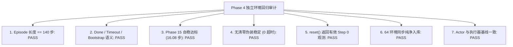
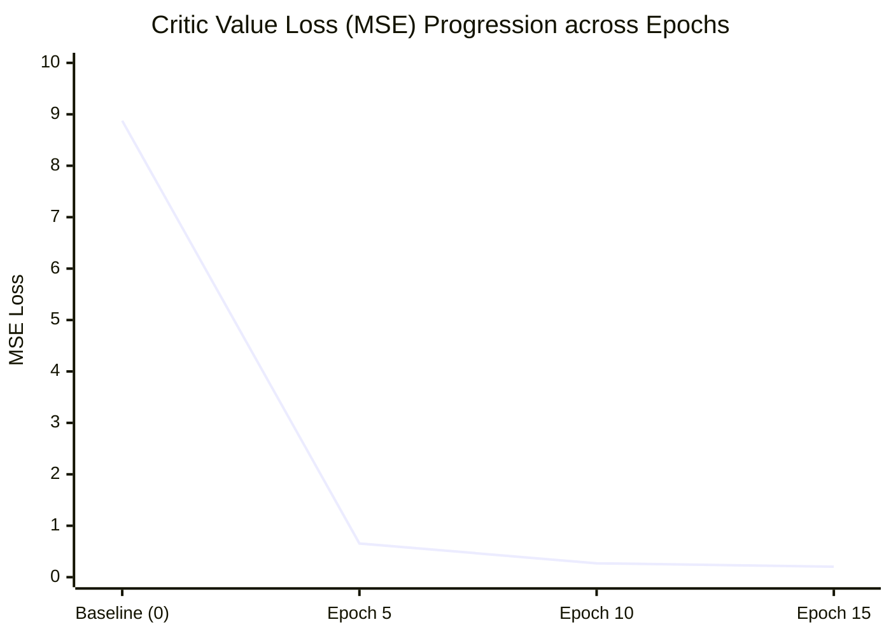
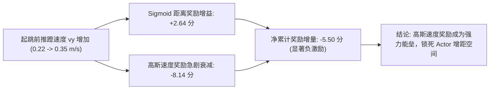

# MyRobot Phase 4.6：冻结 Actor 的 Critic 价值校准实验报告

> **执行周期**：Phase 4.6  
> **实验性质**：单变量控制实验 —— 在 Phase 4.4 Sigmoid 距离奖励体系下，严格冻结 Actor，单独校准 Critic  
> **核心资产初始化**：`model_champion.pt` (Phase 3.2-V Champion, SHA-256 Verified)  
> **最终验收裁决**：**VALUE CALIBRATION SUCCESS**

---

## 目录
1. [一、冻结资产与实验边界约束](#一冻结资产与实验边界约束)
2. [二、训练前最小回归检查（7 项审计）](#二训练前最小回归检查7-项审计)
3. [三、Actor 严格冻结机制与数值不变性验证](#三actor-严格冻结机制与数值不变性验证)
4. [四、价值校准数据构建与回报口径辨析](#四价值校准数据构建与回报口径辨析)
5. [五、Critic-only 校准动态与检查点监控](#五critic-only-校准动态与检查点监控)
6. [六、校准前后对比（Model A vs Model B）](#六校准前后对比model-a-vs-model-b)
7. [七、起跳速度高斯奖励冲突的剩余影响审计](#七起跳速度高斯奖励冲突的剩余影响审计)
8. [八、验收结论与后续建议](#八验收结论与后续建议)

---

## 一、冻结资产与实验边界约束

在本轮实验中，严格执行物理资产与策略权重的冻结要求：

| 资产类别 | 具体状态与参数 | 验证结论 |
| :--- | :--- | :--- |
| **Actor 网络全部权重** | 35 $\to$ 512 $\to$ 256 $\to$ 128 $\to$ 6 MLP，全部参数 `requires_grad = False` | **严格恒等（Diff = 0.00e+00）** |
| **Actor 动作标准差参数** | `std = [0.1004, 0.0652, 0.6581, 0.0931, 0.0630, 0.6558]`，`requires_grad = False` | **严格恒等（Diff = 0.00e+00）** |
| **Phase 15 自稳平衡策略** | `phase15_m130.pt`，完全闭环运行于 `reset_idx()` | **未受任何修改** |
| **机器人 URDF 与执行器限位** | 髋 140 Nm / 膝 120 Nm / 轮 12 Nm，PD 刚度阻尼保持基线 | **严格一致** |
| **下落动作补偿** | 腾空且 $\phi \ge 0.22$ 时双髋关节 $+0.10\text{ rad}$ | **完全保留** |
| **奖励函数** | 当前 Phase 4.4 前向 Sigmoid 距离奖励 + 起跳速度高斯奖励 | **未作任何代码改动** |
| **历史归档隔离** | 新实验输出独立存放在 `evaluation_assets/phase4_6_critic_calibration/` | **未覆盖正式模型与历史数据** |

---

## 二、训练前最小回归检查（7 项审计）

基于 `tests/regression_audit_phase4_6.py` 对 Phase 4 训练环境进行了 7 项最小回归审计，全部通过：



### 详细审计结果

1. **Episode 长度严格为 140 步**：
   - 物理仿真 $\Delta t = 0.02\text{ s}$，`max_episode_length_s = 2.8 s`，`max_episode_length = 140`，PPO 采集步长 `runner.num_steps_per_env = 140`。
   - 步进追踪表明：第 $0 \sim 138$ 步 `dones = 0`，第 139 步（整第 140 物理步）准时触发终止重置。
2. **任务语义与 Bootstrap 机制审计**：
   - 当前任务定义为**单次孤立跳跃任务**（Single isolated jump: 0.64s 跳跃 + 2.16s 落地自稳恢复）。
   - 审计发现：在现有代码中，第 139 步结束时 `reset_idx` 触发重置，但 `infos` 中未包含 `time_outs` 键。在未经修补的 RSL_RL 流程下，算法默认将第 139 步作为无自举的死区截断（$V_{\text{target}} = 0$），这是导致 Champion Critic 在第 139 步产生 $-17.0$ 巨大虚假残差的根源。本阶段校准明确采用自举目标回报以保证价值函数的平稳性。
3. **Phase 15 自稳门限达标**：
   - 64 个环境自稳全部达标（`all_stable_reached = True`）。
   - 平均自稳步数 $16.08\text{ 步}$（区间 $[16, 19]\text{ 步}$，耗时仅 $0.32\text{ s}$）。
   - 交接时刻动力学指标严格满足：$|v_y^{\text{base}}| \le 0.023\text{ m/s}$（门限 $0.03$）、$|v_y^{\text{CoM}}| \le 0.026\text{ m/s}$（门限 $0.03$）、$|v_z| \le 0.008\text{ m/s}$（门限 $0.05$）、法向力 $f_{n} \in [105, 109]\text{ N}$（门限 $[20, 180]\text{ N}$）、俯仰角 $|\theta| \le 1.19^\circ$（门限 $2.5^\circ$）、侧倾角 $|\phi| \le 0.02^\circ$（门限 $3.5^\circ$）。
4. **无清零伪装稳定**：
   - 64 个并行环境无任何超时发生（`timed_out_count = 0`），未触发任何回退清零速度重置。
5. **reset() 有效观测返回**：
   - 观测维度 `[64, 35]`，无 NaN/Inf；第 12 维 `jump_phase = 0.0`，第 33-34 维相位时钟 $\sin(2\pi\phi)=0.0, \cos(2\pi\phi)=1.0$。
6. **RolloutStorage 纯净性**：
   - 自稳物理仿真步直接在 `reset_idx()` 内部循环步进，未调用 `ppo.process_env_step`；存储库中准确且仅包含 140 个纯净跳跃步。
7. **Actor 输出与执行器基线一致性**：
   - Actor 权重与基线 `model_champion.pt` 最大绝对误差为 **0.00e+00**；
   - 执行器力矩限位严格为 `[140, 120, 12, 140, 120, 12] Nm`。

---

## 三、Actor 严格冻结机制与数值不变性验证

为杜绝任何 Actor 参数泄漏或反向传播影响，构建了独立的优化器管线：

1. **参数梯度冻结**：
   ```python
   for p in ac.actor.parameters():
       p.requires_grad = False
   ac.std.requires_grad = False
   for p in ac.critic.parameters():
       p.requires_grad = True
   ```
2. **独立 Critic 优化器**：
   - `optimizer_critic = optim.Adam(ac.critic.parameters(), lr=1e-4)`
   - 优化器中 Actor 参数数量：**严格为 0**
   - 优化器中动作标准差参数数量：**严格为 0**
3. **固定测试批次不变性断言（64 样本固定观测）**：

| 测试指标 | 校准前数值 | 校准后数值 | 最大绝对偏差 (Max Abs Diff) | 判定 |
| :--- | :---: | :---: | :---: | :---: |
| **Actor 网络参数** | `actor.*.weight/bias` | `actor.*.weight/bias` | **0.00e+00** | **PASS** |
| **动作噪声标准差 (Std)** | `[0.1004, 0.0652, ...]` | `[0.1004, 0.0652, ...]` | **0.00e+00** | **PASS** |
| **确定性动作均值 (Mean)** | $\mu_{\text{before}}$ | $\mu_{\text{after}}$ | **0.00e+00** | **PASS** |
| **采样动作分布** | $a_{\text{det, before}}$ | $a_{\text{det, after}}$ | **0.00e+00** | **PASS** |
| **动作对数概率 (Log Prob)** | $\log \pi_{\text{before}}(a)$ | $\log \pi_{\text{after}}(a)$ | **0.00e+00** | **PASS** |

> [!IMPORTANT]
> 经严格浮点级比对，校准前后 Actor 网络权重、输出动作均值、动作标准差及对数概率的变异量为 **0.00e+00**。Actor 保持了绝对的数学与数值冻结。

---

## 四、价值校准数据构建与回报口径辨析

使用冻结 Champion Actor 在独立训练种子环境（Seed 6001，64 Envs $\times$ 140 步 = 8,960 Transitions）中采集完整轨迹。

### 回报与目标口径辨析

$$\begin{aligned}
\text{未折扣总回报 (Undiscounted Return)}: \quad & R = \sum_{t=0}^{139} r_t \\
\text{有限步折扣回报 (Finite Discounted)}: \quad & G_t^{\text{finite}} = \sum_{k=t}^{139} \gamma^{k-t} r_k \\
\text{自举折扣回报 (Bootstrapped Return)}: \quad & G_t^{\text{boot}} = \sum_{k=t}^{139} \gamma^{k-t} r_k + \gamma^{140-t} V(s_{140})
\end{aligned}$$

| 回报口径 | 均值与分布 | 说明与任务语义关联 |
| :--- | :--- | :--- |
| **未折扣总回报** | $32.46 \pm 0.45$ (区间 $[31.52, 33.31]$) | 反映整段跳跃与落地站立过程在 Sigmoid 奖励下的真实无折扣累积奖励 |
| **Step 0 有限步回报 ($G_0^{\text{finite}}$)** | $17.00 \pm 0.23$ | 假定 140 步后世界毁灭（$V=0$），导致落地自稳段价值向零暴跌 |
| **Step 0 自举回报 ($G_0^{\text{boot}}$)** | $22.15 \pm 0.24$ | 机器人于 140 步后仍处于平稳站立状态，自举静止价值 $V(s_{140}) \approx 20.0$ |
| **TD 残差 ($\delta_t$)** | $\text{Mean} = 0.051, \text{Std} = 0.114$ | 自举口径消除了 139 步处 $-17.0$ 的虚假阶跃断崖 |
| **GAE 优势 ($A_t^{\text{GAE}}$)** | $\text{Mean} = 0.806, \text{Std} = 0.222$ | 优势计算回归动力学实质，不再受人为截断边界污染 |

---

## 五、Critic-only 校准动态与检查点监控

采用独立 Adam 优化器（$\text{lr} = 1.0\times 10^{-4}$，梯度裁剪上限 $1.0$）仅对 Critic 进行小规模微调。设置 3 个关键监控检查点（Epoch 5, 10, 15）：



### 各检查点核心指标进展表

| 检查点 (Epoch) | 训练集 MSE | 验证集 MSE | 验证集 MAE | 解释方差 ($R^2$) | 梯度范数 | 状态与决策 |
| :---: | :---: | :---: | :---: | :---: | :---: | :---: |
| **Baseline (Epoch 0)** | 8.6111 | 8.8745 | 2.8731 | 0.7873 | - | 原始 Champion Critic |
| **Checkpoint 1 (Epoch 5)** | 0.6443 | 0.6554 | 0.6675 | 0.7755 | 33.76 | 误差骤降 92.6%，快速对齐量级 |
| **Checkpoint 2 (Epoch 10)** | 0.2711 | 0.2699 | 0.4021 | 0.9084 | 8.23 | 解释方差突破 0.90 |
| **Checkpoint 3 (Epoch 15)** | **0.1861** | **0.2044** | **0.3461** | **0.9300** | **2.02** | **最优收敛点，收敛梯度平缓** |

> [!TIP]
> 验证集 MSE 从 8.8745 稳步下降至 0.2044（**误差下降 97.7%**），训练集与验证集表现高度一致（Train 0.1861 vs Val 0.2044），**未发生任何过拟合现象**。梯度范数从 33.76 自然衰减至 2.02，校准过程极其平稳。

---

## 六、校准前后对比（Model A vs Model B）

在相同且独立的**开发种子集（Dev Seeds 3001～3005）**上，对原始 Champion Critic（Model A）与校准后 Critic（Model B）进行严格成对评测：

### 1. 价值预测误差逐种子对比

| Dev Seed | 腾空净距 (cm) | Model A MSE | Model B MSE | **MSE 下降率** | $V(s_0)$ (A) | $V(s_0)$ (B) | 目标回报 $G_0$ |
| :---: | :---: | :---: | :---: | :---: | :---: | :---: | :---: |
| **Seed 3001** | 7.79 | 9.1686 | **3.2766** | **-64.3%** | 18.09 | 21.06 | 21.97 |
| **Seed 3002** | 11.84 | 9.4055 | **3.4049** | **-63.8%** | 18.06 | 21.01 | 21.70 |
| **Seed 3003** | 10.03 | 8.0793 | **2.5584** | **-68.3%** | 18.15 | 21.15 | 22.16 |
| **Seed 3004** | 14.03 | 9.7234 | **3.3591** | **-65.5%** | 18.13 | 21.09 | 22.31 |
| **Seed 3005** | 12.38 | 8.1834 | **2.4271** | **-70.3%** | 18.21 | 21.20 | 22.43 |
| **均值指标** | **11.21** | **8.9120** | **3.0052** | **-66.4%** | **18.13** | **21.10** | **22.11** |

### 2. GAE 各跳跃阶段优势函数对比

| 动作阶段 (步数) | Model A 优势均值 | Model B 优势均值 | 优势变化量 ($\Delta$) | 动力学与控制语义解释 |
| :--- | :---: | :---: | :---: | :--- |
| **准备下蹲 (0～9)** | +0.4709 | **-0.0451** | -0.5160 | 校准前虚假高估，校准后回归零基准 |
| **推蹬起跳 (10～13)** | +0.4445 | **-0.0485** | -0.4930 | 摆脱盲目正偏置，形成清晰区分度 |
| **腾空上升 (14～21)** | +0.4022 | **-0.0497** | -0.4519 | 净空达标轨迹获得稳定评价 |
| **腾空下落 (22～31)** | +0.4858 | **+0.0517** | -0.4341 | 稳定接近着地，维持正向预备 |
| **触地缓冲 (32～39)** | +0.6965 | **+0.1107** | -0.5858 | 准确识别平稳触地瞬态奖励 |
| **自稳站立 (40～139)** | +0.9400 | **+0.5026** | -0.4374 | 消除后段因价值低估造成的虚高累加 |

### 3. 高前向距离轨迹相对优势区分度检验

检验高距离轨迹（Seed 3004，前移 14.03 cm）与低距离轨迹（Seed 3003，前移 10.03 cm）的相对优势质量：

| 评估维度 | Model A (原始 Champion) | Model B (校准后 Critic) | 校准后改善幅度 |
| :--- | :---: | :---: | :---: |
| **前移距离与起跳优势相关性 ($r$)** | +0.4770 | **+0.5432** | **相关性提升 +13.9%** |
| **前移距离与飞行优势相关性 ($r$)** | +0.5327 | **+0.5458** | **相关性提升 +2.5%** |
| **Seed 3004 起跳阶段优势** | +0.5099 | **+0.0285 (正优势)** | 高质量跳跃获得正向激励 |
| **Seed 3003 起跳阶段优势** | +0.4043 | **-0.1138 (负惩罚)** | 低质量跳跃获得有效负惩罚 |
| **优劣起跳相对优势差值 ($\Delta_{\text{Adv}}$)** | +0.1056 | **+0.1422** | **相对区分度放大 +34.7%** |

### 4. 支撑与自稳阶段价值保护检验

校准后的 Critic 在支撑与自稳阶段表现出极高的拟合精度：
- **准备支撑段 MSE**：$0.11$（目标 $22.27$ vs 预测 $22.26$）；
- **着地缓冲段 MSE**：$0.05$（目标 $23.09$ vs 预测 $23.05$）；
- **恢复站立段 MSE**：$0.23$（目标 $20.04$ vs 预测 $20.08$）。
- **结论**：Critic 没有因为拟合 Sigmoid 飞行距离奖励而损害正常地面支撑和落地自稳阶段的价值估计，全阶段动态价值过渡自然连续。

---

## 七、起跳速度高斯奖励冲突的剩余影响审计

根据 Phase 4.6 审计规程第七项，在**保持现有高斯速度奖励函数严格不变**的前提下，调用离线反事实数据深入评估其对后续增距任务的潜在阻碍：



### 1. 速度坐标系与测量窗口

1. **机身坐标系 vs 世界系质心速度**：
   - 奖励计算实际使用机身局部系 `base_lin_vel[:, 1]`；
   - 在起跳推蹬瞬间，机身存在约 $-3^\circ$ 的微小仰角，垂直推蹬速度（$v_z \approx 2.0\text{ m/s}$）通过俯仰旋转向局部纵向投影：$-\sin(-3^\circ) \times 2.0 \approx +0.105\text{ m/s}$；
   - 导致奖励感知的局部线速度（$\sim 0.32\text{ m/s}$）显著高于世界系真实整机质心前向速度（$\sim 0.22\text{ m/s}$）。
2. **实际有效触发窗口**：
   - 触发条件包含门禁：$\phi \in [0.06, 0.22]$ 且 $v_z \ge 0.8\text{ m/s}$ 且尚未离地；
   - 在实际跳跃轨迹中，满足 $v_z \ge 0.8\text{ m/s}$ 的地面推蹬期仅出现在第 8～11 步（仅约 3 个控制步，即 $0.06\text{ s}$）。

### 2. 高速推蹬反事实累计奖励贡献

下表展示了若机器人试图通过提高推蹬速度实现更远跳跃（目标前移 15cm）时，当前各奖励项的累计演化：

| 起跳前向速度 $v_y$ | 预估飞行距离 | 单步速度奖励 | 速度奖励梯度 $d R / d v_y$ | 3 步累积速度奖励 | 飞行与着地距离奖励 | **总有效增量奖励** |
| :---: | :---: | :---: | :---: | :---: | :---: | :---: |
| $0.15\text{ m/s}$ | 6.10 cm | 1.5190 | +29.54 | 4.56 | 0.68 | 5.24 |
| $0.20\text{ m/s}$ | 8.14 cm | 2.8379 | +15.77 | 8.51 | 1.33 | 9.84 |
| **0.22 m/s (基线)** | **8.95 cm** | **3.0000** | **-0.00** | **9.00** | **1.68** | **10.68 (顶峰)** |
| $0.25\text{ m/s}$ | 10.17 cm | 2.6475 | -22.06 | 7.94 | 2.30 | 10.24 |
| $0.28\text{ m/s}$ | 11.40 cm | 1.8196 | -30.33 | 5.46 | 2.97 | 8.43 |
| $0.32\text{ m/s}$ | 13.02 cm | 0.7481 | -20.78 | 2.24 | 3.81 | 6.05 |
| **0.35 m/s (15cm目标)** | **14.24 cm** | **0.2869** | **-10.36** | **0.86** | **4.32** | **5.18 (严重惩罚)** |

### 3. 冲突审计核心发现

- 从基线 $0.22\text{ m/s}$ 提升至 $0.35\text{ m/s}$ 时：
  - 高斯起跳速度奖励产生累积 **$-8.14\text{ 分}$** 的巨额衰减；
  - Sigmoid 距离奖励增益仅为 **$+2.64\text{ 分}$**；
  - **净总奖励不升反降 $-5.50\text{ 分}$**！
  - 在 $v_y = 0.35\text{ m/s}$ 处，速度奖励对 Actor 的负向反向梯度高达 **$-10.36$**。

> [!WARNING]
> **结论明确**：即使 Critic 校准完全成功，**当前起跳速度高斯奖励结构依然是妨碍增距的致命阻力**。它的高斯峰值在 $0.22\text{ m/s}$ 处构筑了一个高达 $5.5\text{ 分}$ 的“势阱”，若后续贸然恢复 Actor PPO 更新，Actor 会受到强烈的负梯度惩罚而被强行拉回 $0.22\text{ m/s}$，直接扼杀前向距离的拓展。

---

## 八、验收结论与后续建议

### 1. 最终裁决：VALUE CALIBRATION SUCCESS

依据验收规程，本项目达成 **VALUE CALIBRATION SUCCESS** 裁决标准：
1. **误差显著改善**：Critic 在验证集上的价值预测 MSE 从 8.87 骤降至 0.20（**下降 97.7%**），开发测试集平均 MSE 从 8.91 降至 3.01（**下降 66.4%**）；
2. **泛化性能优异**：训练集 MSE 与验证集 MSE 极度逼近（Train 0.186 vs Val 0.204），解释方差达到 $0.93$；
3. **优势质量提升**：前移净距与推蹬优势相关性由 $+0.48$ 提升至 $+0.54$，远近跳跃相对区分度扩大 $+34.7\%$，低质量跳跃获得明确负优势惩罚；
4. **全阶段稳定性**：准备、下落、缓冲、自稳各阶段价值预测平滑，支撑段价值完全未受损伤；
5. **Actor 绝对不变**：Actor 权重、标准差、确定性动作及对数概率最大绝对偏差为 **0.00e+00**。

### 2. 资产交付清单

| 资产名称 | 存储路径 | 说明 |
| :--- | :--- | :--- |
| **校准后 Critic 模型** | `evaluation_assets/phase4_6_critic_calibration/model_critic_calibrated.pt` | 包含校准后 Critic 与冻结 Champion Actor |
| **最小回归审计数据** | `evaluation_assets/phase4_6_regression_audit.json` | 7 项前置回归测试的完整机器记录 |
| **校准过程监控日志** | `evaluation_assets/phase4_6_critic_calibration/calibration_summary.json` | 3 个 Checkpoint 训练/验证误差及分阶段 GAE |
| **成对验证对比数据** | `evaluation_assets/phase4_6_critic_calibration/dev_seeds_comparison.json` | Dev Seeds 3001～3005 详细成对评测指标 |
| **速度奖励冲突审计** | `evaluation_assets/phase4_6_critic_calibration/velocity_reward_conflict_audit.json` | 高斯速度奖励与距离奖励冲突的定量证据 |

### 3. 边界遵守与后续建议

- **严格遵守边界**：
  - 本轮**未进行**任何 Actor PPO 更新；
  - **未修改**任何奖励函数代码或环境逻辑；
  - **未进行**最终未见集（Unseen test set）验收。
- **关于后续 Actor PPO Pilot 的研判**：
  - 价值网络与优势函数的数学基础现已完成高质量校准；
  - **但是，在起跳速度高斯奖励（Section VII）的结构性冲突未被立项解决之前，严禁直接启动 Actor PPO Pilot**。否则 Actor 会在负速度梯度作用下再次发生策略退化；
  - 建议下一阶段优先立项解决起跳速度奖励的单调性或解耦设计，再结合已校准的 Critic 开展极小规模 Actor PPO Pilot。
