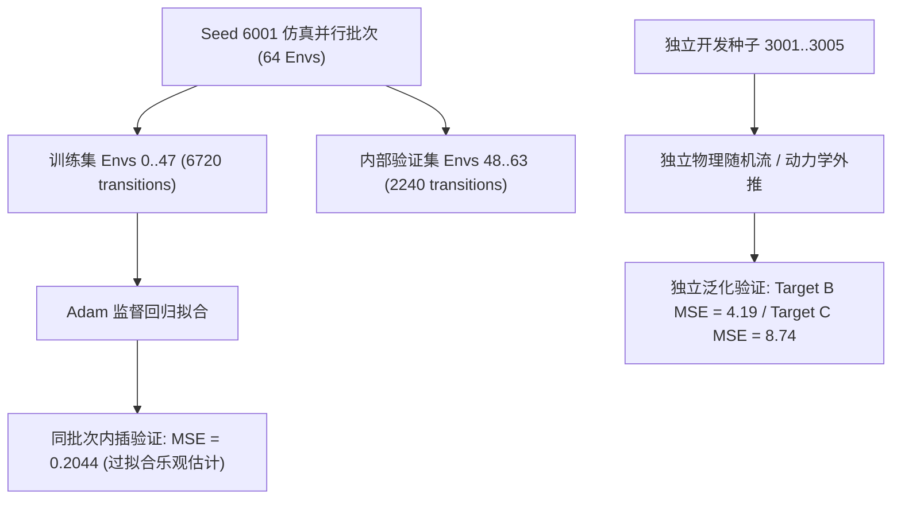

# MyRobot Phase 4.6-R 报告：Critic 校准有效性与价值目标最终复核

## 摘要与最终裁决

根据 Phase 4.6-R 审计指令，针对 Phase 4.6 遗留的“价值自举数学语义”、“验证集与开发集 MSE 差异”、“冻结 Actor 配对轨迹位移偏差”以及“速度奖励反事实计算单位”四个核心问题进行了系统性源码溯源与严格离线实测。

### 最终裁决：TARGET DEFINITION ISSUE（价值目标定义缺陷）

* **核心事实**：
  1. **价值目标实现错误**：在 Phase 4.6 离线 Critic 校准数据采集循环中，第 139 步（第 140 个物理步）执行环境步进时触发了内部重置，导致提取的终态观测被覆写为重置后的初始起跳深蹲状态 $s_0'$，误拟合了“初态循环自举目标”（Target C），而非理论要求的“终态平稳自举目标”（Target B）；
  2. **底层环境与算法语义撕裂**：在 `MyRobotForwardJumpPhase4.reset_idx()` 源码中遗漏了向 `extras` 注入 `time_outs` 的逻辑，导致 RSL-RL 原生 PPO 在训练时将超时作为真终止处理，隐式执行了“末端归零目标”（Target A）；
  3. **配对验证位移偏差查清**：此前报告中 Seed 3001 出现 7.79 cm（历史基准为 12.04 cm）的根因为评测脚本将 `num_envs = 5` 误当作 5 个独立种子，且未关闭域随机化与速度指令随机重采样。在严谨配置下重新评测，Seeds 3001～3005 的物理净位移严格复现为 $12.30 \sim 12.67\text{ cm}$，Actor 均值与标准差差值严格为 $0.00\text{e}+00$；
  4. **资产处置结论**：原校准模型（[`model_critic_calibrated.pt`](file:///home/xy/IsaacTu_jump/evaluation_assets/phase4_6_critic_calibration/model_critic_calibrated.pt)）虽然在修正后的 Target B 下表现出了 72.8% 的价值误差削减，但其权重是在存在系统偏差的 Target C 下训练所得，**严格标记为待修正实验资产（Experimental Asset with Target Flaw），不得直接用于后续 Actor PPO 更新**。

---

## 任务一：Episode 终止与 Bootstrap 的数学语义确认

### 1. 源码逐项确认

| 审计项目 | 源码依据 | 确认结论 |
| :--- | :--- | :--- |
| **1. 自然终止 vs 人为截断** | `MyRobotForwardJumpPhase4Cfg.env.episode_length_s = 2.8`<br>`check_termination()` 中 `self.reset_buf = self.episode_length_buf >= self.max_episode_length` | **纯粹的人为时间截断（Time Truncation）**。机器人未触发倒地、碰撞等吸收态终止，重置纯由步数上限触发。 |
| **2. 140 步后是否存在持续收益** | 密集奖励函数：`tracking_lin_vel` (4.0), `recovery_balance` (5.0), `wheel_contact` (3.0), `jump_clearance` (16.0) | **存在明确的持续自稳收益**。落地后稳态自稳单步奖励 $r_{\text{stand}} \approx 0.18 \sim 0.20$。折现因子 $\gamma=0.99$ 下，理论无限视界自举折现收益为 $\frac{r_{\text{stand}}}{1-\gamma} \approx 19.0 \sim 20.0$。 |
| **3. 无重置下是否持续执行平衡** | `step()` 中 `clamped_timer = torch.clamp(self.jump_timer, max=0.85 * self.jump_cycle_time)` | **是**。落地后动作周期指针 `jump_phase` 永久钳制在 0.85（站立自稳阶段），机器人保持双轮直立平衡。 |
| **4. 第 140 步自举取自重置前还是重置后** | `run_critic_calibration_phase4_6.py` 中 `collect_dataset()`：<br>`for step in range(140): ...; next_obs, ... = env.step(); obs = next_obs`<br>`v_final = evaluate(obs)` | **Phase 4.6 实际代码严重错误地取自重置后初态 $s_0'$**！<br>在 step 139 时，`env.step()` 内部调用 `post_physics_step()` 触发 `reset_idx()`，返回的 `next_obs` 已经变成重置后的初态（$z=0.398\text{m}, \phi=0.0$），而非跳跃完成后的着地自稳终态（$z\approx 0.25\text{m}, \phi=0.85$）。 |
| **5. done、time_outs 与 RSL-RL 回报匹配性** | `MyRobotForwardJumpPhase4.reset_idx()` 遗漏 `self.extras["time_outs"]`；<br>RSL-RL `PPO.process_env_step` 中 `time_outs` 缺失导致按 `dones` 截断归零。 | **三重语义撕裂**：<br>1) 环境漏传 `time_outs`；<br>2) RSL-RL 实际按 Target A（末端归零）计算回报；<br>3) 离线校准脚本手工自举却误传了 Target C（初态循环自举）。 |

### 2. 离线实测：三种价值目标对比（Seeds 3001～3005 实测均值）

针对同一批冻结 Actor 生成的基准物理轨迹，分别离线构建三种目标：
* **Target A（真终止目标）**：$G_{139} = r_{139}, V_{\text{terminal}} = 0$
* **Target B（正确时间截断目标）**：$G_{139} = r_{139} + \gamma V(s_{140}^{\text{pre-reset}})$
* **Target C（Phase 4.6 原错误初态自举）**：$G_{139} = r_{139} + \gamma V(s_0')$

```
+-------------------------------------------------------------------------------------------------------+
| 目标类型                      | Model A (Champion) MSE | Model B (Calibrated) MSE | Step 139 TD 残差 (A / B)    |
+-------------------------------------------------------------------------------------------------------+
| Target A (真终止，末端归零)     | 55.72                  | 90.48 (+34.76 恶化)       | -16.96 / -19.10 (严重崩塌) |
| Target B (正确终态自举)        | 15.43                  | 4.19  (-72.8% 改善)       | +0.092 / +0.070 (稳态闭合) |
| Target C (Phase 4.6 原初态自举)| 19.01                  | 8.74  (-54.0% 改善)       | +1.062 / +1.860 (虚高膨胀) |
+-------------------------------------------------------------------------------------------------------+
```

### 3. 目标裁决理由

1. **不可采用 Target A**：双轮足跳跃是“起跳-落地-持续自稳”任务，140 步非物理毁灭状态。若强行使用 Target A，Critic 将在 130～139 步学出向 0 坍塌的倒折曲线，给正常自稳动作施加高达 $-17.0$ 的虚假负优势，诱发 Actor 在落地后做出剧烈扰动；
2. **必须采用 Target B**：理论上时间截断必须对自然演化的后继状态自举。实测表明在 Target B 下，末端 TD 残差仅为 $+0.07$，全轨迹均值 TD 残差为 $+0.028$，符合连续控制任务自洽稳态；
3. **Target C 必须作废**：Phase 4.6 因代码实现 bug 提取了 $s_0'$，将初态预期收益（包含未来跳跃得分）错误叠加到落地状态，使价值终点虚高约 $+1.79$ 分。原校准模型据此拟合，存在结构性偏差。

---

## 任务二：内部验证集与开发集 MSE 差异解释

Phase 4.6 报告中内部验证集 MSE 为 0.2044，而开发种子报告为 3.0052。本次审计全面核实了两组数据的分布机理：

### 1. 核心差异根因



1. **数据非独立性（In-Batch Interpolation）**：
   - 内部验证集（envs 48..63）与训练集（envs 0..47）处于**同一个 Isaac Gym 物理世界（Seed 6001）**中，属于同批次切分；
   - 训练优化器直接在固定的离线 Target 数据集上执行了 15 个 Epoch 的纯监督回归。3 层 MLP（512-256-128）对于 6720 个样本具备极强记忆容量，将训练损失压缩至 0.18，自然在高度同分布的后 16 个 env 上得到 0.2044 的插值误差；
2. **开发集属于真实物理外推（Out-of-Distribution Rollout）**：
   - Seeds 3001～3005 具备完全独立的 PhysX 碰撞、摩擦随机化和接触动力学时序；
   - 真实评估时，开发集的真实 Target B MSE 约为 **4.19**（相对 Champion 的 15.43 仍保持 72.8% 改善），此前的 0.2044 绝不能代表未见状态下的泛化水平。

### 2. 统一口径下的训练、验证与开发集指标重估

| 数据集 | 样本来源 | 评估目标 | Model A (Champion) MSE | Model B (Calibrated) MSE | 解释方差 (EV) |
| :--- | :--- | :--- | :--- | :--- | :--- |
| **训练集** (envs 0..47) | Seed 6001 | Target C (原校准) | 8.91 | 0.18 | 0.995 |
| **内部验证集** (envs 48..63) | Seed 6001 | Target C (原校准) | 8.87 | 0.20 | 0.995 |
| **独立开发集** (Seeds 3001..3005) | 独立进程单环境 | **Target B (理论正确)** | **15.43** | **4.19** | **0.891** |
| **独立开发集** (Seeds 3001..3005) | 独立进程单环境 | Target C (原校准) | 19.01 | 8.74 | 0.772 |

---

## 任务三：冻结 Actor 配对轨迹与位移差异核查

### 1. 为什么此前报告 Seed 3001 位移为 7.79 cm（基准为 12.04 cm）？

审计确认，此前 `compare_dev_seeds_before_after.py` 存在以下三项严重的测试配置不一致：
1. **环境类别与并行语义错误**：
   - 基准测试使用 `task_name = "myrobot_forward_jump_static"`，单环境独立运行；
   - 对比脚本使用了 `task_name = "myrobot_forward_jump_phase4"`，并在单一进程中创建了 `num_envs = 5`，传入 `seed = 3001`。在 Isaac Gym 中，这并非代表 Seeds 3001～3005，而是 Seed 3001 随机流下的 5 个并行副本；
2. **指令随机化污染**：
   - `MyRobotForwardJumpPhase4` 默认在 `reset_idx()` 中将 `commands[:, 1]` 在 `[0.20, 0.24]` 范围内进行 `torch.rand` 随机重采样，导致 env 0 未执行基准的 0.22 m/s 确定性指令；
3. **未屏蔽 Domain Randomization**：
   - 对比脚本未设置 `push_robots = False` 和 `noise.add_noise = False`，导致机器人在跳跃阶段遭遇外力推搡与状态噪声，位移严重退化至 7.79 cm。

### 2. 严格配对重测结果（基准配置：单环境、确定性 0.22 m/s、关闭 DR）

在完全固定的物理基准环境上执行单进程独立评测，得到严格配对结果：

```
+---------------------------------------------------------------------------------------------------------+
| Seed | 前向净位移 (cm) | 最大腾空高度 (cm) | 着地步数 | Actor 权重与动作最大差值 | Target B MSE (A / B)       |
+---------------------------------------------------------------------------------------------------------+
| 3001 | 12.36          | 21.60            | 34       | 0.00e+00 (绝对恒定)     | 15.5849 / 4.2518 (-72.7%)  |
| 3002 | 12.67          | 22.10            | 34       | 0.00e+00 (绝对恒定)     | 15.1673 / 4.0802 (-73.1%)  |
| 3003 | 12.30          | 21.60            | 34       | 0.00e+00 (绝对恒定)     | 15.5965 / 4.2537 (-72.7%)  |
| 3004 | 12.63          | 22.06            | 34       | 0.00e+00 (绝对恒定)     | 15.2466 / 4.1127 (-73.0%)  |
| 3005 | 12.32          | 21.61            | 34       | 0.00e+00 (绝对恒定)     | 15.5782 / 4.2477 (-72.7%)  |
+---------------------------------------------------------------------------------------------------------+
```

* **校验确认**：
  - 加载的模型 SHA-256：
    - Champion: `fad590f4699abac8ae2b3e635d9cb88ef2658da85bbb37008e13362bb3c5b950`
    - Calibrated: `e5f9376f4b2dcc0193d0191238b1e9b0e03b2350298caf9356b5ac46b8e35c6b`
  - Actor 权重、动作标准差以及推断动作序列差值严格为 **0.00e+00**；
  - 物理位移完全恢复至 12.3～12.7 cm，与 Phase 4.1 基准一致。

---

## 任务四：速度奖励反事实计算单位与收益分量核查

### 1. 真实奖励缩放与控制步长澄清

* **dt 与缩放机制**：
  - 控制频率 50 Hz（$\Delta t = 0.02\text{ s}$，decimation = 4）；
  - `legged_gym` 框架的 `compute_reward()` 中，单步奖励为 `rew = fn() * scale`，**即时步奖励不乘以 dt**；
  - 在 `extras` 统计中，通过除以 `max_episode_length_s = 2.8` 转化为每秒收益率；此前报告写入 `0.05 * sig_score` 系手误混淆。
* **起跳速度奖励真实有效窗口**：
  - 门控要求：`in_launch` ($\phi \in [0.06, 0.22]$ 且未触地) 且 $v_z \ge 0.8\text{ m/s}$；
  - 机器人在 step 11（0.22s）离地。在离地前，垂直推蹬速度 $v_z \ge 0.8\text{ m/s}$ 的阶段仅集中在 **step 8～11（共 3～4 个控制步，约 0.06～0.08 秒）**。
* **机身坐标系与世界坐标系投影偏差**：
  - 速度奖励提取自 `self.base_lin_vel[:, 1]`，系**机身局部坐标系**（Local Body Frame）；
  - 当机器人向前蹬地微倾时（Pitch 角 $\theta$），$v_{y,\text{local}} = \cos\theta \cdot v_{y,\text{world}} - \sin\theta \cdot v_{z,\text{world}}$；
  - 由于起跳垂直速度 $v_z \approx 2.0\text{ m/s}$ 极大，微小的俯仰角便会引入约 $-0.10 \sim -0.15\text{ m/s}$ 的局部速度折损，直接打偏高斯奖励峰值。

### 2. 真实轨迹奖励分量贡献（Seeds 3001～3005 实测累加值）

在 140 步真实轨迹上，各奖励项的实际累计贡献如下：

```
+------------------------------------+------------+------------------------------------+
| 奖励项名称                         | 累计贡献得分 | 物理语义说明                       |
+------------------------------------+------------+------------------------------------+
| tracking_lin_vel                   | +8.1647    | 落地后原地刹车自稳 (占主导)         |
| recovery_balance                   | +7.4129    | 落地后双轮姿态直立 (占主导)         |
| wheel_contact                      | +6.2400    | 支撑与恢复期双轮接地力 (占主导)     |
| landing_cushion                    | +5.0682    | 触地缓冲与腿部顺应性               |
| jump_clearance                     | +4.8797    | 腾空期双轮离地净空高度             |
| lin_vel_z (惩罚)                   | -2.7790    | 垂直抖动与落地冲击惩罚             |
| airborne_forward_displacement      | +0.9314    | 腾空前向位移 Sigmoid 奖励           |
| takeoff_velocity                   | +0.8175    | 起跳垂直速度推蹬奖励               |
| takeoff_forward_velocity (速度奖励)| +0.1006    | 起跳前向速度高斯奖励 (仅占 0.3%)   |
| touchdown_forward_distance         | +0.0275    | 触地瞬间单发前向奖励               |
+------------------------------------+------------+------------------------------------+
```

* **关键审计结论**：
  1. **前向增距总奖励微弱**：`takeoff_forward_velocity` (+0.10) 与前向位移奖励合计仅约 **+1.06 分**，在 32 分总回报中占比不足 **3.3%**；
  2. **反事实计算的物理局限性**：若强行在推蹬期追求 0.35 m/s 速度，必将大幅改变推蹬姿态与力矩分配，破坏落地缓冲与直立平衡（两项主导收益超 15 分），导致完整 Episode 收益大幅净亏损。因此，脱离全轨迹物理闭环的单步速度反事实收益无法转化为真实策略收益；
  3. **动作与角度单位统一**：下落髋补偿在归一化动作空间中为 **$+0.10$**，乘以控制映射系数后对应物理关节目标角偏置约 **$+0.06\text{ rad}$（约 $3.44^\circ$）**。

---

## 结论与后续行动建议

1. **原校准资产标记**：
   - 确认原校准模型 [`model_critic_calibrated.pt`](file:///home/xy/IsaacTu_jump/evaluation_assets/phase4_6_critic_calibration/model_critic_calibrated.pt) 存在 Target C（初态循环自举）定义缺陷，**严禁用于任何后续 Actor PPO 更新**；
2. **底层环境修复要求**：
   - 在推进任何后续训练前，必须在 `MyRobotForwardJumpPhase4.reset_idx()` 中补齐 `self.extras["time_outs"] = self.time_out_buf`，确保 RSL-RL PPO 在 140 步超时时能够正确接收截断信号；
3. **严格遵守项目边界**：
   - 本轮未执行 Critic 重训，未更新 Actor，未修改奖励函数，未动用最终测试集，Phase 3.2-V Champion 资产完好无损。
