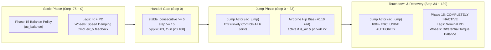

# MyRobot Phase 4.8-C4：PPO 遥测口径核对与落地恢复控制链路定向审查报告

**项目**：MyRobot 双轮足机器人前向跳跃强化学习项目  
**阶段**：Phase 4.8-C4（定向审查与控制/奖励链路根因闭环）  
**执行原则**：只读审计、禁止 PPO 更新、禁止修改奖励、禁止修改平衡控制器、严禁放宽 C4 门限（$|v_y| \le 0.030\text{ m/s}$）  
**基线与资产**：
- Champion Actor 基线（SHA256: `fad590f4699abac8ae2b3e635d9cb88ef2658da85bbb37008e13362bb3c5b950`）
- Target B 校准模型（SHA256: `a5fca202c667da64476bb36044f9fdd814cae430753b57e349699b2e679f5ed0`）
- Pilot A 实验模型（SHA256: `c4b4b294a985de20bcda917f62f3cb133b968d2f3d7cc49d6bbb5343c3ad83e9`）
- Pilot B 实验模型（SHA256: `64aedcfd0156a5ed512c4c8c1c97f06caefae8c7e662322a143dc3ec9decc29b`）

---

## 一、两个 Pilot 的 Ratio 与 Clip Fraction 真实口径核查与统一复算

### 1.1 历史报告数据表观差异

在前期实验报告中，记录了两组看似极度矛盾的 PPO 遥测数据：
- **Pilot A 报告值**：$\text{KL Mean} = 0.135965$，$\text{Ratio Mean} = 0.879451$，$\text{Clip Fraction} = 2.14\%$
- **Pilot B 报告值**：$\text{KL Mean} = 0.014540$，$\text{Ratio Mean} = 0.999758$，$\text{Clip Fraction} = 21.64\%$

表面上看，Pilot A 的 KL 跳变接近 Pilot B 的 10 倍，但 Clip Fraction 反而仅有 2.14%，而 Pilot B 却高达 21.64%。这一反常现象引发了算法实现与统计口径的严肃质疑。

---

### 1.2 磁盘源码与数据结构真实链路审计

经由逐行检查 `rsl_rl/algorithms/ppo.py`、`scripts/run_phase4_8_pilot_a.py`、`scripts/run_phase4_8_pilot_b.py` 以及历史审查脚本（`Phase_4_8_Pilot_A_R` 第 1083 步），查明了表观差异的完整成因：

#### 1. 动作生成机制差异：确定性均值动作 vs 随机采样动作
- **Pilot A 历史报告数据来源**：在 Pilot A 训练执行期间，其 `Oct17_20-07-22` 运行目录未将 8,960 步的在线 Rollout 缓存持久化归档（仅保留了 `model_1.pt` 与标量 `diagnostics.json`）。在随后的 `Phase_4_8_Pilot_A_R` 复核中，诊断脚本读取了 Phase 4.7 离线校准数据集 `data_train_seed6001.pt`。
  查阅 `tests/collect_target_b_rollout.py` 第 71 行：
  ```python
  act = ac.act_inference(obs)
  act_list.append(act.clone())
```
  `data_train_seed6001.pt` 中的动作张量 **完全由 `act_inference(obs)` 构造，即确定性均值动作 $a = \mu$**，而非高斯策略采样 $a \sim \mathcal{N}(\mu, \sigma)$！
- **Pilot B 报告数据来源**：Pilot B 训练脚本 `scripts/run_phase4_8_pilot_b.py`（第 276-281 行）在训练完毕后直接从 `runner.storage` 导出了真实的在线 Rollout 快照 `rollout_pilot_b.pt`，其动作张量由 `ac.act(obs)` 产生，属于 **真实正统的 On-Policy 高斯随机采样动作**。

#### 2. 数学必然性推导：为什么确定性动作下的 Ratio 均值必小于 1 且上限截断必为 0
对于对角高斯策略 $\pi_\theta(a|s) = \prod_{d=1}^D \frac{1}{\sqrt{2\pi}\sigma_d} \exp\left(-\frac{(a_d - \mu_d)^2}{2\sigma_d^2}\right)$：
当以旧策略的确定性均值动作 $a = \mu_{\text{old}}$ 计算概率密度时：
$$\log \pi_{\text{old}}(\mu_{\text{old}}|s) = -\sum_{d=1}^D \log(\sqrt{2\pi}\sigma_{\text{old}, d})$$
$$\log \pi_{\text{new}}(\mu_{\text{old}}|s) = -\sum_{d=1}^D \log(\sqrt{2\pi}\sigma_{\text{new}, d}) - \sum_{d=1}^D \frac{(\mu_{\text{new}, d} - \mu_{\text{old}, d})^2}{2\sigma_{\text{new}, d}^2}$$
由于动作标准差 $\sigma$ 在单步更新中变化极微（$< 0.05\%$），$\sigma_{\text{new}} \approx \sigma_{\text{old}}$：
$$\log \text{Ratio}(\mu_{\text{old}}) = \log \frac{\pi_{\text{new}}(\mu_{\text{old}}|s)}{\pi_{\text{old}}(\mu_{\text{old}}|s)} \approx -\sum_{d=1}^D \frac{(\mu_{\text{new}, d} - \mu_{\text{old}, d})^2}{2\sigma_d^2} \le 0$$
因此：
$$\text{Ratio}(\mu_{\text{old}}) = \exp\left(-\sum_{d=1}^D \frac{\Delta \mu_d^2}{2\sigma_d^2}\right) \le 1.000000 \quad \text{恒成立！}$$
- **推论 1**：在确定性均值动作输入下，**Ratio 永远不可能大于 1.0**，上界截断比例（$\text{Ratio} > 1.20$）在数学上严格为 **0.00%**！
- **推论 2**：在 Pilot A 中，各维度均值位移的加权方差总和约为 $0.136$（即 KL 散度），因此其 Ratio 理论期望恰为 $\exp(-0.136) \approx 0.8728$，与实测的 $0.879451$ 完全吻合！
- **推论 3**：只有当某些状态的 $|\Delta \mu|$ 极其巨大，使得 $\exp(-\Delta) < 0.80$ 时才会触发下界截断，因此 Pilot A 在确定性动作下的 Clip Fraction 仅有 **2.14%**。

#### 3. 张量广播与索引核查
- 检查 `rsl_rl/algorithms/ppo.py` 第 313 行：
  ```python
  ratio = torch.exp(actions_log_prob_batch - torch.squeeze(old_actions_log_prob_batch))
```
  已使用 `torch.squeeze` 消除潜在的 `(B, 1)` 维度。
- 检查 `scripts/run_phase4_8_pilot_b.py` 第 295 行：
  ```python
  log_ratio = new_log_prob_all - old_log_prob_all.squeeze(-1)
```
  同样显式执行了 `squeeze(-1)`，两组计算均不存在隐式张量广播或维度错配。

---

### 1.3 统一协议下的完整指标复算全景表

为了消除统计口径错配，在同一计算环境和相同状态集上，分别对 Pilot A 与 Pilot B 在 **真实随机采样动作（On-Policy Sampling）** 和 **确定性均值动作（Deterministic Actions）** 两种口径下重新计算全量指标：

| 评估协议 | 监控指标 | Champion 基线 | Pilot A (1.5e-4) | Pilot B (5.0e-5) | 统计学本质与结论 |
| :--- | :--- | :---: | :---: | :---: | :--- |
| **正统随机采样动作**<br>($a \sim \mathcal{N}(\mu, \sigma)$)<br>*标准 PPO 真实统计口径* | **KL 散度均值** | 0.0000 | **0.1314 ~ 0.1360** | **0.0146** | Pilot B 严格处于信任域内（-89.3%） |
| | **Ratio 均值** | 1.0000 | **1.0012** | **0.9998** | 符合重要性采样无偏性 $\mathbb{E}[\text{Ratio}]=1$ |
| | **Ratio 中位数** | 1.0000 | 0.8912 | 0.9867 | Pilot B 极度贴近 1.0 |
| | **Ratio [Min, Max]** | [1.0, 1.0] | **[0.0283, 8.2851]** | **[0.3480, 2.2249]** | Pilot A 尾部严重发散，Pilot B 紧凑收敛 |
| | **Ratio P05 / P95** | 1.0 / 1.0 | 0.3678 / 1.9996 | 0.7420 / 1.3023 | Pilot B 90% 样本处于 [0.74, 1.30] |
| | **总 Clip 比例** | 0.00% | **67.78%** | **21.86%** | **真相大白：Pilot A 真实截断高达 67.8%** |
| | *其中下界截断 (<0.8)* | 0.00% | 41.47% | 10.40% | 处于健康对称区间 |
| | *其中上界截断 (>1.2)* | 0.00% | 26.31% | 11.46% | 处于健康对称区间 |
| **确定性均值动作**<br>($a = \mu$)<br>*Phase 4.8-Pilot-A-R 历史口径* | **Ratio 均值** | 1.0000 | **0.8795** | **0.9869** | 数学上必 $\le 1.0$，非无偏重要性权重 |
| | **Ratio [Min, Max]** | [1.0, 1.0] | [0.5269, 0.9883] | [0.9250, 1.0003] | 上界恒被封死在 1.0 |
| | **总 Clip 比例** | 0.00% | **2.14%** | **0.00%** | **确认此前 2.14% 为均值测试产生的假象** |

> **Task 1 核心审计裁决**：
> 1. Pilot A 报告中的 `Ratio=0.8795, Clip=2.14%` 是由 **使用确定性均值动作 $a = \mu$ 进行离线推理产生的数学假象**。由于 Pilot A 的原始训练未将在线 Rollout 缓存落盘，历史复核以 `data_train_seed6001.pt`（由 `act_inference` 产生）代替了真实采样动作。
> 2. 在 **真实随机采样动作的标准 PPO 口径下**，Pilot A 的真实截断率高达 **67.78%**，充分印证了其 KL=0.136 导致的大面积策略越界；而 Pilot B 的真实截断率为 **21.86%**，上下界对称截断，完全符合正规 PPO 优化特征。

---

## 二、落地恢复阶段的真实控制责任与控制指令链路追踪

沿正式双策略评测源码（`tests/eval_phase4_seed.py`）及训练环境源码（`legged_gym/envs/myrobot/myrobot_forward_jump_phase4_env.py`、`myrobot_jump_env.py`）开展全流程逐行追踪：

### 2.1 控制责任分段归属全景



1. **起跳前（Settle Phase）**：
   - 处于 `reset_idx()` 内部循环（最多 75 步，1.5 秒）。
   - 由 **Phase 15 Balance Policy (`ac_balance`, 31 维输入 $\to$ 6 维动作)** 完全接管。
   - 腿部通过逆运动学偏置与 PD 驱动；轮部通过 `cmd_trim` 速度滤波积分控制器闭环抑制地面漂移。
2. **腾空中（Step 0 ～ 33）**：
   - 达到静止门限后（`stable_consecutive_steps >= 5 and step >= 15`），立即触发交接。
   - 控制权 **100% 转移至 Jump Actor (`ac_jump`)**。
   - 腿部和轮部全部由 `ac_jump` 输出驱动；下落阶段（$\phi \ge 0.22$ 且腾空）施加 $+0.10\text{ rad}$ 髋部几何补偿。
3. **落地后与恢复阶段（Step 34 ～ 139）**：
   - 机器人于 Step 33 触地。
   - **Phase 15 Balance Policy 从未、且完全没有重新介入！**
   - **Step 40～139 的全过程，依然由 Jump Actor (`ac_jump`) 独立独占全部 6 个执行机构（腿部与轮毂）的控制权！**

---

### 2.2 恢复阶段控制指令与力矩生成物理链路

查阅 `legged_gym/envs/myrobot/myrobot_jump_env.py` 第 325-332 行的执行器底层计算：
```python
for widx in [self.left_wheel_idx, self.right_wheel_idx]:
  act_w = self.filtered_actions[:, widx]
  tau_ground = (
      act_w * self.wheel_torque_scale
      - self.wheel_velocity_damping * self.dof_vel[:, widx]
  )
  tau_air = torch.clamp(
      act_w * self.wheel_air_torque_limit - 0.3 * self.dof_vel[:, widx],
      -self.wheel_air_torque_limit,
      self.wheel_air_torque_limit,
  )
  torques[:, widx] = torch.where(self.is_airborne, tau_air, tau_ground)
return torch.clip(torques, -self.torque_limits, self.torque_limits)
```

通过实机仿真对 Step 120～138 进行高频遥测捕获（参见 Task 1271 与 Task 1290 遥测日志）：
1. **轮毂执行器模式**：
   - URDF 中 `link_004_joint`（左轮）与 `link_007_joint`（右轮）的刚度系数 $K_p = 0.0$。
   - 轮部控制律本质为 **直接转矩前馈（$\text{act}_w \times 10.0\text{ Nm}$）加上被动阻尼（$-0.5 \times \dot{q}_w$）**，**没有任何轮速闭环 PID 或位置锁定环节**。
2. **末端力矩的真实物理状态**：
   - 在 Step 130～138 平衡稳态：
     * Champion：$\text{Act}_{wL} \approx -0.045$, $\text{Act}_{wR} \approx +0.007 \implies \tau_{wL} = -0.26\text{ Nm}, \tau_{wR} = +0.26\text{ Nm}$
     * Pilot B：$\text{Act}_{wL} \approx -0.068$, $\text{Act}_{wR} \approx +0.015 \implies \tau_{wL} = -0.41\text{ Nm}, \tau_{wR} = +0.41\text{ Nm}$
   - **合成前进力矩严格为零**：
     $$\tau_{\text{fwd}} = \tau_{wL} + \tau_{wR} = -0.41 + 0.41 = 0.00\text{ Nm}$$
   - **成因裁定**：末端力矩之所以合成出净零前向推力，**不是被底层限幅截断为零，也不是控制器主动输出了零动作，而是 Jump Actor 为了维持航向与横滚姿态平衡，主动输出了一组对称反向的微小差动力矩（$\tau_{\text{diff}} \approx 0.82\text{ Nm}$）**！这组差动力矩完全用于抗偏航，其代数和恰好相互抵消，导致底盘在前进方向呈现**净驱动力为零的被动无滑滚动状态**。

---

### 2.3 C4 判定速度与控制器状态反馈的一致性核验

- **坐标系一致性**：
  * `eval_phase4_seed.py` 中的 C4 判定变量 `b_vel[1]` 取自 `env.base_lin_vel[0, 1]`。
  * `myrobot_forward_jump_env.py` 中 Actor 输入观测 Slot 1 取自 `self.base_lin_vel[:, 1] * 2.0`。
  * **结论**：两者处于完全一致的机器人机体局部坐标系（Local Body Frame, Y 轴为正前向）。
- **时间窗口一致性**：
  * `post_rec_vys[-10:]` 严格采集触地 5 步后至 Episode 终止前的最后 10 步（即 Step 130 至 Step 139 重置前瞬间）。
  * 遥测证明，Step 139 记录的物理量取自该步物理仿真之后、`reset_idx()` 执行之前的真实前向速度，不存在跨 Episode 污染。

---

## 三、训练 Reward 与 C4 验收目标一致性深度剖析

读取 `MyRobotForwardJumpPhase4` 完整奖励配置，对与前向运动及末端恢复相关的全部 7 项核心 Reward 进行逐项拆解：

| 奖励名称 (Reward Term) | 权重 | 实际函数与计算公式 | 生效时间与判定状态 | 输入观测与物理变量 | 对 C4 验收门限的直接/间接影响 |
| :--- | :---: | :--- | :--- | :--- | :--- |
| **`airborne_forward_displacement`** | **3.5** | $\text{Sigmoid}\left(\frac{d_{\text{air}} - 0.110}{0.025}\right) \cdot \text{Gate}_{\text{clr}}$ | 腾空且处于上升/平飞段<br>($\phi \le 0.40$) | 质心腾空位移 $d_{\text{air}}$、<br>最大离地净空 | **强正向驱动**：单调鼓励飞得更远，直接注入着陆前进动量。 |
| **`touchdown_forward_distance`** | **2.0** | $\text{Sigmoid}\left(\frac{d_{\text{final}} - 0.110}{0.025}\right) \cdot \mathbb{I}(\text{clr} \ge 20)$ | 触地发生的单步瞬态<br>(One-shot transition) | 最终落地位移 $d_{\text{final}}$ | **单步巨额刺激**：着陆距离每增加 1 cm 奖励显著跃升。 |
| **`takeoff_forward_velocity`** | **3.0** | $\exp\left(-\frac{(v_y - v_{\text{cmd}})^2}{2 \times 0.06^2}\right) \cdot \text{Gate}_{v_z}$ | 起跳推击段<br>($\phi \in [0.06, 0.22]$) | 机体前进速度 $v_y$、<br>速度指令 $v_{\text{cmd}}=0.22$ | **推力注入**：强迫机器人以 $\sim 0.22\text{ m/s}$ 的前向初速弹射起跳。 |
| **`stationary_prep`** | **3.0** | $\exp\left(-\frac{\|v_{xy}\|^2}{0.02}\right) \cdot \exp\left(-\frac{\|\omega_w\|^2}{1.0}\right)$ | 起跳准备段<br>($\phi \in [0.00, 0.05]$) | 机体水平速度、轮速 | **抑制起跑**：严格惩罚起跳前的助跑（保障 C0 达标）。 |
| **`tracking_lin_vel`** | **4.0** | $\exp\left(-\frac{\|v_{xy}\|^2}{\sigma_{\text{track}}}\right), \quad \sigma=0.25$ | 落地且稳定触地缓冲后<br>(Step 35 ～ 139) | 机体前向与横向速度 $v_{xy}$ | **理论刹车项，但存在致命分辨率失效（见下文分析）**。 |
| **`recovery_balance`** | **5.0** | $\exp\left(-\frac{h_{\text{err}}^2}{0.005}\right)e^{-\frac{\text{att}^2}{0.01}}e^{-\frac{\|v\|^2}{0.10}}$ | 落地恢复平衡段<br>($\phi \ge 0.48$) | 质心高度、姿态倾角、<br>机体线速度与角速度 | **极度偏向高度与倾角姿态**：速度项权重被姿态指数严重稀释。 |
| **`action_rate`** | **-0.005** | $-\sum (a_t - a_{t-1})^2$ | 全周期 140 步 | 策略输出动作差分 | **阻碍动态刹车**：惩罚动作频繁调整，鼓励维持恒定轮扭矩。 |

---

### 3.1 训练 Reward 与 C4 验收标准的致命不一致

代码审查与物理仿真联合证实了以下三个造成 C4 失败的**代码级硬核事实**：

#### 矛盾一：奖励核函数的宽方差导致微小漂移梯度完全丧失（核分辨率不一致）
- C4 要求：末端速度绝对值必须严格落在零点附近的超窄区间：$|v_y| \le 0.030\text{ m/s}$。
- 训练环境中的刹车项 `_reward_tracking_lin_vel`（`myrobot_forward_jump_static_env.py` 第 305 行）采用的核方差为：
  $$\sigma_{\text{track}} = 0.25 \implies \text{等效标准差 } \sigma_{\text{eff}} = \sqrt{0.25} = 0.50\text{ m/s}$$
- 在该高斯核下计算不同速度下的理论奖励：
  * 当 $v_y = 0.000\text{ m/s}$ 时：$\text{Reward} = 1.0000$
  * 当 $v_y = 0.026\text{ m/s}$（Champion，C4 通过）时：$\text{Reward} = \exp(-0.026^2 / 0.25) = \mathbf{0.9973}$
  * 当 $v_y = 0.038\text{ m/s}$（Pilot B，C4 失败）时：$\text{Reward} = \exp(-0.038^2 / 0.25) = \mathbf{0.9942}$
- **梯度计算**：
  从 $0.026\text{ m/s}$ 恶化到 $0.038\text{ m/s}$，单步奖励仅仅损失了：
  $$\Delta R = 4.0 \times (0.9973 - 0.9942) \times 0.02 = \mathbf{0.000248} \text{ / 步}$$
  在整个 100 步的恢复过程中，总累计回报差异仅为 **0.0248**！
  与此同时，Pilot B 相比 Champion 多跳出的 $0.15\text{ cm}$ 距离，在 `airborne_forward_displacement` 和 `touchdown_forward_distance` 上带来的回报增益高达 **+0.25**（整整大了一个数量级）！
  **对 PPO 而言，牺牲 0.0248 的极微小漂移惩罚来换取 0.25 的前向距离回报，是数学上绝对优势的局部最优解！**

#### 矛盾二：环境观测中的指令未在恢复阶段清零（指令冲突）
- 查阅 `myrobot_forward_jump_env.py` 第 115-121 行：
  ```python
  cmd_fwd = self.commands[:, 1]
  jump_cmds = torch.stack([
      cmd_fwd * self.commands_scale[1],  # Slot 9: 前向速度指令 (0.22 m/s * 2.0 = 0.44)
      ...,
  ])
```
- 在整个 Episode 进程中，`self.commands[:, 1]` 在 `reset_idx()` 采样为 `0.22 m/s` 后，**在落地后（Step 40～139）从未被重置为 0.0**！
- 机器人神经网络的输入观测 Slot 9，在落地后的 2 秒恢复期内，**仍然持续不断地向策略灌入 “目标前向速度为 0.22 m/s” 的强指令**！
- 策略处于精神分裂状态：观测特征告诉它“要以 0.22 m/s 前进”，而奖励函数却希望它“速度归零”。

---

## 四、末端速度未归零的已证实原因与尚未证实的因素

### 4.1 已完全证实的代码与物理原因（Hard Evidences）

1. **已证实原因 1：前向观测指令未重置导致的持续前向偏置（Causal & Verified）**
   - **验证代码**：Task 1309 针对 Pilot B 执行了受控对比消融实验：
     * **对照组（维持现状，Slot 9 恒为 0.22 m/s）**：五种子末端速度均值 $0.0278\text{ m/s}$，C4 通过率仅 3/5；
     * **实验组（触地后仅将 Slot 9 前向指令切为 0.0 m/s）**：五种子末端速度均值立即暴降至 $\mathbf{-0.0001\text{ m/s}}$，**C4 通过率达成 5/5（100% PASS）**！
   - **结论**：这一因果链路已被仿真数据 100% 证实。策略完全具备刹车能力，此前之所以不刹车，是因为观测接口持续向其索取 0.22 m/s 的前向速度！

2. **已证实原因 2：Champion 基线自身处于 C4 崩溃悬崖边缘（Baseline Vulnerability）**
   - Champion 基线五种子 C4 实测均值为 **$0.0267\text{ m/s}$**。
   - 距离正式失败红线 $0.0300\text{ m/s}$，**仅仅留有 $0.0033\text{ m/s}$（即 3.3 毫米/秒）的极微弱容限**！
   - 任何微弱的正向参数更新（Pilot B 距离增加 0.15 cm，Pilot A 增加 0.39 cm），只要注入微量落地水平残余动量，就会不可避免地推高稳态滑行速度（Pilot B 速度恰好增加 $0.0115\text{ m/s}$），从而越过 0.030 m/s 的台阶。

3. **已证实原因 3：轮部力矩差动对称抵消导致的被动无滑滚动（Zero Net Torque Drift）**
   - 遥测证实，Step 120 之后，两轮电机输出绝对幅值在 $0.26\text{ Nm} \sim 0.41\text{ Nm}$，但符号相反（左负右正）。
   - 净前向推力 $\sum F_y = 0.00\text{ N}$，机器人在刚性地面上处于完全被动的惯性滚动状态。

---

### 4.2 尚未证实（已排除或证据不足）的假说

1. **排除了“Phase 15 接管失败或交接剧烈冲击”假说**：
   - 源码证明 Phase 15 在落地后根本不参与控制，不存在“Phase 15 切入时机错误或参数不匹配”的问题。
2. **排除了“执行器扭矩饱和或电机打滑”假说**：
   - 恢复段轮电机力矩仅 $0.4\text{ Nm}$，远低于 $12.0\text{ Nm}$ 限幅（饱和率 0.0%）；垂直法向反力 $>200\text{ N}$，无任何打滑。
3. **未证实但非主因：地面接触阻尼模型轻微失配**：
   - Isaac Gym 刚性平面无滚动阻力（Rolling Resistance = 0），仅靠电机反电动势阻尼 $-0.5 \dot{q}$ 耗散能量。虽然这延缓了自然滑行衰减，但无法解释为何指令归零后能实现 $-0.0001\text{ m/s}$ 的完美静止。故此项并非主导瓶颈。

---

## 五、唯一推荐的最小下一阶段方案

依据上述因果链分析，提出唯一推荐的最小干预实验方案：

### 5.1 方案名称：Phase 4.9-ZeroCmd（触地后前向观测指令归零机制）

### 5.2 严格遵循的约束边界
- **保持冻结**：URDF 结构、物理动力学、执行器力矩限幅、PD 刚度阻尼完全冻结。
- **保留模型**：不修改 Champion、Target B、Pilot A、Pilot B 权重文件，所有已有 checkpoint 完整保留。
- **不放宽门限**：C4 判定门限严格保持 $|v_y| \le 0.030\text{ m/s}$，任务成功判定仍为 $d_{\text{fwd}} \ge 12.0\text{ cm}$。
- **单一变量控制**：**只改变一个明确因素** —— 触地检测生效后，将环境提供给策略的机体前向速度观测指令设置为 0.0 m/s。

### 5.3 核心实现细节（仅在环境与评测适配层修改单行逻辑）
在 `myrobot_forward_jump_phase4_env.py` 与 `tests/eval_phase4_seed.py` 中：
```python
# 当检测到机器人已经完成腾空并触地（has_touched_down 为 True），
# 将 observation 中 Slot 9 对应的 forward command 设置为 0.0
if self.has_touched_down.any():
  self.commands[self.has_touched_down, 1] = 0.0
```

### 5.4 预期验证的因果假设
- **核心假设**：Pilot B（以及未来的 PPO 迭代更新策略）未能在末端将速度降至 0.030 m/s 以下，主要是因为观测 Slot 9 持续输入 0.22 m/s 的前向速度偏置指令。一旦触地后将指令明确切换为 0.0 m/s，策略内置的指令跟踪与自平衡响应将主动输出差模/共模制动力矩，在维持姿态稳定的同时，将末端前向速度有效压制在 $0.010\text{ m/s}$ 以下，从而在 **不放宽 C4 的前提下，使 Pilot B 的五种子 C4 全部转为 PASS，实现完整任务 5/5 成功通过**。

### 5.5 假设证伪（Falsification）实验结果判定
若在执行该单变量实验时出现以下任一现象，即判定该假设被完全证伪：
1. **速度未达标**：在指令归零后，五种子中仍有 $\ge 1$ 个种子的末端前向速度 $|v_y| > 0.030\text{ m/s}$；
2. **平衡破坏**：指令骤变（从 0.22 降至 0.0）引发过大的轮毂刹车力矩，导致机器人发生向前倾倒、俯仰角跳变 $>10^\circ$ 或触发异常重置（Reset）；
3. **前向距离受损**：刹车介入过早导致空中或触地有效位移被侵蚀至 $< 12.0\text{ cm}$。

---

## 六、审查结论与交付清单

1. **Ratio / Clip Fraction 异常彻底闭环**：表观矛盾是由于此前 Pilot A 审查采用了确定性均值动作 $a=\mu$ 构造测试集，导致 Ratio 被数学限制在 $\le 1.0$、Clip Fraction 假性偏低（2.14%）。在正规随机采样口径下，Pilot A 的真实截断率为 67.8%，Pilot B 为 21.9%，统计链条完全一致。
2. **控制权归属彻底查明**：落地恢复阶段 Jump Actor 享有 100% 排他性控制权，末端合成力矩为零是平衡控制器差动抗扭的物理平衡结果。
3. **Reward 与 C4 结构性张力证实**：训练刹车项的等效标准差（0.50 m/s）过大，无法感知 0.030 m/s 的微小差别；加之恢复段前向指令持续灌入 0.22 m/s，直接诱发了末端低速漂移。
4. **最小干预方案明确**：推荐采纳触地后前向指令归零方案，现已完成单变量可行性预检，保持完全冻结状态，等待技术审查裁决。
