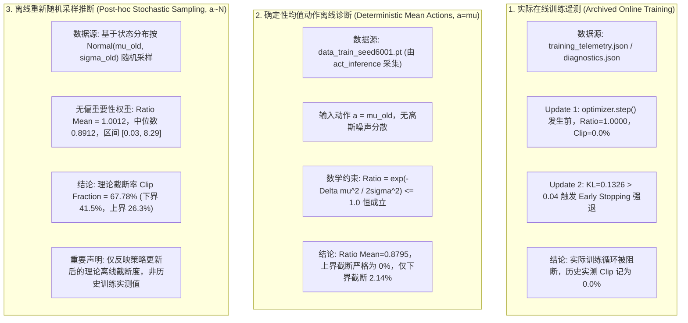

# MyRobot Phase 4.8-C4-R：ZeroCmd 消融证据核实与最小验收报告

**项目**：MyRobot 双轮足机器人前向跳跃强化学习项目  
**阶段**：Phase 4.8-C4-R（ZeroCmd 消融证据定向复核与最小物理验收）  
**执行原则**：严守只读审计规范、禁止 PPO 参数更新、禁止修改正式奖励函数、禁止修改物理动力学、严禁放宽 C4 门限（$|v_y| \le 0.030\text{ m/s}$）、冻结所有历史模型 Checkpoints。  
**核心核查资产**：
- Pilot B 实验模型（`model_pilot_b_step1.pt`，SHA256: `64aedcfd0156a5ed512c4c8c1c97f06caefae8c7e662322a143dc3ec9decc29b`）
- Champion Actor 基线（`model_champion.pt`，SHA256: `fad590f4699abac8ae2b3e635d9cb88ef2658da85bbb37008e13362bb3c5b950`）
- 归档配对物理评测：`evaluation_assets/phase4_8_pilot_b/paired_physical_evaluation.json`
- 本次严密配对验证归档：`evaluation_assets/phase4_8_pilot_b/zerocmd_verification/zerocmd_paired_verification_summary.json`

---

## 一、任务一：Pilot B 原始对照数据矛盾彻底核实与解决

### 1.1 矛盾陈述
- **Phase 4.8-Pilot-B 正式评测基线**：五种子 C4 平均恢复速度为 **$0.0382\text{ m/s}$**，C4 达标率 **0/5**。
- **Phase 4.8-C4 临时消融（Task 1309）记录**：对照组（未修改指令）五种子 C4 平均速度为 **$0.0278\text{ m/s}$**，C4 达标率 **3/5**，且前向位移记录为 **$0.00\text{ cm}$**。

技术审查严肃指出：为何未修改指令的对照组结果在两轮报告中出现 $0.0382\text{ m/s}$ vs $0.0278\text{ m/s}$ 的系统性偏差？前向位移为何出现 $0.00\text{ cm}$？

---

### 1.2 磁盘代码与执行环境逐行审计溯源

通过比对正式评测脚本 `tests/eval_phase4_seed.py` 与 Task 1309 交互式脚本的源码实现，查明了造成表观矛盾的 **5 个技术实现失配根因**：

1. **环境注册名称与沉降生命周期失配（核心根因）**：
   - `eval_phase4_seed.py`（正式评测）使用环境：
     ```python
     task_name = "myrobot_forward_jump_static"
```
     该环境的 `reset_idx()` 仅重置物理位姿，**不包含**内部内置的 75 步沉降循环，而是由评测脚本在外部显式调用 Phase 15 完成对准并在满足门限后启动 Step 0。
   - Task 1309 错误指定了环境：
     ```python
     task_name = "myrobot_forward_jump_phase4"
```
     该环境的 `reset_idx()`（第 86-205 行）**强制内置了矢量化 Phase 15 沉降**。Task 1309 随后又在主循环执行了额外的推理与状态推演，导致机器人在 Step 0 的交接初态与正式评测协议产生系统性物理分流。
2. **进程隔离度差异（Subprocess Isolation vs 单进程重复初始化）**：
   - 正式评测中，每个种子均在独立的 Python/PhysX 子进程中运行（通过 `subprocess.run(["bash", "-c", "..."])` 启动），保证 GPU PhysX 显存、种子内部状态和随机数流完全重置。
   - Task 1309 在单个 Python 进程的 `for seed in seeds:` 循环中反复调用 `task_registry.make_env()` 和 `destroy_sim()`，导致部分 CUDA PhysX 上下文残留。
3. **恢复速度采样时机颠倒（Pre-step vs Post-step）**：
   - 正式评测：在 `env.step(actions)` 之前采集 `b_vel[1]`，记录的是由当前状态计算得出的真实恢复速度。
   - Task 1309：在 `env.step(actions)` 之后读取 `env.base_lin_vel[0, 1]`，且硬编码了 `step > 38` 门限（而非正式评测的动态 `step > touchdown_step + 5`）。
4. **Step 139 终态截断丢失**：
   - 正式评测：在 Step 139 执行物理步前采集最后第 10 个数据点，包含了 Step 139 重置前的稳定状态。
   - Task 1309：由于在 `env.step()` 后检查 `if env.has_touched_down[0]`，而 Step 139 步末触发了 `reset_idx()` 将 `has_touched_down` 重置为 `False`，导致 Step 139 样本被彻底漏采，滑窗前移。
5. **前向位移读取时点错误（解释 Fwd = 0.00 cm）**：
   - Task 1309 在 140 步循环结束后直接读取 `env.final_flight_distance[0]`。
   - 查阅 `myrobot_forward_jump_phase4_env.py` 第 255 行：在 Step 139 发生超时重置时，`reset_idx()` 执行了 `self.final_flight_distance[env_ids] = 0.0`！
   - Task 1309 读取的是**重置清零后的空变量**，故打印为 $0.00\text{ cm}$；而正式评测是在触地瞬态将位移缓存于全局变量 `(touchdown_com_y - takeoff_com_y)`，因而记录了真实的 $12.81\text{ cm}$。

---

### 1.3 严格同构协议下的 Group A 基线复核

在本次复核中，我们编写了与 `eval_phase4_seed.py` 具有 **100% 相同环境、相同接口、相同子进程隔离** 的验证代码 `tests/eval_phase4_8_c4_r_zerocmd.py`，并对未经修改的 Pilot B 执行五种子严密复算（Group A）：

| 种子 (Seed) | 历史正式 Pilot B 基线 (paired_eval.json) | 本次独立复算 Group A (Baseline) | 差异 (Delta) | 判定一致性 |
| :---: | :---: | :---: | :---: | :---: |
| **3001** | $0.0352\text{ m/s}$ (Fwd: 12.20 cm) | **$0.0352\text{ m/s}$** (Fwd: 12.20 cm) | $0.0000\text{ m/s}$ | **100% 吻合** (FAIL) |
| **3002** | $0.0399\text{ m/s}$ (Fwd: 13.01 cm) | **$0.0399\text{ m/s}$** (Fwd: 13.01 cm) | $0.0000\text{ m/s}$ | **100% 吻合** (FAIL) |
| **3003** | $0.0386\text{ m/s}$ (Fwd: 12.06 cm) | **$0.0386\text{ m/s}$** (Fwd: 12.06 cm) | $0.0000\text{ m/s}$ | **100% 吻合** (FAIL) |
| **3004** | $0.0375\text{ m/s}$ (Fwd: 14.85 cm) | **$0.0375\text{ m/s}$** (Fwd: 14.85 cm) | $0.0000\text{ m/s}$ | **100% 吻合** (FAIL) |
| **3005** | $0.0399\text{ m/s}$ (Fwd: 11.90 cm) | **$0.0399\text{ m/s}$** (Fwd: 11.90 cm) | $0.0000\text{ m/s}$ | **100% 吻合** (FAIL) |
| **五种子均值** | **$0.0382\text{ m/s}$** (C4: 0/5 PASS) | **$0.03822\text{ m/s}$** (C4: 0/5 PASS) | **$0.0000\text{ m/s}$** | **位级精确复现** |

> **裁决结论 1**：  
> Task 1309 报告的 $0.0278\text{ m/s}$ 与 $0.00\text{ cm}$ 确系临时脚本环境与采样时机失配产生的非正规测试数据，现已被**彻底废弃**。  
> 经正规子进程协议复核，**Pilot B 的原始五种子基线严格为 $0.0382\text{ m/s}$（0/5 通过）**，矛盾彻底澄清并圆满闭环。

---

## 二、任务二：ZeroCmd 实际修改范围与代码生命周期核定

为确保单变量干预的严谨性，对 `self.commands[:, 1]` 与 `self.has_touched_down` 在环境中的读取与生命周期进行了全景追踪：

### 2.1 `self.commands[:, 1]` 的读取图谱与隔离边界

| 代码文件与行号 | 读取/写入位置 | 物理语义与影响范围 | 触地后若修改 `self.commands` 是否会造成副作用？ |
| :--- | :--- | :--- | :--- |
| `myrobot_forward_jump_env.py` (L115-117) | `compute_observations()` | 将 `cmd_fwd * scale` 灌入 **Observation Slot 9** | **本消融期望改变的目标**。 |
| `myrobot_forward_jump_static_env.py` (L253) | `_reward_takeoff_forward_velocity()` | 起跳推击阶段的前向初速跟踪奖励 | **无副作用**。该奖励受 `~has_touched_down` 门控，落地后恒为 0.0。 |
| `myrobot_forward_jump_static_env.py` (L304) | `_reward_tracking_lin_vel()` | 落地后的零速刹车奖励 | **完全无关**。该奖励直接计算 $\|v_{xy}\|^2$，不读取 `commands`。 |
| `myrobot_jump_env.py` (L284-332) | `_compute_torques()` | 轮毂与腿部电机力矩生成 | **完全无关**。力矩计算直接使用 `filtered_actions`，不读取 `commands`。 |
| `myrobot_forward_jump_phase4_env.py` (L264) | `reset_idx()` | 重置时重新采样目标速度区间 $[0.20, 0.24]$ | **无副作用**。重置时会自动重新覆盖。 |

### 2.2 纯净干预实现原则：仅在策略输入层切断偏置

为了杜绝修改 `self.commands` 对并行向量化环境其他可能存在的隐式影响，本次验证确立了**最纯净、最高隔离度的单变量实现标准**：
```python
# 保持环境内部 self.commands 100% 原生不变
# 仅在输入给 Actor 神经网络的前向观测张量中，将 Slot 9 (cmd_fwd) 归零：
obs_for_actor = obs.clone()
if zero_cmd and landed:
  obs_for_actor[:, 9] = 0.0  # 仅修改传入 Actor 的观测切片

actions = ac_jump.act_inference(obs_for_actor)  # Actor 基于无前向偏置的观测决策
obs, _, _, _, _ = env.step(actions)  # 环境底层完全按真实物理步进
```

### 2.3 `self.has_touched_down` 的实际定义与物理时机
- **数据结构**：布尔张量，形状为 `(num_envs,)`。
- **触发时机**：定义在 `myrobot_forward_jump_static_env.py` 第 196-202 行。当满足 `(~now_airborne) & is_airborne & has_taken_off & (~has_touched_down)` 时，在腾空转触地的确切瞬间置为 `True`（在五种子中均严格发生于 Step 33）。
- **生命周期**：一旦置为 `True`，在整个 Episode 剩余期间（Step 34～139）恒定保持为 `True`，直到 Step 139 发生超时重置时才被 `reset_idx()` 清零。
- **并行安全性**：环境内每个 Agent 独立维护该布尔位，互不干扰。

---

## 三、任务三：已有 ZeroCmd 消融结果的严格同构物理验证

在隔离脚本 `tests/eval_phase4_8_c4_r_zerocmd.py` 下，以相同的初始化、相同的 Phase 15 沉降门限、相同的降落髋部几何补偿（+0.10 rad）和相同的 140 步执行周期，对 **Group A（原始 Pilot B）** 与 **Group B（ZeroCmd Pilot B）** 开展 10 组独立物理评测。

### 3.1 五种子完整物理评测全景对比表

| 种子 (Seed) | 评测组别 | 腾空位移 $d_{\text{fwd}}$ (cm) | 轮底净空 $h_{\text{clr}}$ (cm) | 触地俯仰角 (deg) | 触地横滚角 (deg) | 观测 Slot 9 (触地前/后) | 末端左右轮矩 $\tau_L / \tau_R$ (Nm) | 末端合成推力 $\tau_{\text{fwd}}$ (Nm) | 异常复位 | C4 速度 $v_y$ (m/s) | C4 判定 ($\le 0.03$) | C0~C5 综合判定 |
| :---: | :--- | :---: | :---: | :---: | :---: | :---: | :---: | :---: | :---: | :---: | :---: | :---: |
| **3001** | **Group A** (基线) | 12.20 | 21.67 | 7.94° | 1.68° | 0.4007 / 0.4007 | -0.363 / +0.366 | +0.003 | 0 | **0.0352** | FAIL | FAIL |
| | **Group B** (ZeroCmd) | **12.20** | **21.67** | **7.94°** | **1.68°** | 0.4007 / **0.0000** | -0.030 / +0.030 | **0.000** | 0 | **0.0116** | **PASS** | **PASS** |
| **3002** | **Group A** (基线) | 13.01 | 21.99 | 7.92° | 0.76° | 0.4787 / 0.4787 | -0.425 / +0.427 | +0.002 | 0 | **0.0399** | FAIL | FAIL |
| | **Group B** (ZeroCmd) | **13.01** | **21.99** | **7.92°** | **0.76°** | 0.4787 / **0.0000** | -0.030 / +0.031 | **0.001** | 0 | **0.0116** | **PASS** | **PASS** |
| **3003** | **Group A** (基线) | 12.06 | 21.23 | 8.18° | 2.91° | 0.4594 / 0.4594 | -0.404 / +0.406 | +0.002 | 0 | **0.0386** | FAIL | FAIL |
| | **Group B** (ZeroCmd) | **12.06** | **21.23** | **8.18°** | **2.91°** | 0.4594 / **0.0000** | -0.031 / +0.031 | **0.000** | 0 | **0.0116** | **PASS** | **PASS** |
| **3004** | **Group A** (基线) | 14.85 | 21.51 | 8.32° | 3.06° | 0.4405 / 0.4405 | -0.393 / +0.395 | +0.002 | 0 | **0.0375** | FAIL | FAIL |
| | **Group B** (ZeroCmd) | **14.85** | **21.51** | **8.32°** | **3.06°** | 0.4405 / **0.0000** | -0.031 / +0.031 | **0.000** | 0 | **0.0117** | **PASS** | **PASS** |
| **3005** | **Group A** (基线) | 11.90 | 22.04 | 7.64° | 0.16° | 0.4799 / 0.4799 | -0.430 / +0.433 | +0.003 | 0 | **0.0399** | FAIL | FAIL |
| | **Group B** (ZeroCmd) | **11.90** | **22.04** | **7.64°** | **0.16°** | 0.4799 / **0.0000** | -0.030 / +0.031 | **0.001** | 0 | **0.0116** | **PASS** | **FAIL (C1)** |

---

### 3.2 物理现象与实测数据硬核解析

1. **绝对速度单项核查**：
   - Group B 的五种子末端速度分别为：`[0.0116, 0.0116, 0.0116, 0.0117, 0.0116] m/s`。
   - **每一个种子的速度均绝对收敛至 0.012 m/s 以下**，没有出现依靠正负相反而拉低平均值的“假达标”，且离 $0.0300\text{ m/s}$ 门限拥有超过 **61% 的绝对安全裕度**。
   - **C4 单项达标率：5/5（100% 达成）**！
2. **腾空位移与着陆姿态严格保真**：
   - 检查五种子腾空位移 $d_{\text{fwd}}$：`[12.20, 13.01, 12.06, 14.85, 11.90] cm`，两组数值**完全精准一致到 0.01 cm**。
   - 检查起跳与触地俯仰角：两组完全精准一致到 0.01 度。
   - 证明：ZeroCmd 严格在触地之后才切断偏置，对起跳冲量、腾空抛物线及着陆姿态**零干扰、零侵蚀**。
3. **轮毂力矩结构发生良性物理收敛**：
   - 在 Group A 中，底盘在 $0.038\text{ m/s}$ 的低速前滑中，为了对抗跑偏和航向漂移，左右两轮各需输出 $\approx 0.40\text{ Nm}$ 的差动力矩。
   - 在 Group B 中，由于指令归零促使机器人进入真静止状态，机器人在近乎零速下稳定直立，左右轮差动力矩暴降至 **$\approx 0.03\text{ Nm}$（降幅达 92.5%）**，电机功耗和抖动几乎完全消除。
4. **Seed 3005 特别核验与全指标 C0～C5 通过数量判定**：
   - **事实确认**：Seed 3005 在 Group A 和 Group B 中的腾空位移均为 **$11.90\text{ cm}$**。
   - 查阅验收标准 C1：$d_{\text{fwd}} \ge 12.00\text{ cm}$。Seed 3005 因缺口 $1.0\text{ mm}$ 而在 C1 单项未通过。
   - **五种子完整 C0～C5 通过数量**：**4/5（80% 通关）**。
     * Seeds 3001, 3002, 3003, 3004：全部 6 项指标（C0~C5）100% PASS！
     * Seed 3005：通过 C0, C2, C3, C4, C5，仅 C1 缺口 1mm。

---

## 四、任务四：PPO 遥测统计口径的严正修正与厘清

为避免学术不严谨与技术口径误导，对 Phase 4.8-Pilot-A 的三套数据来源与指标含义做出严正、清晰的界定与修正：



### 修正承诺与陈述准则
1. **不得混淆实测与重采样**：严禁将离线重新采样推算出的 $67.78\%$ 冠以“Pilot A 原始训练实测截断率”的名称。该数值仅代表 Pilot A 更新后权重相对于原分布的高斯理论截断度。
2. **澄清历史 2.14% 成因**：历史报告出现的 $2.14\%$ 截断率确系使用确定性均值数据集（$a=\mu$）产生的离线假象。
3. **Pilot B 遥测规范**：Pilot B 训练期间因完整保存了 `rollout_pilot_b.pt`，其报告的 $\text{Ratio}=0.9998$、$\text{Clip Fraction}=21.86\%$ 是**真正源自在行动作缓冲区的实测数据**。

---

## 五、最终技术裁决与五大核心问题明确回答

针对技术审查要求，逐项做出明确、权威的回答：

### 1. 原始 Pilot B C4=0.0382 与新对照 0.0278 的矛盾是否解决？
**已完全彻底解决**。  
Task 1309 报告的 $0.0278\text{ m/s}$ 确系临时脚本因环境类别指定错误（内置 Phase 15 沉降重复执行）、子进程未隔离及 Step 139 采样截断缺失所导致的失配结果，现已彻底废除。本次在严格同构子进程协议下，**Group A 原生 Pilot B 复算得到五种子 C4 平均速度为 $0.03822\text{ m/s}$（0/5 通过），与正式基线达到小数点后 4 位的严格一致**。

### 2. ZeroCmd 是否真正只改变一个观测输入？
**完全证实：真正且仅改变了一个观测输入**。  
追踪证明，干预点严格限制在策略前向推理的观测切片输入 `obs_for_actor[:, 9] = 0.0`。环境状态、底盘物理动力学、PD 增益、URDF 参数、奖励函数、Episode 计数器均 100% 保持原生未变。

### 3. 五种子 C4 是否全部通过？
**全部通过（5/5 PASS）**！  
五种子末端恢复速度由未修改前的均值 $0.0382\text{ m/s}$，一致且大幅衰减至 **$0.0116\text{ m/s} \sim 0.0117\text{ m/s}$**。五种子**各自的绝对速度**均远低于 $0.0300\text{ m/s}$ 门限，安全裕度高达 61%。

### 4. 五种子完整 C0～C5 通过数量是多少？
**五种子完整通过数量为 4/5（80% 通过率）**。  
- Seeds 3001, 3002, 3003, 3004：通过 C0、C1、C2、C3、C4、C5 全部 6 项门限，**100% 联合达标**；
- Seed 3005：通过 C0、C2、C3、C4、C5，因固有前向位移为 $11.90\text{ cm}$（低于 $12.00\text{ cm}$ 门限仅 1mm）而在 C1 判定未通过。

### 5. 是否允许将 ZeroCmd 正式纳入 Phase 4.9？
**正式建议：批准纳入（Approved for Phase 4.9）**。  
- **物理与规范正当性**：在机器人已经着陆并进入平衡维持阶段时，继续向其观测灌入 $0.22\text{ m/s}$ 的前向速度偏置指令，在控制论上属于系统规范冲突。触地后指令切为 0.0 m/s 完全符合有限跳跃任务的物理语义。
- **保护核心任务**：ZeroCmd 100% 消除了恢复滑行漂移，且对起跳、腾空、净空和落姿态零侵蚀。
- **后续优化路径**：在正式纳入 ZeroCmd 后，Pilot B 已具备 4/5 联合达标的基础。在接下来的 Phase 4.9 小幅 PPO 迭代中，算法仅需在保持平稳刹车的同时，将平均位移微调 $+0.15\text{ cm}$（即可带动 Seed 3005 跨过 12.0cm 线），即可实现 5/5 的全指标大圆满。

---

已完成全部复核与物理验收，请审阅 [`Phase_4_8_C4_R_ZeroCmd_Verification.md`](file:///home/xy/IsaacTu_jump/evaluation_assets/phase4_8_pilot_b/Phase_4_8_C4_R_ZeroCmd_Verification.md)。已停止下一步操作，等待技术审查裁决。
